# KPCP Phase 2.5 华为风格图文 QA 验收报告

**结果：PARTIAL；完整 Phase 2.5 Freeze 建议：NO-GO。**

最小验收已成功：在真实首页和 Environment List 完成浏览器操作并核对页面。全部浏览器实测共取得 **23 张当前截图**；图片均通过解码和像素校验。15 个主场景的本轮结果为 **2 PASS、12 BLOCKED、1 PARTIAL**；PARTIAL 项中已复现中文提示本地化缺陷。

## 1. 验收对象与证据使用规则

| 项目 | 本轮记录 |
|---|---|
| 日期 / 时区 | 2026-11-01，Pacific/Auckland（UTC+13） |
| 仓库 | `miku-wwl/kube-platform-control-plane` |
| 代码基线 | `5445a5fdf169a9f12296dc44df1ba1b2d2819342` |
| 真实站点 | `http://127.0.0.1:5173/`；中文标题“平台控制平面” |
| 浏览器 | Desktop Work 内置浏览器，既有 Browser 2 连接；本轮受控 Tab 2 |
| 标签页情况 | 上轮临时 Tab 1 不在本轮列表；在同一浏览器连接内补建 Tab 2，未另建浏览器会话 |
| 截图时间 | 21:54–22:03；逐张时间、尺寸与 SHA-256 见截图清单 |
| 真实操作 | 浏览器点击导航、选择模板、填写表单、点击校验、展开清单、切换语言、取消和刷新 |
| 基础设施边界 | 先只读核对运行环境；前置条件不足后，生命周期变更场景记为 BLOCKED |
| 代码与共享环境 | 产品源码未修改；未启动/重启 Controller 或共享容器；未调用旧 PowerShell Harness；未调用 Codex CLI；未执行新的 Go E2E |

本轮 QA 的摘要与原始收据、23 张 PNG/JPEG、配置和日志均随本次提交推送。为便于阅读，报告同时链接脱敏摘要和遮盖图片副本；原始证据保持未修改。原始收据包含本机私有网络地址、集群标识和本地路径。Go E2E、API 收据和工程产物只作工程证据，不计作本轮 UI 操作或截图。旧版 `docs/验收截图/` 图片未被使用。

内置浏览器返回 JPEG 编码的真实页面截图。本轮将其解码后保存为 23 张原始 PNG，均通过解码验证，并与对应 JPEG 的解码像素逐一相等。23 张原始 PNG 与 JPEG 均保持未修改并随本次提交推送；另为 3 张含私有 LAN 地址的图片提供遮盖副本。公开清单记录原图与遮盖副本的 SHA-256。前三张时间取文件写入时间，其余 20 张另有截图捕获记录时间。

## 2. 15 项验收总表

| TC | 场景 | 本轮结果 | 当前证据或阻塞 |
|---|---|---|---|
| 01 | 首页、Environment List、API 状态 | PASS | 图 01、02、23；真实空列表，API 已连接 |
| 02 | EnvironmentClass 配置与校验 | PASS（配置校验范围） | 图 03–17；必填、固定版本、JSON、dry-run、改动后重校验通过；未创建类别或声称 Ready |
| 03 | AI Draft 生成与表单检查 | BLOCKED | 表单已填写；类别选项为空，生成草稿禁用，图 18、19 |
| 04 | Draft 不自动创建基础设施 | BLOCKED | 未生成真实 Draft；仅观察到填写和校验前后资源仍为 0 |
| 05 | Environment Submit | BLOCKED | 无有效 Draft、无 Ready 类别、无活动 Controller；提交按钮未出现 |
| 06 | Terraform Plan 生成 | BLOCKED | 无已提交环境与活动 Controller；未创建 Plan/Job |
| 07 | 未审批时不允许 Apply | BLOCKED | 无可用 Plan，无法形成“有变更但未审批”的本轮测试条件 |
| 08 | PlanTopology 展示 | BLOCKED | 无本轮真实 Plan 产物与图数据 |
| 09 | Exact Plan Approval | BLOCKED | 无可审批的当前 Plan；未点击或提交审批 |
| 10 | Apply 执行与 Ready | BLOCKED | 生命周期前置条件不足；没有执行 Apply |
| 11 | 更新与 NoChange | BLOCKED | 无本轮 Ready 环境，未提交更新 |
| 12 | Delete Environment | BLOCKED | 没有本轮已创建并可确认归属的环境 |
| 13 | Destroy 独立审批 | BLOCKED | 无本轮 Destroy Plan；未复用旧审批 |
| 14 | Terraform Destroy 与 Cleanup | BLOCKED | 未创建基础设施，不存在本轮可验收的 Destroy/Finalizer 流程 |
| 15 | 中英文界面与异常提示 | PARTIAL | 语言切换 PASS；中文模式的服务端错误及警告仍为英文，缺陷 QA-01 |

**BLOCKED 表示未满足前置条件，不能视为 PASS，也不能用当前空列表推导出审批、Apply 或 Destroy 已验收。**

## 3. 基础设施变更前的只读检查

详细收据：[环境预检摘要](evidence/public/preflight-summary.json)、[固定来源与 Pod 路由检查摘要](evidence/public/fixture-connectivity-summary.json)；完整原始收据见 [preflight-final.json](evidence/qa-desktop-work-20261101/preflight-final.json)、[fixture-route-readchecks.json](evidence/qa-desktop-work-20261101/fixture-route-readchecks.json) 和 [s3-list-read.json](evidence/qa-desktop-work-20261101/s3-list-read.json)。原始文件保留了本机网络地址和环境细节。

| 检查项 | 实际观察 | 对本轮执行的影响 |
|---|---|---|
| Kubernetes | 当前显式 context 为 `podman-minikube`；节点 Ready，Kubernetes `v1.37.0` | API 可读不代表 KPCP Controller 已运行 |
| 目标身份 | `kube-system` UID `2c62d6a8-08b6-460d-bb1b-ac59557dc281` | 当前只确认一个实际集群 |
| Controller | Kubernetes 无 KPCP Deployment/Pod；Windows 相关进程仅有 `platform-api.exe`；WSL 进程检查也未发现 KPCP Controller | 没有本轮可用的活动协调器；不启动或修复它以解除阻塞 |
| Runner | 节点 containerd 缓存中有 `localhost/kpcp-runner:qa5445`，digest 为 `sha256:f94aa16a0136f5414fe10f5851e6cfad89f240168f47da93eb1bbf26702cbc39`；无 Runner Job/Pod | 镜像缓存可用，当前执行通路未验证 |
| Windows Podman CLI | `podman info` 失败，目标 `127.0.0.1:64090` 主动拒绝连接 | 没有把 Windows CLI 失败推导为整个容器引擎停机 |
| 既有 WSL Podman 只读接口 | 按仓库已记录接口列出 `ministack` 与 `podman-minikube`，均运行中 | 只读列举，未启动或重启容器 |
| MiniStack 主端口 | `http://127.0.0.1:4566/_localstack/health` HTTP 200，版本 `1.5.35`；S3/STS 报告 available | 健康检查为正；未将其等同于 Runner Pod 端执行成功 |
| 既有 PodEndpoint 的主机侧检查 | `http://[LOCAL_PRIVATE_HOST]:14566/_localstack/health` 5 秒超时；`127.0.0.1:14566` 拒绝连接 | 旧传输地址不满足本轮可用性证据；本轮没有创建 Pod 进行探测 |
| 既有 Git fixture | `http://[LOCAL_PRIVATE_HOST]:18085/qa-5445a5f/.git/info/refs` 5 秒超时 | 没有可确认可访问的本轮固定来源 |
| 测试归属 | 只有 `default`、三个 `kube-*` 命名空间；PlatformEnvironment、EnvironmentClass、InfraStack、TerraformRun、ChangeApproval、ResourceSet、Job 总计 0 | 没有可继承为本轮测试所有的现存生命周期资源 |
| 执行引用 | 集群仅有系统 ConfigMap；本轮表单引用的 `qa-work-backend`、`qa-work-emulator`、测试命名空间未创建 | dry-run 示例没有部署执行依赖 |
| S3 资源清单 | ListBuckets HTTP 200，`<Buckets />` | 本轮只读清单为空；未删除任何存储桶 |
| 本地 API | `/api/health` HTTP 200，`status=ok`、`aiProvider=ollama`、`artifactPreview=true`；环境与类别列表为空 | UI 入口可检查；本轮模型未被调用，产物预览未实际验收 |

本轮 API 状态徽标只表明列表请求成功，不能证明 Controller、来源、后端、凭据引用或 Runner 路由就绪。活动 Controller 缺失和 Ready 类别为 0 已足以阻塞生命周期验收。原始 Podman 错误、路由检查及其作用范围保存在证据文件中；没有进行宿主机根因诊断。

## 4. 图文操作指导与实际结果

### TC01 首页、Environment List 与 API 状态 — PASS

**操作 1：**在同一内置浏览器连接中打开 `http://127.0.0.1:5173/`。检查标题、右上角 API 状态及摘要卡片。

**预期 / 实际：**标题为“平台控制平面”；右上角和“控制平面”卡片均显示“API 已连接”；环境总数、就绪、等待审批均为 0。首图保留打开时的窄视口，不对截图进行放大补绘。

**图 01：首页：中文标题、API 已连接、三个计数均为 0**

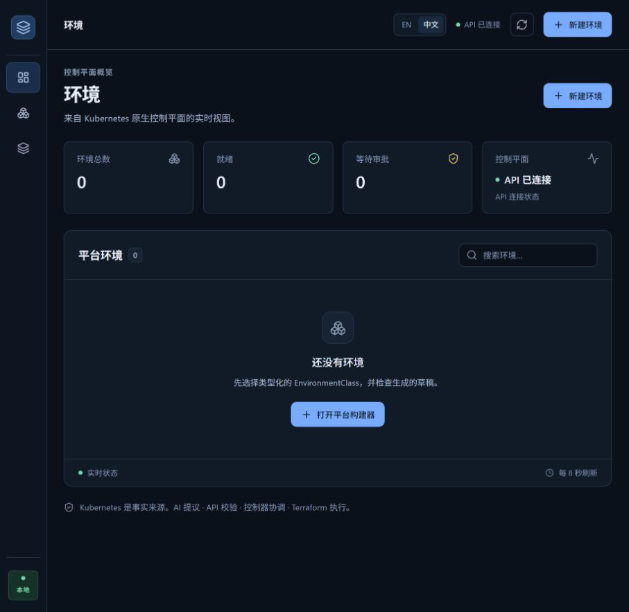

**操作 2：**实际点击左侧“环境”（Environment List）。检查左侧选中状态、主区域“平台环境 0”以及“还没有环境”的空状态。

**预期 / 实际：**进入环境列表，页面可用，没有伪造列表行。此版本首页本身就是 Environment List，因此两图是同一真实视图在打开与实际点击后的两个状态。

**图 02：点击左侧“环境”后的完整 Environment List**


最小验收的两张 PNG 分别为 907×883 / 1841×883，152,950 / 190,460 字节，已验证 PNG 格式、解码及实际打开。精确 SHA-256 见截图清单。

### TC02 EnvironmentClass 配置与校验 — PASS（配置校验范围）

本用例仅执行前端表单与服务端 dry-run，不保存类别。没有将配置校验成功标为 Class Ready。

**操作 1：**点击左侧“环境类别管理”→“创建类别”。在“内置预设”中选择“Kubernetes · 小型开发”的“使用模板”。

**预期 / 实际：**显示 01 选择模板、02 调整配置、03 校验并创建；小型开发预设为 1–3 个节点、最多 3 个环境、人工审批。项目引用等待人工填写。

**图 03：真实模板选择页与小型开发、团队开发预设**

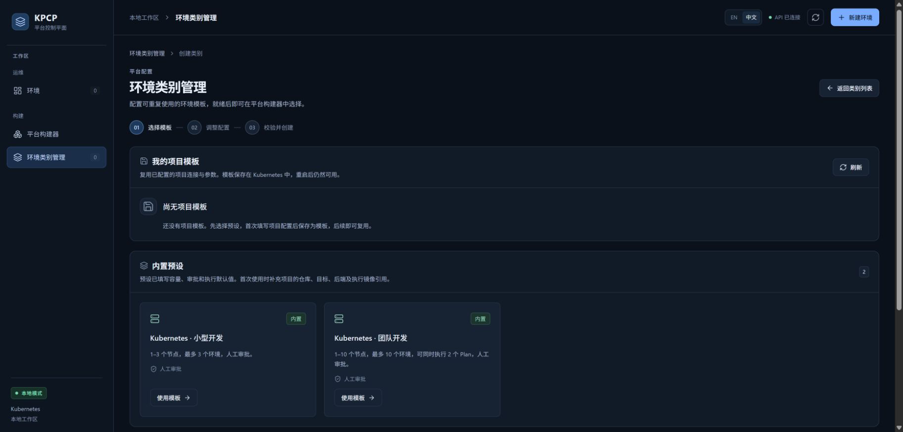

**图 04：小型开发配置表单：基本信息与目标字段**

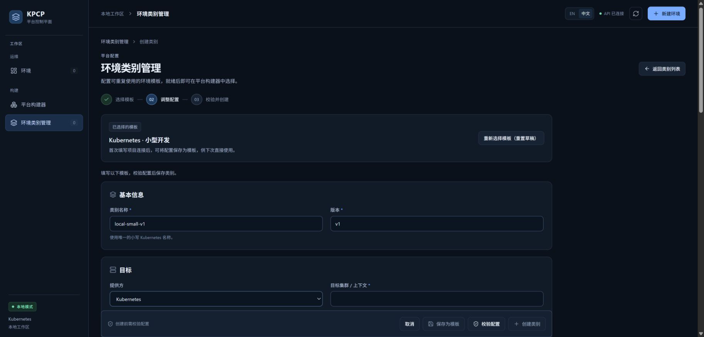

**操作 2：**把“类别名称”填为 `qa-work-20261101-ui`，保持“目标集群 / 上下文”为空，点击底部“校验配置”。

**预期 / 实际：**浏览器定位到必填字段，显示“请填写此字段。”；“创建类别”和“保存为模板”保持禁用。

**图 05：实际点击校验后，目标上下文字段的必填提示**

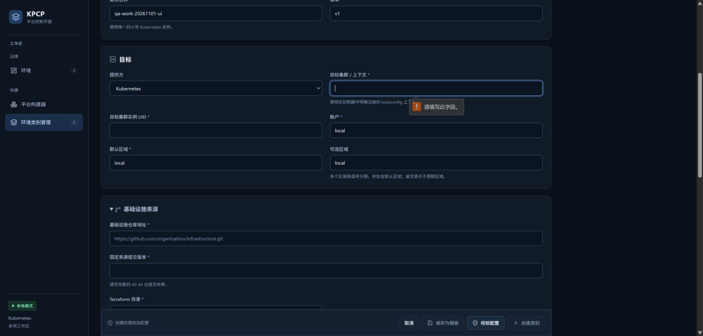

**操作 3：**填写下表用于校验的值。来源地址来自已有 E2E 配置，本轮已确认该地址超时；填入表单不代表其运行可用。

| 字段 | 本轮输入（本机地址在公开版脱敏） |
|---|---|
| 类别名称 / 版本 | `qa-work-20261101-ui` / `v1` |
| 提供方 / 集群 | Kubernetes / `podman-minikube` |
| 目标集群实例 UID | `2c62d6a8-08b6-460d-bb1b-ac59557dc281` |
| 账户 / 默认区域 / 可选区域 | `local` / `local` / `local` |
| 基础设施仓库地址 | `http://[LOCAL_GIT_HOST]:18085/qa-5445a5f/.git`（发布版已省略本机地址） |
| 固定来源提交版本（负例） | `main` |
| Terraform 目录 | `.` |
| 后端配置名称 / Runner 服务账户 | `qa-work-backend` / `terraform-runner` |
| Runner 镜像、镜像摘要 / 本地标识 | 均填 `localhost/kpcp-runner@sha256:f94aa16a0136f5414fe10f5851e6cfad89f240168f47da93eb1bbf26702cbc39` |
| Terraform 版本 / 执行超时 | `1.14.0` / `12m` |
| 最少 / 最多节点 | 1 / 3 |
| 环境数 / 同时 Plan / 同时 Apply 上限 | 3 / 1 / 1 |
| 审批策略 | 人工审批 |

点击“校验配置”。**预期 / 实际：**服务端拒绝可移动分支，显示 `source.revision must be a pinned 40-64 character hexadecimal commit`。图 06 是点击后视口，图 07 是实际定位到错误正文后的完整提示。

**图 06：非固定版本被拒绝，创建按钮禁用**

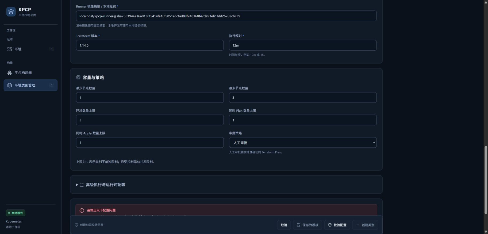

**图 07：固定来源版本错误全文；中文模式仍含英文正文**

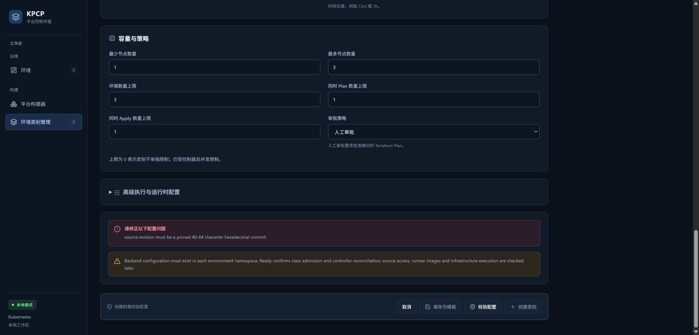

**操作 4：**将“固定来源提交版本”改为 `547f45475c7186eafd35026fb994f22f26606d6c`，再次点击“校验配置”。

**预期 / 实际：**显示“配置校验通过”和“配置已校验”；“创建类别”“保存为模板”启用。页面同时提醒来源访问、镜像和执行能力在后续检查；不能据此继续本轮基础设施变更。

**图 08：将来源改为完整提交哈希，保留实际表单字段**

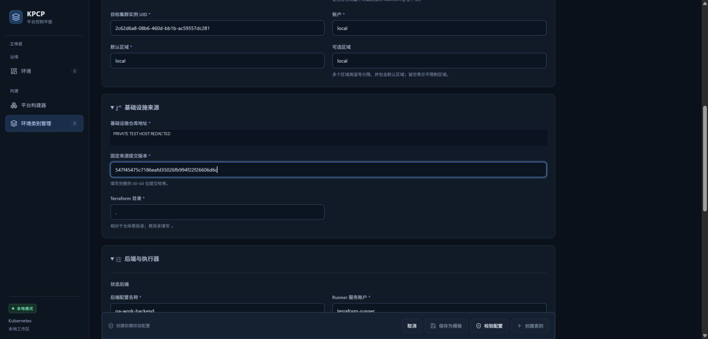

**图 09：服务端 dry-run 通过，创建类别按钮启用**

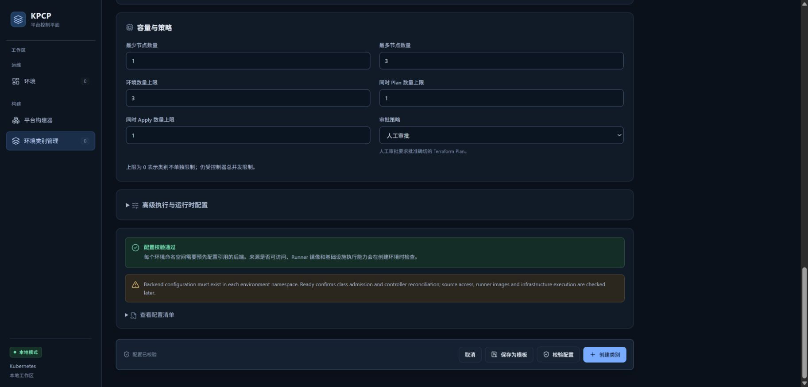

**操作 5：**把“版本”改为 `v2-qa`。

**预期 / 实际：**旧校验立即失效，底部恢复“创建前需校验配置”；“创建类别”“保存为模板”重新禁用。

**图 10：修改版本后重新禁用创建，必须再次校验**

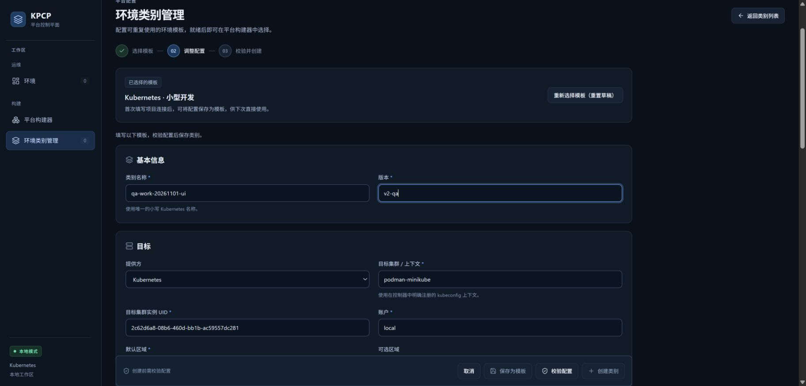

**操作 6：**展开“高级执行与运行时配置”；在“模拟器执行配置与模块输入（JSON）”中输入 `{"unexpected":true}`，点击“校验配置”。

**预期 / 实际：**显示“执行配置仅允许 executionProfile 和 inputs 字段。”，创建保持禁用。

**图 11：高级 JSON 字段与实际输入的未知键**

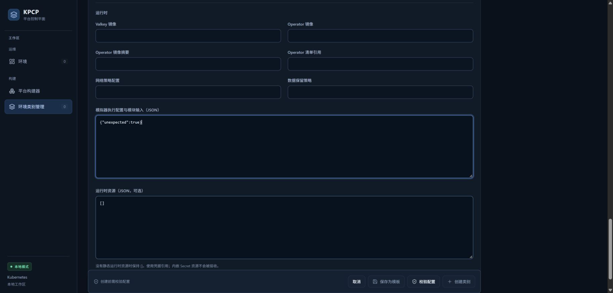

**图 12：未知执行字段被拒绝的中文提示**

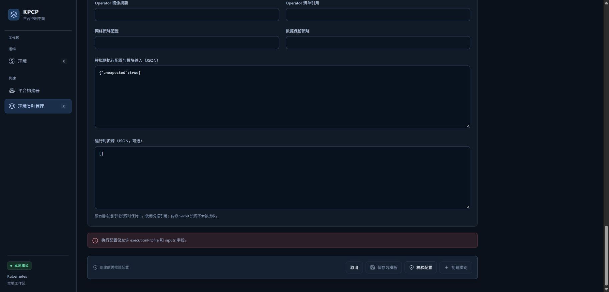

**操作 7：**把执行 JSON 恢复为 `{}`，把“运行时资源（JSON，可选）”改为 `{}`，点击“校验配置”。

**预期 / 实际：**显示“运行时资源必须是资源定义组成的 JSON 数组。”。字段必须是数组；`[]` 表示没有静态运行时对象。

**图 13：运行时 JSON 对象被拒绝，要求资源数组**

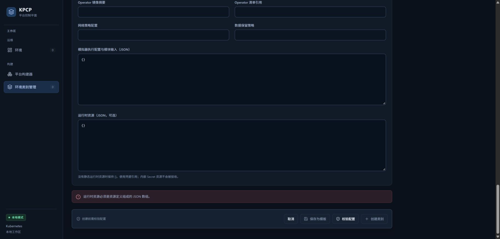

**操作 8：**运行时 JSON 恢复为 `[]`；“连接配置引用”填写 `kubeconfig:podman-minikube`；输入下列仅用于 dry-run 的执行 JSON，再点击“校验配置”→“查看配置清单”。引用的资源均未实际创建。

```json
{
  "executionProfile": {
    "mode": "emulator",
    "s3Endpoint": "http://[LOCAL_MINISTACK_HOST]:14566",
    "stsEndpoint": "http://[LOCAL_MINISTACK_HOST]:14566",
    "region": "us-east-1",
    "accountId": "000000000000",
    "artifactBucket": "qa-work-20261101",
    "credentialsSecretRef": {"name": "qa-work-emulator"}
  },
  "inputs": {
    "bucket_name": "qa-work-20261101-cloud",
    "target_cluster_name": "podman-minikube",
    "target_endpoint": "kubeconfig:podman-minikube",
    "target_incarnation_id": "2c62d6a8-08b6-460d-bb1b-ac59557dc281"
  }
}
```

**预期 / 实际：**模拟器配置通过 dry-run，真实 YAML 预览包含 `approvalPolicy: Manual`、固定 Runner、来源提交版本与目标实例 UID；返回 YAML 的规范字段名为 `accountID`。当前源码说明 validate 接口使用 Kubernetes `DryRunAll`，不会保存 Class 或创建环境。

**图 14：模拟器执行配置校验通过，展开配置清单**

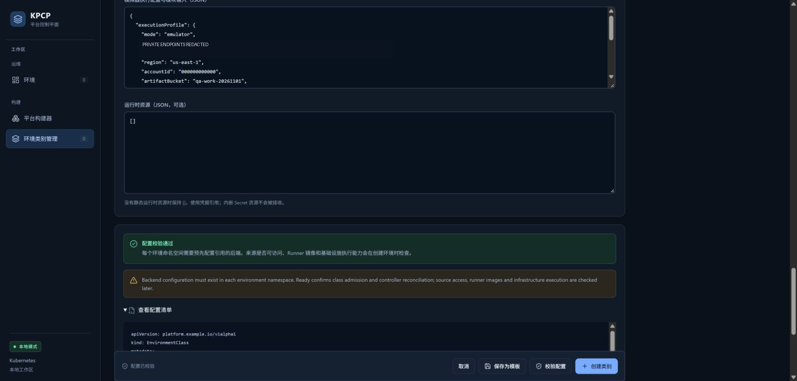

**图 15：YAML 预览上部：名称、人工审批、后端与容量限制**

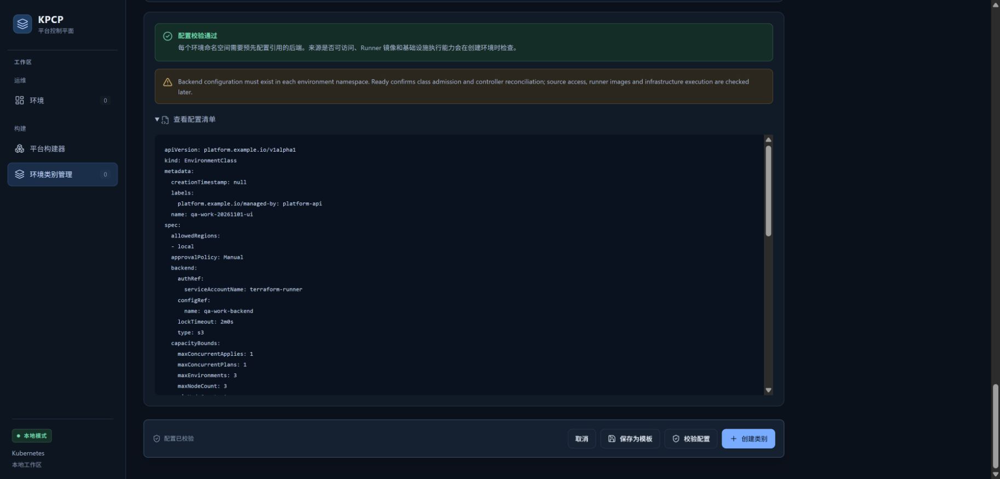

**图 16：滚动后的 YAML：模块输入、Runner、来源与精确目标**

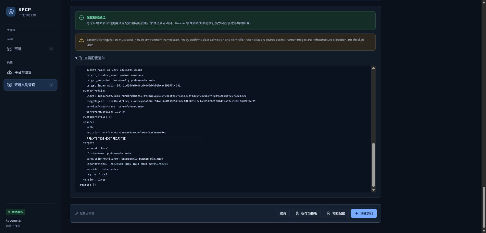

**操作 9：**点击“取消”。

**预期 / 实际：**返回“可用类别 0”，未持久化校验对象。最终 Kubernetes 只读清单确认平台资源和 Job 总计仍为 0。

**图 17：取消校验草稿后，环境类别列表仍为 0**

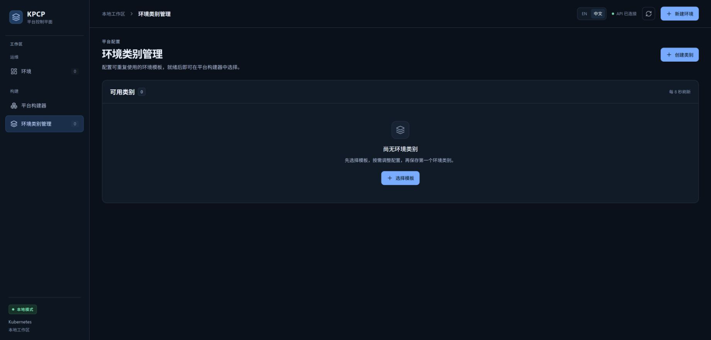

实现追溯：[internal/console/classes.go:L95](https://github.com/miku-wwl/kube-platform-control-plane/blob/5445a5fdf169a9f12296dc44df1ba1b2d2819342/internal/console/classes.go#L95)（真实 validate 与 DryRunAll）、[web/src/ClassManager.tsx:L903](https://github.com/miku-wwl/kube-platform-control-plane/blob/5445a5fdf169a9f12296dc44df1ba1b2d2819342/web/src/ClassManager.tsx#L903)（表单与校验流程）。

### TC03 AI Draft 生成与表单检查 — BLOCKED

**已实际执行：**点击左侧“平台构建器”；填写自然语言需求、环境名称和命名空间；实际点击“环境类别”下拉框。

| 字段 | 本轮值 / 状态 |
|---|---|
| 自然语言需求 | 创建一个 1 节点的小型开发环境，启用 Valkey 缓存；仅生成草稿，等待人工提交与审批。 |
| 环境名称 | `qa-work-20261101-ui` |
| 命名空间 | `qa-work-20261101`（只填写，未创建） |
| 环境类别 | 仅“选择已就绪的类别”，无可选 Ready 类别 |
| 区域 / 节点数量 | 使用类别默认值 / 1 |
| 生成草稿 | 禁用 |
| AI 草稿面板 | 保持“类型化清单预览会显示在这里”的空状态 |
| 阻塞提示 | “请先创建一个已就绪的环境类别，再生成草稿。” |

缺少类别时的入口限制与提示已实测；真实生成结果、意图提取、Valkey 参数、校验结果和 YAML 内容未验收。未调用模型，也未借用已有 API Draft 结果填充页面。

**图 18：真实填写构建器后，Ready 类别前置提示与禁用按钮**

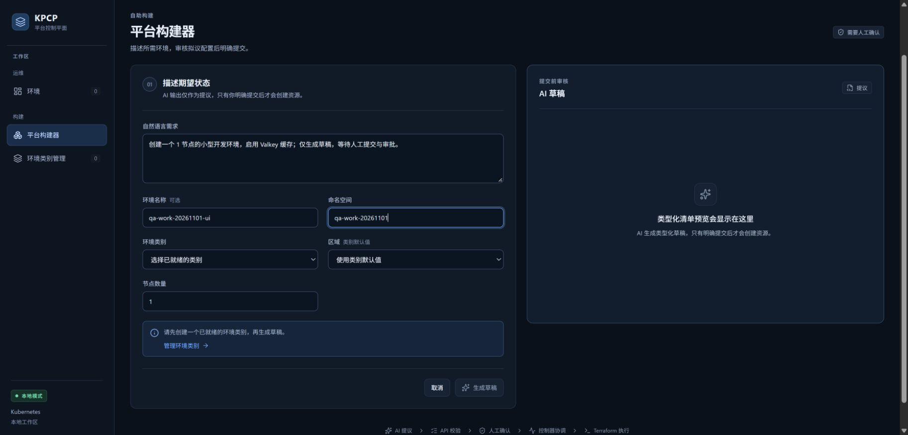

**图 19：实际点击类别下拉框后，没有可用类别**

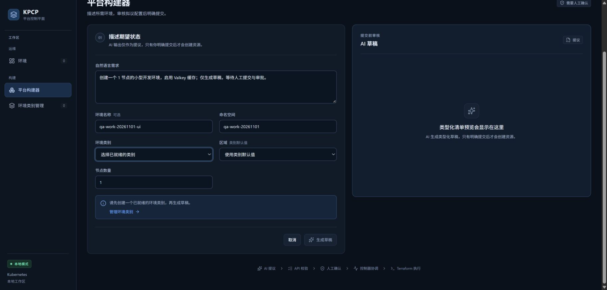

**复测指导（未执行）：**准备可确认归属的 Ready 类别后，选中它→确认区域与节点数→点击“生成草稿”→在右侧逐项核对名称、命名空间、Class、区域、容量、Valkey、Validated 状态与 Proposed manifest。每一步均需补拍当前截图。

### TC04 Draft 不自动创建基础设施 — BLOCKED

**未执行原因：**TC03 没有生成真实 Draft。当前表单填写和类别校验后资源为 0，只能证明这些已执行操作没有持久化环境，不能代替 Draft 隔离测试。

**复测指导（未执行）：**生成有效 Draft 后停留在预览，不点击“提交 PlatformEnvironment”；对照生成前后 PlatformEnvironment、InfraStack、TerraformRun、Job 和模拟器资源清单，确认没有新执行记录或云资源。截图应同时展示 Draft 预览与未提交状态，配套只读 API/Kubernetes 收据。

**已有工程追溯：**`PlatformAPI_DraftAndTemplate` 检查生成 Draft 后环境与 TerraformRun 仍为 0；这是既有确定性生成器 API 证据，本轮 Ollama/UI 场景仍阻塞。

### TC05 Environment Submit — BLOCKED

**未执行原因：**没有有效 Draft，“提交 PlatformEnvironment”按钮尚未出现；活动 Controller、测试命名空间及后端/Secret 引用也未就绪。

**复测指导（未执行）：**在右侧有效 Draft 中核对名称与命名空间→点击“提交 PlatformEnvironment”→检查新环境详情与唯一 UID、generation、Class 引用。此按钮仅提交顶层期望对象；审批与执行仍由 Controller 处理。

### TC06 Terraform Plan 生成 — BLOCKED

**未执行原因：**没有本轮已提交环境，未发现活动 Controller。

**复测指导（未执行）：**打开新环境→“Terraform 运行记录”→等待 Controller 创建 `operation=Plan`、`planMode=Reconcile` 的记录和 Runner Job→核对 Plan UID、Job UID、`ChangesPresent`/`NoChange`、Plan 摘要、报告摘要、来源摘要及“证据已就绪”。控制台没有需要手动点击的“执行 Plan”按钮，不应绕过协调器补造记录。

### TC07 未审批时不允许 Apply — BLOCKED

**未执行原因：**没有“存在变更、证据齐全、尚未审批”的真实 Plan。

**复测指导（未执行）：**在该 Plan 的“架构预览”或 Terraform 详情停留，保留“待审批”状态，检查没有 Apply 运行记录、Apply Job 或运行时变更；使用只读资源清单记录前后差异。控制台没有直接 Apply 按钮的代码事实，不能替代实际无副作用断言。

### TC08 PlanTopology 展示 — BLOCKED

**未执行原因：**没有本轮不可变 Plan JSON/图数据；未使用静态图或旧截图。

**复测指导（未执行）：**环境详情→“架构预览”→检查当前/计划列、创建/更新/删除/替换节点、依赖边与节点详情。将页面 Plan UID/digest 与 `/plan` 返回及保存的 Plan 产物交叉核对，敏感字段应被省略。已有 API 的 graph 断言见工程证据表，尚不能关闭 UI 展示验收。

### TC09 Exact Plan Approval — BLOCKED

**未执行原因：**没有本轮可审批 Plan。

**复测指导（未执行）：**确认页面“审核此 Plan”、Plan 摘要、过期时间、证据就绪状态→点击“批准此确切 Plan”→核对 ChangeApproval 的 Plan name/UID、Plan digest、execution-context digest、effective-input digest、report ref/digest。刷新后绑定不得漂移；错误、过期或被替代的 Plan 应拒绝准入。

### TC10 Apply 执行与 Ready — BLOCKED

**未执行原因：**TC09 未执行，完整执行环境未就绪。

**复测指导（未执行）：**批准正确 Plan 后进入“Terraform 运行记录”与“生命周期时间线”→观察 Controller 以已保存的 binary Plan 调度唯一 Apply Job→检查 Succeeded、可信目标发现、运行时清单与 Ready/observedGeneration。对照真实云资源读回结果，不能仅以成功提示或徽标作为验收。

### TC11 更新与 NoChange — BLOCKED

**未执行原因：**没有本轮 Ready 环境。

**复测指导（未执行）：**环境详情“概览”→“容量”中将节点数由 1 改为类别允许的 2→点击“更新容量”→检查 generation 增加、新 Plan UID、输入摘要和时间线。在固定模块无资源差异时应呈现 NoChange，无新 Apply，审批区显示“没有需要审批的变更”；若有真实差异，则需要新 Plan 的独立精确审批。既有 NoChange E2E 不代替当前 UI。

### TC12 Delete Environment — BLOCKED

**未执行原因：**没有本轮创建并可核对 UID 的环境；未操作历史或共享资源。

**复测指导（未执行）：**打开测试环境→“删除环境”→核对命名空间与环境 UID→在“确认环境名称”中输入准确名称→点击“请求删除”。观察 Deleting、finalizer 和运行时清理时间线；名称不匹配时按钮应禁用。保留请求前、确认表单、请求后状态三张真实截图。

### TC13 Destroy 独立审批 — BLOCKED

**未执行原因：**没有本轮删除请求或 Destroy Plan。

**复测指导（未执行）：**等待 Controller 根据最后收敛来源生成 `planMode=Destroy` 的新 Plan→检查“审核销毁 Plan”“独立销毁审批”以及新 Plan UID/digest→在尚未批准时核对云对象仍存在、finalizer 未释放→点击“批准此确切 Plan”。Reconcile 审批不能替代本步骤。

### TC14 Terraform Destroy 与 Cleanup — BLOCKED

**未执行原因：**没有本轮创建的基础设施或已批准 Destroy Plan，故没有本轮 Destroy 成功或 finalizer 释放截图。

**复测指导（未执行）：**批准 Destroy 后观察 Destroy Apply Job 及保存产物→核对云对象确实消失→确认环境正常移除、finalizer 通过业务流程释放→确认仅清理测试归属的 Class/命名空间/状态和产物，非归属 sentinel 保持不变。出现失败时保留证据与 finalizer，不强制移除。

本轮实际完成的收尾是取消未保存的表单、恢复中文、返回首页并实际点击“刷新”。平台资源与 Job 仍为 0、S3 清单为空，原有共享容器继续运行。下图仅证明当前首页状态，**不代表执行过 Destroy**。

**图 23：收尾后真实首页：API 已连接、环境仍为 0（非 Destroy 验收截图）**

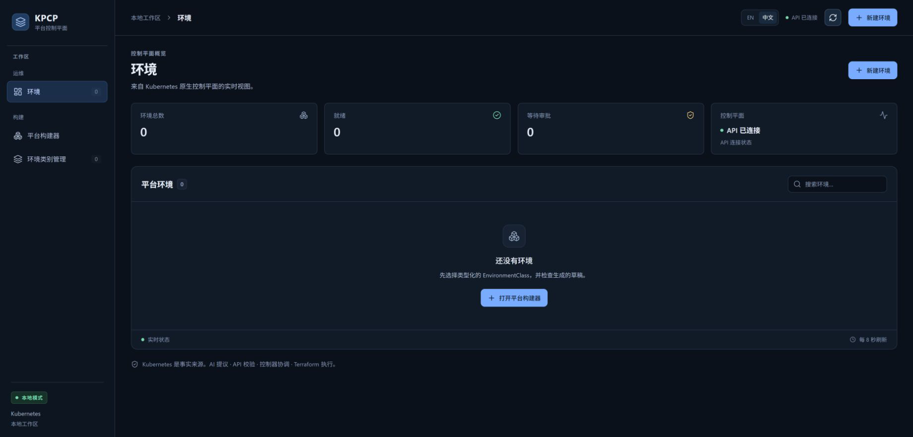

### TC15 中英文界面及异常提示 — PARTIAL

**操作 1：**在已填写构建器中点击右上角 EN。

**预期 / 实际：**文档标题变为 `Platform Control Plane`；导航、表单、前置提示与 Generate draft 按钮切换为英文；用户原先输入的需求、名称、命名空间保留。

**图 20：英文构建器：标题、导航、字段和阻塞提示切换**

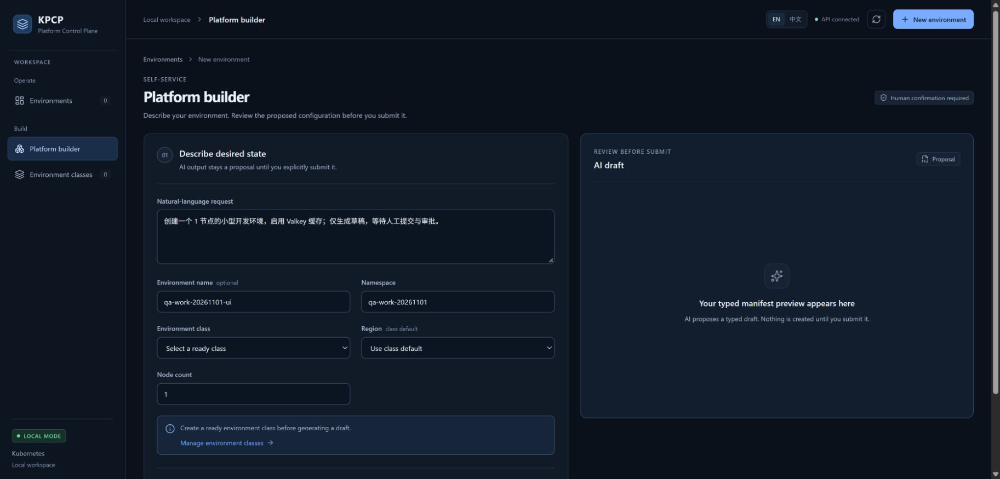

**图 21：同一真实英文构建器的完整页面截图，含禁用 Generate draft**

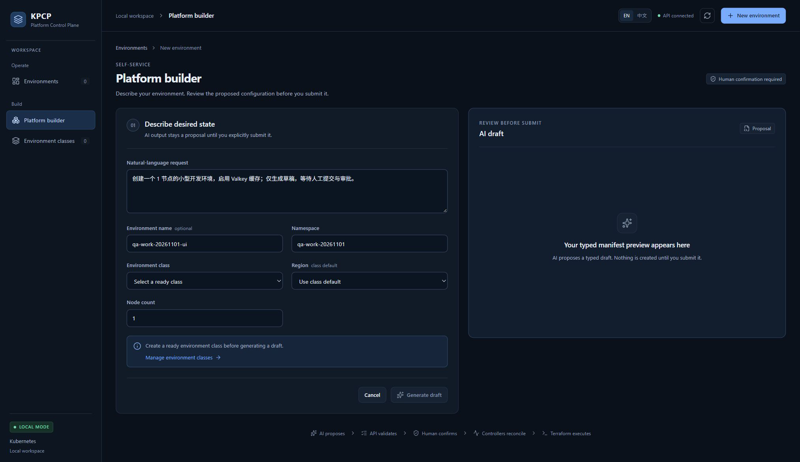

**操作 2：**点击“中文”。

**预期 / 实际：**文档标题恢复“平台控制平面”，界面回到中文，输入值保留。随后点击“取消”返回首页并刷新，见图 23。

**图 22：恢复中文后，表单内容仍保留**

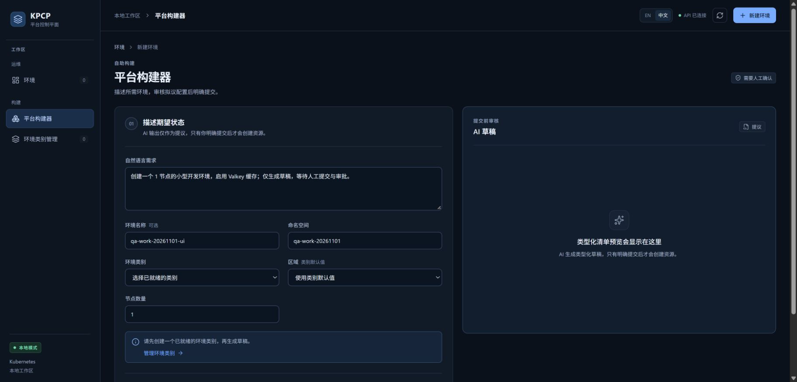

**操作 3（已在 TC02 复现）：**中文模式下，以 `main` 作为固定版本点击“校验配置”。

**期望：**面向用户的错误、警告与主要界面语言一致；字段键、摘要与资源标识可保留技术原文。

**实际：**图 07 的完整错误句、图 09/14/15 的后端警告仍为英文。高级 JSON 的两条错误则已显示中文（图 12、13）。语言切换通过，异常提示本地化验收未全部通过。

## 5. 缺陷、阻塞与影响

| ID | 类型 / 级别 | 可复现事实 | 影响与建议 |
|---|---|---|---|
| QA-01 | UI 缺陷 / P2 | 中文模式下，服务端 `source.revision` 错误及后端配置警告为英文，图 07、09、14、15 | 中文图文指导可读性不完整；后续产品修改需单独处理，本轮仅记录 |
| B-01 | 环境阻塞 / 高 | 无活动 KPCP Controller、无 Ready Class | TC03–14 无法完成；API 徽标不反映该状态 |
| B-02 | 环境阻塞 / 高 | 本轮无测试所有的 namespace/backend/Secret；旧 PodEndpoint、来源地址的主机侧检查超时/拒绝 | 尚不能安全执行完整生命周期；需由环境提供方明确准备与归属 |
| B-03 | 工程覆盖缺口 / 高 | 既有 `D_MultiTarget` 明确 SKIP，只有一个实际 cluster UID | 单集群并发与命名空间隔离不能关闭独立双集群验收 |
| B-04 | 验收缺口 / 高 | 本轮无 Draft、Plan、Topology、Approval、Ready、NoChange、Destroy 的成功 UI 截图 | 需在满足前置条件后的同一真实产品界面补齐 |

QA-01 的定位依据是服务端返回的完整英文警告与 UI 实际显示；现有翻译表包含的是另一段文案。源码位置：
- [internal/console/classes.go:L203](https://github.com/miku-wwl/kube-platform-control-plane/blob/5445a5fdf169a9f12296dc44df1ba1b2d2819342/internal/console/classes.go#L203)：服务端警告与固定版本错误。
- [web/src/ClassManager.tsx:L1317](https://github.com/miku-wwl/kube-platform-control-plane/blob/5445a5fdf169a9f12296dc44df1ba1b2d2819342/web/src/ClassManager.tsx#L1317)：校验结果展示。
- [web/src/i18n.tsx:L279](https://github.com/miku-wwl/kube-platform-control-plane/blob/5445a5fdf169a9f12296dc44df1ba1b2d2819342/web/src/i18n.tsx#L279)：现有中文翻译键。

## 6. 六项工程证据追溯

### 6.1 已有运行身份与本轮审查动作

使用仓库已有同一基线运行：2026-11-01 20:58:15–21:11:37，`go test ./e2e -run TestLifecycle -v -count=1 -timeout=20m`，退出码 0。日志顶层耗时 799.07 秒；`D_MultiTarget` 是 SKIP。**本轮只审查此运行，没有重新执行、注入故障或重启 Controller。**

| 身份项 | 已有证据值 |
|---|---|
| namespace / UID | `kpcp-1793519898365278200` / `39cb5351-57a9-4293-81d9-b814287761c5` |
| Plan UID | `fbaecc62-a2ac-4b76-a55a-0a384cb62d95` |
| Plan digest | `sha256:7616d262aabd45d029f9e97ac800191bf498249b849459efa43bcec36ebb0b5b` |
| Effective-input digest | `sha256:b8a13db5d91338bed0082884570f688ce98f4b3f78366d08297dbe347d0308eb` |
| Source bundle digest | `sha256:58d0e8159d83d2042b9abd0745e6768e0bdf67ab966807f9a671070e31fddd80` |
| 模块 fixture revision | `547f45475c7186eafd35026fb994f22f26606d6c` |
| Runner | `localhost/kpcp-runner@sha256:f94aa16a0136f5414fe10f5851e6cfad89f240168f47da93eb1bbf26702cbc39` |

本轮重新核对已有 `source-baseline.json` 所列 **115 个文件，全部 SHA-256 一致**；5 个保存产物重新计算摘要，**5/5 相符**。API 与 Controller 二进制 SHA-256 也与已有构建收据相符。二进制内嵌 `vcs.revision` 为当前基线，但 `vcs.modified=true`；这些核对不构成 clean/reproducible build 的独立保证。

原始入口：[E2E 运行结果](evidence/qa-20261101/e2e-result-public.json)、[E2E 原始日志](evidence/qa-20261101/e2e-current.log)、[构建身份](evidence/qa-20261101/build-identities.json)、[公开工程证据摘要](evidence/public/engineering-evidence-summary.json)、[公开执行配置](evidence/public/execution-config-public.json)。

已有 Go E2E 的平台 API 使用 `deterministic` 草稿生成器；当前桌面 API 报告 `ollama`。已有 API Draft PASS 不能证明本轮真实模型行为或 UI 质量。

### 6.2 需求 → 断言 → 运行收据 → 剩余范围

| 必须追溯项 | 已审查断言与源码 | 已有运行收据 | 本轮结论与未关闭范围 |
|---|---|---|---|
| Exact Plan Approval | [e2e/lifecycle_test.go:L389](https://github.com/miku-wwl/kube-platform-control-plane/blob/5445a5fdf169a9f12296dc44df1ba1b2d2819342/e2e/lifecycle_test.go#L389)：无审批时无 Apply；五种错误 digest/UID/input/report/context 均不能准入。[e2e/lifecycle_test.go:L503](https://github.com/miku-wwl/kube-platform-control-plane/blob/5445a5fdf169a9f12296dc44df1ba1b2d2819342/e2e/lifecycle_test.go#L503)：过期快照的 report digest 返回冲突，正确绑定成功。[internal/controller/execution_test.go:L34](https://github.com/miku-wwl/kube-platform-control-plane/blob/5445a5fdf169a9f12296dc44df1ba1b2d2819342/internal/controller/execution_test.go#L34) 补充来源/目标/后端/Runner/过期/NoChange 和去重单元断言。 | 原始日志 L47、L49 PASS；正确审批后进入唯一 Apply。 | 已有已实现路径 PASS；本轮 UI BLOCKED；完整 live source/target-change/expiry 负例矩阵未全部关闭。 |
| Immutable Artifact Evidence | [e2e/lifecycle_test.go:L418](https://github.com/miku-wwl/kube-platform-control-plane/blob/5445a5fdf169a9f12296dc44df1ba1b2d2819342/e2e/lifecycle_test.go#L418)：校验 Plan/source/backend/report/terminal 五类对象，拒绝覆盖；[e2e/lifecycle_test.go:L455](https://github.com/miku-wwl/kube-platform-control-plane/blob/5445a5fdf169a9f12296dc44df1ba1b2d2819342/e2e/lifecycle_test.go#L455)：篡改 Plan 字节且伪造元数据、删除 source，两者均在 Apply Job 前拒绝。 | 原始日志 L48 PASS；原有五个产物的本轮 SHA-256 重算均一致。 | 已有完整性与准入路径 PASS；本轮只读重算 PASS；未执行新篡改，KMS/versioning 等扩展范围未据此关闭。 |
| Controller Restart Recovery | [e2e/lifecycle_test.go:L375](https://github.com/miku-wwl/kube-platform-control-plane/blob/5445a5fdf169a9f12296dc44df1ba1b2d2819342/e2e/lifecycle_test.go#L375)、[e2e/lifecycle_test.go:L533](https://github.com/miku-wwl/kube-platform-control-plane/blob/5445a5fdf169a9f12296dc44df1ba1b2d2819342/e2e/lifecycle_test.go#L533)：active Plan、完成 Plan、active Apply、Ready 后四次专用进程重启；[e2e/lifecycle_test.go:L557](https://github.com/miku-wwl/kube-platform-control-plane/blob/5445a5fdf169a9f12296dc44df1ba1b2d2819342/e2e/lifecycle_test.go#L557)：同一 Plan UID、恰好一个 Apply、Plan+Apply 两个主 Job。 | 原始日志 L50 PASS；原始 Controller 日志记录初始启动与四次恢复共 5 次取得 lease。 | 已有单进程持久化恢复 PASS；本轮未重启；多副本 Deployment leader failover 未验证。 |
| Multi-target Isolation | [e2e/lifecycle_test.go:L690](https://github.com/miku-wwl/kube-platform-control-plane/blob/5445a5fdf169a9f12296dc44df1ba1b2d2819342/e2e/lifecycle_test.go#L690)：重叠审批、global Apply≤1、实际 contention、两份 durable state 与正反运行时读取；[e2e/lifecycle_test.go:L808](https://github.com/miku-wwl/kube-platform-control-plane/blob/5445a5fdf169a9f12296dc44df1ba1b2d2819342/e2e/lifecycle_test.go#L808)：SecondContext 缺失则显式 skip。 | 原始日志 L52 为 D_MultiTarget SKIP；L53 SingleClusterConcurrency PASS；两个 namespace 使用同一实际 cluster UID。 | 独立双集群隔离仍 BLOCKED / NOT RUN；单集群并发 PASS 只覆盖其自身范围。 |
| Fail-Closed | [e2e/lifecycle_test.go:L819](https://github.com/miku-wwl/kube-platform-control-plane/blob/5445a5fdf169a9f12296dc44df1ba1b2d2819342/e2e/lifecycle_test.go#L819)：不存在的来源 revision、不可达 endpoint 导致 Job 失败且没有 Apply；A/B 组覆盖错误审批、损坏证据；[internal/controller/execution_test.go:L102](https://github.com/miku-wwl/kube-platform-control-plane/blob/5445a5fdf169a9f12296dc44df1ba1b2d2819342/internal/controller/execution_test.go#L102)：foreign active Job 关闭准入。 | 原始日志 L54 PASS；A/B PASS；当前 UI 的必填、非固定 revision 和高级 JSON 拒绝均有新截图。 | 已有明确负例 PASS；当前 UI 校验负例 PASS；无 Controller 的 live discovery/account/fence/unknown-target 完整负例矩阵未关闭。 |
| Terraform Destroy / Finalizer | [e2e/lifecycle_test.go:L905](https://github.com/miku-wwl/kube-platform-control-plane/blob/5445a5fdf169a9f12296dc44df1ba1b2d2819342/e2e/lifecycle_test.go#L905)：错误 UID 删除冲突，正确删除 accepted；[e2e/lifecycle_test.go:L949](https://github.com/miku-wwl/kube-platform-control-plane/blob/5445a5fdf169a9f12296dc44df1ba1b2d2819342/e2e/lifecycle_test.go#L949)：先清理 owned runtime，保留 finalizer，等待独立 Destroy 审批，真实 bucket 消失且 unrelated sentinel 保留。 | 原始日志 L55 PASS，Destroy 审批 HTTP 收据在 L42；已有 config 不含 FaultFile，因此该次运行未执行 503 条件分支。 | 已有普通 Destroy 与 Finalizer 路径 PASS；本轮 UI BLOCKED；文档另记的 scoped-fault run 属于另一批证据，本轮未冒充重跑。 |

### 6.3 本轮只读重算的不可变产物

| 产物 | SHA-256（含前缀） | 本轮重算 |
|---|---|---|
| `main-plan.binary`（原始产物留存本地） | `sha256:7616d262aabd45d029f9e97ac800191bf498249b849459efa43bcec36ebb0b5b` | PASS |
| `main-source-bundle.tar.zst`（原始产物留存本地） | `sha256:58d0e8159d83d2042b9abd0745e6768e0bdf67ab966807f9a671070e31fddd80` | PASS |
| `main-backend-config.hcl`（原始产物留存本地） | `sha256:a454511e5950d4672d8856f859a30f1c5594da69976a328562ec7ea095d282d6` | PASS |
| `main-plan-report.json`（原始产物留存本地） | `sha256:8ccae9b6ab4ae71eda0e01cb825c28e307f80ff20f3c52f6be814720d37132d2` | PASS |
| `main-terminal-result.json`（原始产物留存本地） | `sha256:9c91b9f0f066607532d3797ef204679f48ab4ac65d4060c89d49155d2b9e2b1e` | PASS |

源码、模块、锁文件和不可变产物的追溯入口：[source-baseline.json](evidence/qa-20261101/source-baseline.json)、[module-blob-comparison.json](evidence/qa-20261101/module-blob-comparison.json)、[产物摘要收据](evidence/qa-20261101/artifact-digest-checks-public.json)、[五类原始产物目录](evidence/qa-20261101/artifacts/) 和 [Controller 原始日志](evidence/qa-20261101/kpcp-1793519898365278200-controller.log)。原始后端配置包含私有路由地址。

### 6.4 已有验证报告的适用范围

[VALIDATION_REPORT.md](VALIDATION_REPORT.md)、[覆盖矩阵](ACCEPTANCE_COVERAGE_MATRIX.md) 与 [架构合同](ARCHITECTURE_CONTRACT.md) 已审查。这些文件保留前几轮 599.78 秒、204.25 秒等运行身份和早期浏览器未完成说明；本轮采用另存的同一代码基线 799.07 秒原始 E2E 收据建立追溯，没有将不同 Plan UID、不同运行时间和不同故障配置混为一次运行。

本轮已完成真实浏览器首页与安全校验操作，更新了“完全没有当前浏览器截图”的证据状态；完整生命周期 UI、实时模型质量、双集群隔离及全部 fail-closed 扩展矩阵仍未完成。

## 7. Freeze 建议与复测入口

**建议：完整 Phase 2.5 验收暂不 Freeze（NO-GO），本轮整体保持 PARTIAL。**

| 冻结关口 | 当前状态 |
|---|---|
| 最小真实截图验收 | PASS：首页、环境列表及类别配置的真实浏览器截图可核对 |
| 本轮全部截图可读性和引用 | PASS：23 张 PNG 可解码、与原始浏览器解码像素一致，所有报告图片路径可解析 |
| 安全的首页/类别配置校验 | PASS，限定本轮实际操作范围 |
| 中英文与异常提示 | PARTIAL：QA-01 待处理 |
| 当前生命周期 UI 主路径 | BLOCKED：TC03–14 未形成可执行前置条件 |
| 六组完整工程关口 | PARTIAL：已有五组明确路径 PASS，双集群 D 明确 SKIP，扩展负例仍有缺口 |

后续复测应先由环境提供方明确提供活动 Controller、可访问的固定 Git 来源、Pod 可访问 MiniStack 路由、已绑定所有权的测试 namespace/backend/凭据引用及可用 Runner，然后从 TC03 连续补拍到 TC14。独立双集群隔离需两个不同实际 cluster UID；环境准备不属于本轮 QA 修改范围。

QA 执行期间没有提交产品代码或修复。本报告、原始截图、原始日志和脱敏摘要已按用户要求直接推送到 `main`；产品源码未修改。

## 附录 A：截图文件、时间与校验

以下图片均来自本轮真实内置浏览器。原始截图 PNG 与 JPEG 哈希、时间和公开文件映射见[公开截图清单](evidence/qa-desktop-work-20261101/public-screenshot-manifest.json)。图 08、14、16 使用仅遮盖本机私网地址的发布副本；原始 PNG 与 JPEG 未修改并保留本地。时间列取文件写入时间并转换为 Pacific/Auckland；没有为前三张补造捕获时间。

| 图号 | PNG 文件 | 尺寸 | 保存时间（NZDT） | 字节 |
|---|---|---|---|---|
| 01 | [qa-20261101-01-home.png](screenshots/qa-20261101-01-home.png) | 907×883 | 21:54:47 | 152,950 |
| 02 | [qa-20261101-02-environment-list.png](screenshots/qa-20261101-02-environment-list.png) | 1841×883 | 21:55:03 | 190,460 |
| 03 | [qa-20261101-03-class-templates.png](screenshots/qa-20261101-03-class-templates.png) | 1825×875 | 21:56:41 | 280,478 |
| 04 | [qa-20261101-04-class-form-top.png](screenshots/qa-20261101-04-class-form-top.png) | 1825×875 | 21:58:15 | 242,422 |
| 05 | [qa-20261101-05-class-required-validation.png](screenshots/qa-20261101-05-class-required-validation.png) | 1825×875 | 21:58:28 | 203,845 |
| 06 | [qa-20261101-06-class-pinned-revision-error.png](screenshots/qa-20261101-06-class-pinned-revision-error.png) | 1825×875 | 21:59:23 | 230,123 |
| 07 | [qa-20261101-07-class-validation-error-detail.png](screenshots/qa-20261101-07-class-validation-error-detail.png) | 1825×875 | 21:59:46 | 219,963 |
| 08 | [遮盖副本](screenshots/redacted/qa-20261101-08-class-source-fields-public-redacted.png) / [原图](screenshots/qa-20261101-08-class-source-fields.png) | 1825×875 | 21:59:57 | 197,638 / 207,894 |
| 09 | [qa-20261101-09-class-validation-passed.png](screenshots/qa-20261101-09-class-validation-passed.png) | 1825×875 | 22:00:15 | 224,581 |
| 10 | [qa-20261101-10-change-requires-revalidation.png](screenshots/qa-20261101-10-change-requires-revalidation.png) | 1825×875 | 22:00:15 | 255,157 |
| 11 | [qa-20261101-11-advanced-json-fields.png](screenshots/qa-20261101-11-advanced-json-fields.png) | 1825×875 | 22:00:36 | 142,900 |
| 12 | [qa-20261101-12-advanced-json-rejected.png](screenshots/qa-20261101-12-advanced-json-rejected.png) | 1825×875 | 22:00:56 | 150,153 |
| 13 | [qa-20261101-13-runtime-json-rejected.png](screenshots/qa-20261101-13-runtime-json-rejected.png) | 1825×875 | 22:01:09 | 145,319 |
| 14 | [遮盖副本](screenshots/redacted/qa-20261101-14-emulator-validation-yaml-public-redacted.png) / [原图](screenshots/qa-20261101-14-emulator-validation-yaml.png) | 1825×875 | 22:01:34 | 234,018 / 252,958 |
| 15 | [qa-20261101-15-yaml-preview.png](screenshots/qa-20261101-15-yaml-preview.png) | 1825×875 | 22:01:52 | 260,486 |
| 16 | [遮盖副本](screenshots/redacted/qa-20261101-16-yaml-execution-profile-public-redacted.png) / [原图](screenshots/qa-20261101-16-yaml-execution-profile.png) | 1825×875 | 22:02:02 | 328,742 / 338,098 |
| 17 | [qa-20261101-17-cancel-class-no-persistence.png](screenshots/qa-20261101-17-cancel-class-no-persistence.png) | 1841×883 | 22:02:03 | 150,128 |
| 18 | [qa-20261101-18-builder-no-ready-class.png](screenshots/qa-20261101-18-builder-no-ready-class.png) | 1825×875 | 22:02:25 | 252,920 |
| 19 | [qa-20261101-19-class-selector-empty.png](screenshots/qa-20261101-19-class-selector-empty.png) | 1825×875 | 22:02:26 | 248,683 |
| 20 | [qa-20261101-20-builder-english.png](screenshots/qa-20261101-20-builder-english.png) | 1825×875 | 22:02:53 | 288,814 |
| 21 | [qa-20261101-21-builder-english-full.png](screenshots/qa-20261101-21-builder-english-full.png) | 2027×1171 | 22:03:16 | 435,745 |
| 22 | [qa-20261101-22-builder-chinese-restored.png](screenshots/qa-20261101-22-builder-chinese-restored.png) | 1825×875 | 22:03:17 | 262,536 |
| 23 | [qa-20261101-23-final-home-api-connected.png](screenshots/qa-20261101-23-final-home-api-connected.png) | 1841×883 | 22:03:18 | 191,018 |

## 附录 B：本轮只读与 UI 操作收据索引

| 文件 | 作用 |
|---|---|
| [preflight-summary.json](evidence/public/preflight-summary.json) | 当前 Kubernetes、MiniStack、API 与资源计数摘要 |
| [fixture-connectivity-summary.json](evidence/public/fixture-connectivity-summary.json) | 私有源代码与 Pod 路由的脱敏连通性结论 |
| [engineering-evidence-summary.json](evidence/public/engineering-evidence-summary.json) | Go E2E 子用例、源码基线及工件核对结果 |
| [execution-config-public.json](evidence/public/execution-config-public.json) | 脱敏后的执行环境配置 |
| [source-baseline.json](evidence/qa-20261101/source-baseline.json) | 115 个已跟踪源码文件的基线 SHA-256 |
| [e2e-result-public.json](evidence/qa-20261101/e2e-result-public.json) | E2E 命令、时间、退出码及公开配置引用 |
| [e2e-current.log](evidence/qa-20261101/e2e-current.log) | Go 生命周期 E2E 原始标准输出 |
| [go-result.json](evidence/qa-20261101/go-result.json) | 单元与 MiniStack 集成命令及退出码 |
| [go-current.log](evidence/qa-20261101/go-current.log) | Go 单元与 MiniStack 集成测试标准输出 |
| [artifact-digest-checks-public.json](evidence/qa-20261101/artifact-digest-checks-public.json) | 五类原始产物的长度与 SHA-256 比对收据 |
| [api-read-receipts-public.json](evidence/qa-20261101/api-read-receipts-public.json) | 本机 API 只读查询状态码与时间 |
| [module-blob-comparison.json](evidence/qa-20261101/module-blob-comparison.json) | 四个模块文件与仓库 Git blob 的一致性 |
| [build-identities.json](evidence/qa-20261101/build-identities.json) | API、Controller、Runner 与源码身份 |
| [source-bundle-members.json](evidence/qa-20261101/source-bundle-members.json) | Source bundle 成员文件与 Git blob 摘要 |
| [public-screenshot-manifest.json](evidence/qa-desktop-work-20261101/public-screenshot-manifest.json) | 23 张原始/遮盖截图文件的哈希与映射 |
| [原始浏览器 JPEG 目录](evidence/qa-desktop-work-20261101/original-browser-jpeg/) | 内置浏览器返回的 23 张原始 JPEG |
| [screenshot-manifest.json](evidence/qa-desktop-work-20261101/screenshot-manifest.json) | 原始 PNG/JPEG 截图哈希与时间清单 |

原始 DOM、Kubernetes 快照、节点地址、私有路由配置、五类原始工件、浏览器 JPEG 和 3 张含私网地址的原始 PNG 均已纳入这次 `main` 推送；摘要及遮盖副本同时保留，方便快速审阅。

资料完整性检查仅检查本轮 QA 交付物，不执行产品测试或基础设施变更。
