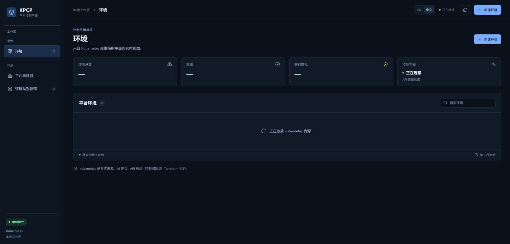
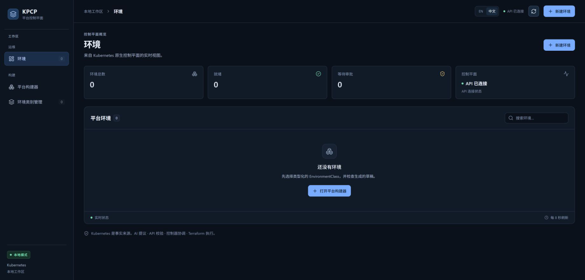
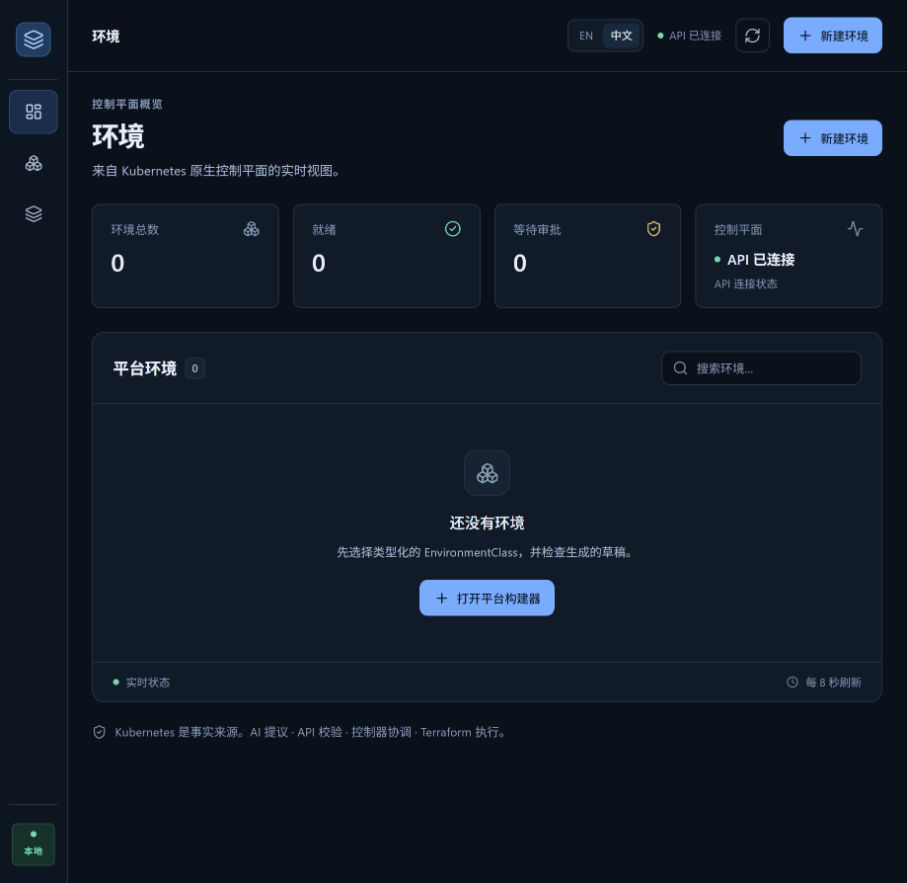

# TC01 — Application Health

## 1. Test Case Summary

| Field | Value |
|---|---|
| Test ID | TC01 |
| Test Name | Application Health |
| Priority | P1 |
| Test Type | Manual UI + Engineering Evidence |
| Preconditions | 原产品代码不变；独立 QA API 与 Vite 监听 loopback；Desktop Work Tab 3 可操作。 |
| Expected Result | 首页可加载；Environment List 可点击；刷新后 API 已连接，计数与 Kubernetes 读模型一致。 |
| Actual Result | 初次进入显示正在连接；实际点击环境与刷新后 API 已连接，环境、就绪、等待审批均为 0。 |
| Status | PASS |
| Commit | `e40c422327aa648a89d6baabf7268cb3239310d8`（现有 5445a5f 二进制，vcs.modified=true；产品路径差异为空，非本次 clean rebuild） |
| Execution Date | 2026-11-01T22:58:47.137000+13:00 → 2026-11-01T23:01:21.530590+13:00 |
| QA Run ID | `kpcp-qa-20261101-2253` |
| Evidence Scope | Current Execution + explicitly preserved Historical PASS |

**Historical Evidence：**2026-11-01 前一轮 TC01 PASS，图 01、02、23 保留原图引用；本轮另有两张新截图，未改写历史结论。

## 2. Test Steps

1. 打开独立 QA 控制台。
2. 点击左侧环境并刷新。
3. 核对页面标题、API 状态和环境计数。

## 3. Detailed Manual Test Guide

### Step 1 — Open QA Console

**操作：**

1. 使用同一 Desktop Work 内置浏览器连接中的可操作 Tab 3。
2. 打开 http://127.0.0.1:5174/。
3. 检查左侧 KPCP 导航、中文标题、摘要卡片与初始加载状态。

**预期结果：** 显示真实产品首页，允许短暂正在连接状态。

**实际结果：** 页面标题为平台控制平面，首帧显示正在连接和正在加载 Kubernetes 资源。

**Screenshot：**

**图注：** 保留初始加载状态，不能单凭此图判断 API 已连接。

### Step 2 — Open Environment List and Refresh

**操作：**

1. 点击左侧环境。
2. 点击右上角刷新按钮。
3. 检查 API 已连接、环境总数、就绪、等待审批以及平台环境列表。

**预期结果：** 连接成功，计数与真实列表一致。

**实际结果：** API 已连接；三个计数均为 0，平台环境 0，列表显示还没有环境。

**Screenshot：**

**图注：** 左侧选中环境；右上角和控制平面卡片为 API 已连接；主区域为空列表。

### Historical Evidence — 原有截图归档引用

以下图片来自前一轮 2026-11-01 21:54–22:03、产品基线 `5445a5f`，不计入本轮截图。保留历史执行事实；含私网地址的三图引用原有遮盖副本。

图注：Historical Evidence，原报告图 01；首页：API 已连接和三个零计数。原图与公开副本对应关系沿用原有清单。

图注：Historical Evidence，原报告图 02；实际点击环境后的完整列表；首页即该列表。原图与公开副本对应关系沿用原有清单。

图注：Historical Evidence，原报告图 23；历史收尾首页与 API 连接状态；原执行没有 Destroy。原图与公开副本对应关系沿用原有清单。

## 4. Engineering Evidence

Current Execution：独立 QA API /api/health 返回 status=ok、aiProvider=deterministic、artifactPreview=true；Kubernetes 节点 Ready，当前无 PlatformEnvironment。API 连通不代表 Controller/Runner 就绪；专用 Controller 与 Runner 探针结果另在 TC02 记录。[历史工程摘要](../evidence/public/engineering-evidence-summary.json) 仅作历史追溯。

构建和前置环境的范围限制见[本轮审查收据](evidence/TC02/environment-preflight.public.json)，二进制原始构建身份及哈希已保留。

- [本用例状态与截图 SHA-256](evidence/TC01/result.json)
- [Current Execution：application-health.json](evidence/TC01/application-health.json)（公开审查投影；原始文件保留本地并记录 SHA-256）

## 5. Actual Result

本轮真实点击、加载、刷新和截图通过。独立 QA 端口运行同一产品源码，没有模拟页面。原 5173/8090 服务保持运行。

## 6. Defects and Blockers

本用例未发现新缺陷。保留的 Tab 2 在本轮无法绑定（browser.user is unavailable）；同一 Browser 2 的新 Tab 3 可用，未重建浏览器会话。

## 7. Final Verdict

**PASS** — 当前首页和列表健康检查通过；历史 PASS 也按原执行身份保留。

## 8. Cleanup / Handoff

本 TC 未创建或修改平台环境。Tab 3 保留供 TC02–TC14 使用。测试专用前置资源由本轮 ledger 追踪，最终在 TC14 清理。

以上保留要求是本用例结束时的连续生命周期交接。整个 Run 的最终清理现已完成，见[TC14](TC14_DESTROY_CLEANUP.md)及[最终清理收据](evidence/TC14/final-cleanup.public.json)；没有待清理测试基础设施。
