# TC02 — Environment Class

## 1. Test Case Summary

| Field | Value |
|---|---|
| Test ID | TC02 |
| Test Name | Environment Class |
| Priority | P0 |
| Test Type | Manual UI + Engineering Evidence |
| Preconditions | 独立命名空间、带本轮归属标签的 artifact bucket、backend ConfigMap、dummy Secret、固定 Git 服务和专用 Controller 已创建；Runner 探针成功；TC01 PASS。 |
| Expected Result | 固定配置通过校验；真实创建后 Class Ready、人工审批策略保持；类别留给后续生命周期。 |
| Actual Result | 真实 UI 校验通过并创建 kpcp-qa-20261101-2253-v1；页面显示就绪与 Ready/ClassValidated，Runner 与固定来源摘要可见。 |
| Status | PASS |
| Commit | `e40c422327aa648a89d6baabf7268cb3239310d8`（现有 5445a5f 二进制，vcs.modified=true；产品路径差异为空，非本次 clean rebuild） |
| Execution Date | 2026-11-01T23:03:21.772000+13:00 → 2026-11-01T23:06:00.860501+13:00 |
| QA Run ID | `kpcp-qa-20261101-2253` |
| Evidence Scope | Historical configuration validation PASS preserved; Current Execution adds real UI creation and Controller Ready |

**Historical Evidence：**原 TC02 PASS 仅限配置校验，未创建 Class。原图 03–17 逐张保留。当前 Ready Class 是新增记录，没有覆盖旧执行事实。

## 2. Test Steps

1. 选择小型开发预设，填写本轮固定来源、后端、Runner 和目标。
2. 填入模拟器执行配置与固定运行时资源，点击校验配置。
3. 点击创建类别。
4. 检查 Ready、ClassValidated 与配置摘要，使用此类别进入构建器。
5. 查阅同文件的 Historical 必填、固定版本、JSON 负例、重校验、预览和取消指导；保留原执行身份。

## 3. Detailed Manual Test Guide

### Step 1 — Fill the Owned QA Class

**操作：**

1. 左侧环境类别管理→创建类别→Kubernetes · 小型开发→使用模板。
2. 类别名填 kpcp-qa-20261101-2253-v1，版本 v1，目标上下文 podman-minikube，实例 UID 从本轮只读 preflight 取得。
3. 来源填本轮 namespace 中 git-source Service 的 /module/.git；固定 revision 为 547f45475c7186eafd35026fb994f22f26606d6c，目录为 .。
4. 后端 ConfigMap 名称为 backend；Runner 服务账户为 runner；镜像和本地标识均为 localhost/kpcp-runner@sha256:f94aa16a0136f5414fe10f5851e6cfad89f240168f47da93eb1bbf26702cbc39；Terraform 1.14.0。
5. 保留最少/最多节点 1/3，环境上限 3，同时 Plan/Apply 上限均为 1，审批策略人工审批。

**预期结果：** 字段与已确认的本轮前置资源一致，创建尚不可用。

**实际结果：** 已实际输入这些值；负例 main 被拒绝后替换为完整固定提交。当前错误语言问题另在 TC15 保存。

**Screenshot：**

本步骤没有本轮对应状态截图；按实际执行范围记录，不以历史图片替代。

**图注：** 输入值与最后创建的全页详情图交叉核对；固定来源和 Runner 不允许移动版本。

### Step 2 — Validate the Emulator and Runtime Configuration

**操作：**

1. 展开高级执行与运行时配置；连接配置引用为 kubeconfig:podman-minikube。
2. 执行 JSON 使用 executionProfile mode=emulator，S3/STS 为本轮 ministack Service，region=us-east-1、accountID=000000000000、artifactBucket=kpcp-qa-20261101-2253、credentialsSecretRef.name=emulator。
3. inputs 的 bucket_name 为 kpcp-qa-20261101-2253-cloud；target_cluster_name、endpoint、incarnation 必须与已登记目标一致。
4. 运行时资源数组仅声明本轮 namespace 中名为 qa-runtime 的 v1 ConfigMap，data.qa-run 等于 Run ID，readinessPolicy=ApplyOnly；不包含 Secret 或其他工作负载。
5. 点击校验配置；检查配置校验通过、创建按钮启用。

本轮实际执行 JSON（只含模拟器测试账户及 Secret 引用，不包含 Secret 值；重跑时先重新分配独占 Run ID 和资源）：

```json
{
  "executionProfile": {
    "accountID": "000000000000",
    "artifactBucket": "kpcp-qa-20261101-2253",
    "credentialsSecretRef": {
      "name": "emulator"
    },
    "mode": "emulator",
    "region": "us-east-1",
    "s3Endpoint": "http://ministack.kpcp-qa-20261101-2253.svc.cluster.local:4566",
    "stsEndpoint": "http://ministack.kpcp-qa-20261101-2253.svc.cluster.local:4566"
  },
  "inputs": {
    "bucket_name": "kpcp-qa-20261101-2253-cloud",
    "target_cluster_name": "podman-minikube",
    "target_endpoint": "kubeconfig:podman-minikube",
    "target_incarnation_id": "2c62d6a8-08b6-460d-bb1b-ac59557dc281"
  }
}
```

本轮实际运行时资源 JSON：

```json
[
  {
    "object": {
      "apiVersion": "v1",
      "data": {
        "qa-run": "kpcp-qa-20261101-2253"
      },
      "kind": "ConfigMap",
      "metadata": {
        "name": "qa-runtime",
        "namespace": "kpcp-qa-20261101-2253"
      }
    },
    "readinessPolicy": "ApplyOnly",
    "resource": "configmaps",
    "version": "v1"
  }
]
```

**预期结果：** 真实服务端 dry-run 通过，不能用此结果替代执行能力检查。

**实际结果：** 配置校验通过，创建按钮启用；此前 Runner 已实际初始化相同 backend。

**Screenshot：**

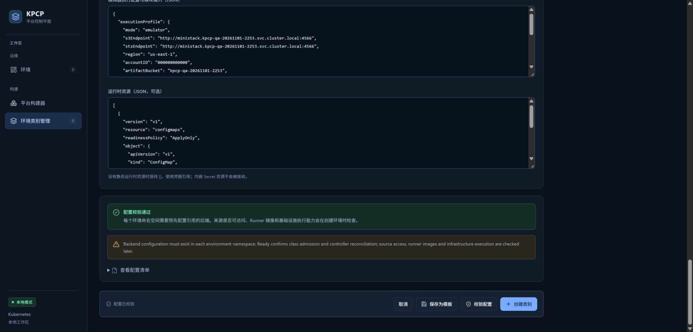

**图注：** 本轮执行 JSON 与 ConfigMap 资源定义、绿色校验提示和创建按钮处于同一真实页面。

### Step 3 — Create and Verify Ready

**操作：**

1. 先在本轮 ledger 登记唯一 Class 名称和最终清理责任。
2. 实际点击创建类别。
3. 在详情中核对类别名称、固定来源、Runner、容量、人工审批和配置摘要。
4. 检查控制器状态 Ready=True，reason=ClassValidated。
5. 点击使用此类别进入构建器，保留 Class 供 TC03–TC14 连续使用。

**预期结果：** 类别已持久化且由实际 Controller 处理；后续构建器可选择。

**实际结果：** UI 直接显示就绪与 Ready/ClassValidated；spec digest 为 sha256:63c23fba5abfff9380f78e5bc9bc369fa0fd604ef71e06f8cbe0626822dca928。

**Screenshot：**

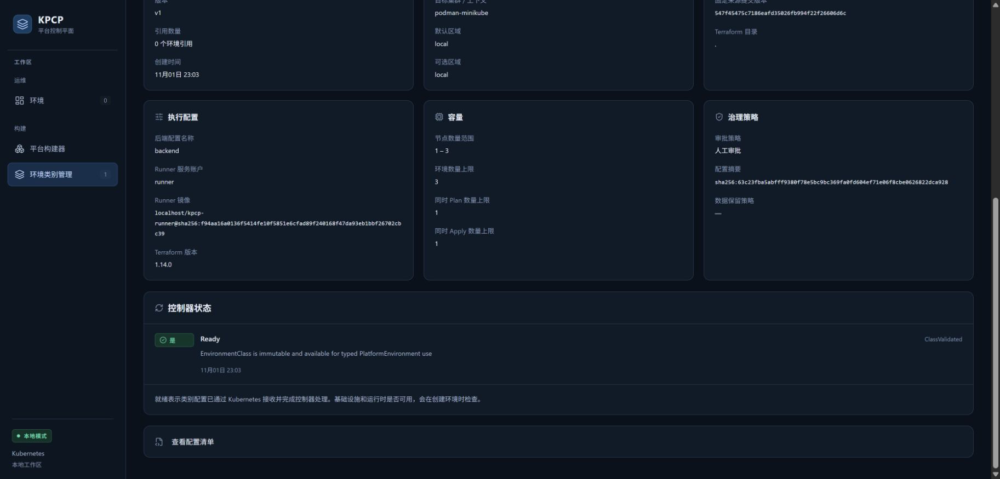

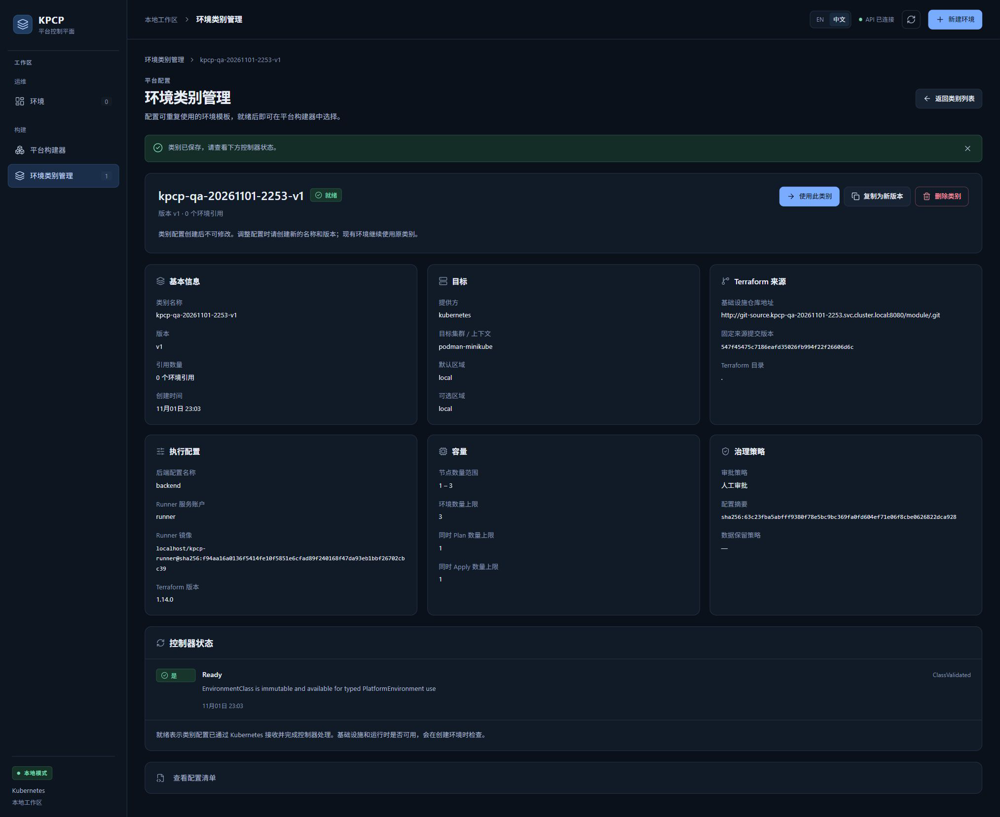

**图注：** 局部图显示控制器 Ready；全页图同时保留类别名、来源、执行器、审批策略及使用此类别按钮。

### Step 4 — Historical — Required Fields and Pinned Revision

**操作：**

1. 历史配置校验范围：2026-11-01 21:54–22:03，以下图片不是本轮新操作。
2. 从环境类别管理→创建类别→Kubernetes · 小型开发→使用模板。
3. 类别名填 qa-work-20261101-ui，目标集群/上下文留空，点击校验配置。
4. 预期浏览器显示请填写此字段；创建类别及保存为模板禁用。
5. 补齐目标、Backend、Runner 和其他字段后，将固定来源提交版本填 main，再点击校验配置。
6. 核对服务端拒绝非固定 revision，创建仍禁用；错误语言另归 QA-01。

**预期结果：** 必填与固定来源版本校验正确，未保存 Class。

**实际结果：** Historical PASS：必填气泡及 source.revision 错误被真实捕获。本轮只重跑了 main 负例和 Ready Class 创建；未将其余旧负例算作新执行。

**Screenshot：**

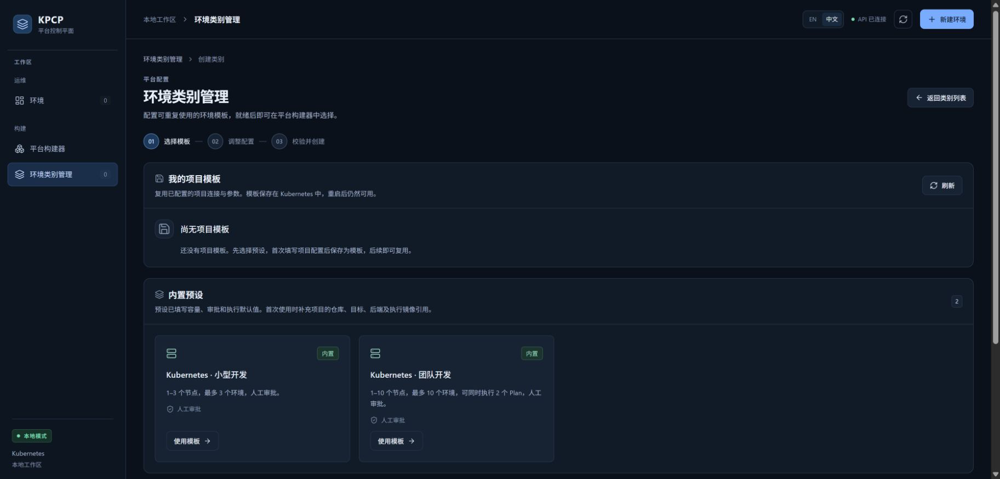

图 03（Historical Evidence）：环境类别内置预设，小型开发与团队开发。

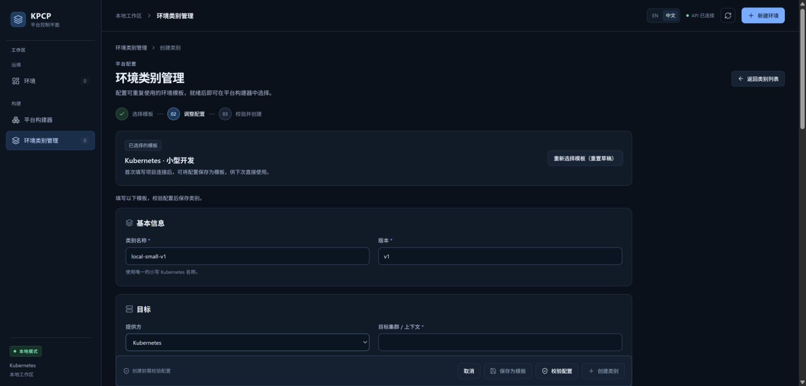

图 04（Historical Evidence）：小型开发表单的基本信息和目标字段。

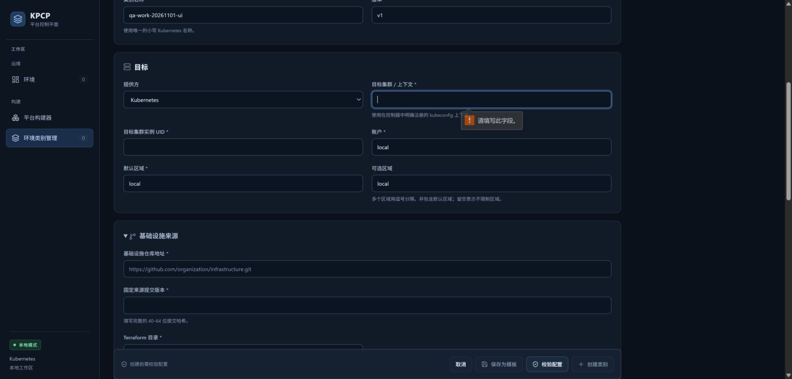

图 05（Historical Evidence）：目标上下文为空时，浏览器必填提示和禁用创建。

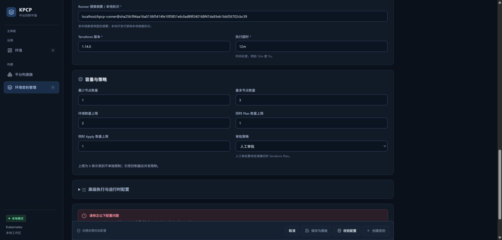

图 06（Historical Evidence）：revision=main 校验失败，创建保持禁用。

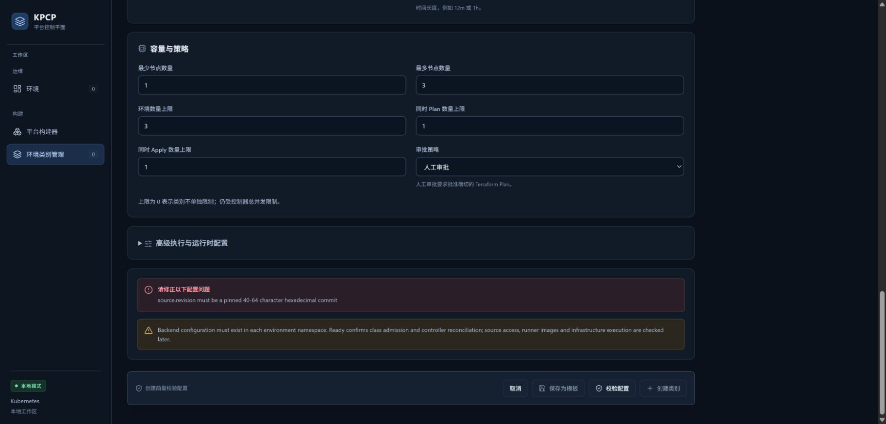

图 07（Historical Evidence）：固定来源版本错误全文；中文模式仍含英文正文。

**图注：** 历史图按原操作顺序引用；来源旧地址不可用于复测执行，应使用本轮独占 DNS 与有效前置环境。

### Step 5 — Historical — Revalidate After a Field Change

**操作：**

1. 将固定来源提交版本改为 547f45475c7186eafd35026fb994f22f26606d6c，点击校验配置。
2. 检查配置校验通过、配置已校验与创建/保存模板启用。
3. 再把版本从 v1 改为 v2-qa。
4. 检查旧校验立即失效、创建前需校验配置和两个按钮重新禁用。

**预期结果：** 修改任何已校验配置后，不能复用旧校验直接创建。

**实际结果：** Historical PASS：固定提交 dry-run 通过，版本修改后要求重新校验。本轮新 Class 另由当前图 01–03 证明。

**Screenshot：**

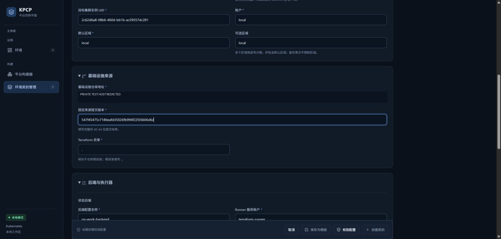

图 08（Historical Evidence）：改用完整固定提交后的来源字段；原私网地址已在既有公开副本遮盖。

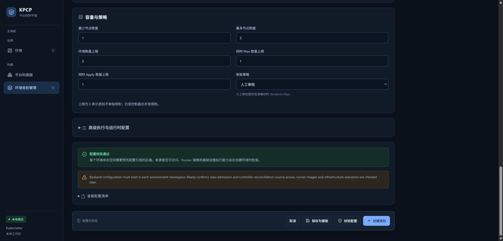

图 09（Historical Evidence）：服务端 dry-run 通过，创建类别启用。

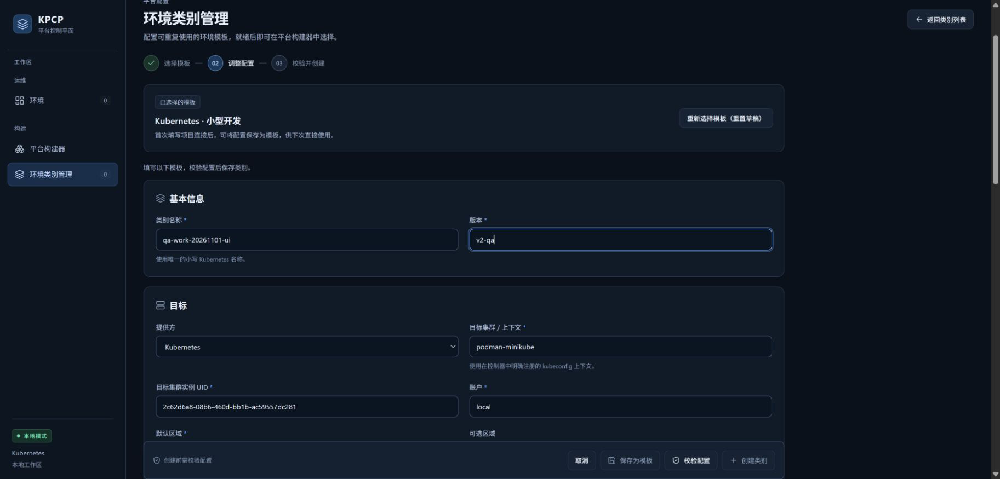

图 10（Historical Evidence）：修改版本后旧校验失效，必须重新校验。

**图注：** 图 08 使用既有公开遮盖副本；图 09/10 对比校验前后按钮状态。

### Step 6 — Historical — Reject Unsupported JSON Shapes

**操作：**

1. 展开高级执行与运行时配置。
2. 模拟器执行配置与模块输入 JSON 输入 {"unexpected":true}，点击校验配置。
3. 核对执行配置仅允许 executionProfile 和 inputs 字段，创建保持禁用。
4. 执行 JSON 恢复 {}，运行时资源 JSON 改为 {}，再次校验。
5. 核对运行时资源必须是资源定义组成的 JSON 数组；[] 才表示空资源数组。

**预期结果：** 未知执行键和错误运行时结构均被拒绝。

**实际结果：** Historical PASS：两条中文错误已分别截图。本轮没有重跑这两条负例，保持其原执行范围。

**Screenshot：**

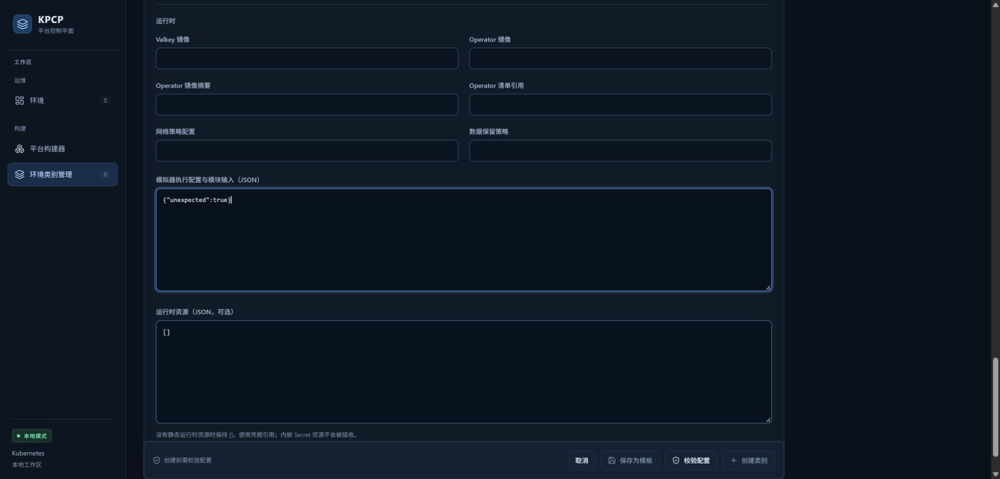

图 11（Historical Evidence）：高级执行 JSON 输入未知键 unexpected。

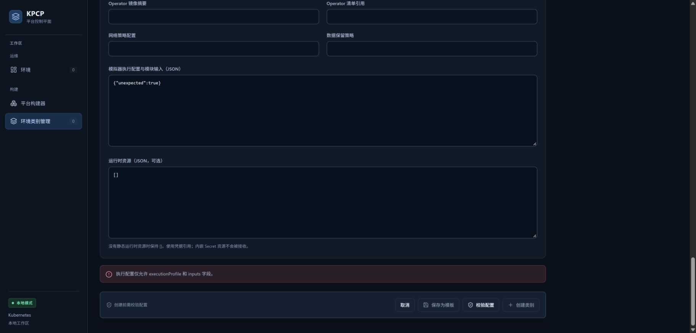

图 12（Historical Evidence）：未知执行字段被中文错误拒绝。

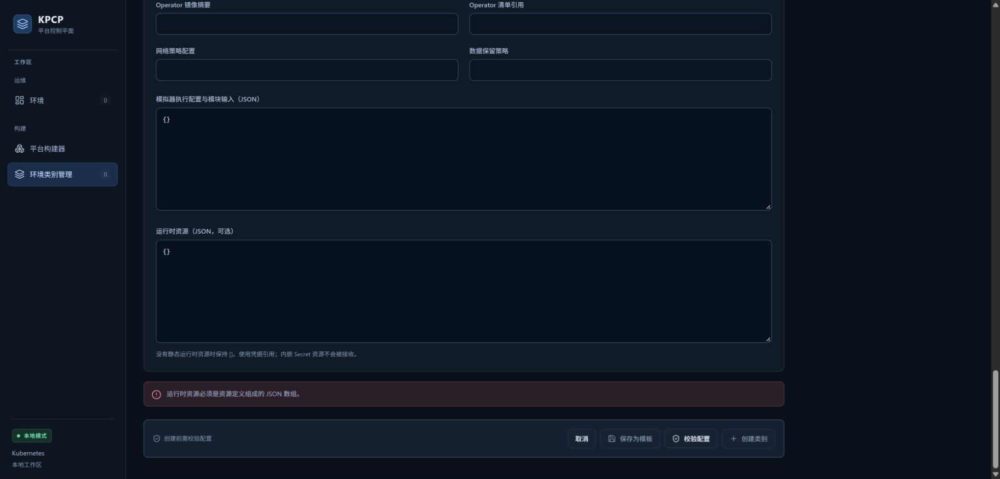

图 13（Historical Evidence）：运行时 JSON 对象被拒绝，要求资源数组。

**图注：** 高级 JSON 输入位置、错误正文与禁用创建状态均由原始真实页面证明。

### Step 7 — Historical — Preview and Cancel Without Persistence

**操作：**

1. 运行时 JSON 恢复 []，连接配置引用填 kubeconfig:podman-minikube。
2. 填入 emulator 执行配置与测试输入后点击校验配置→查看配置清单；旧私有端点已在公开图遮盖，不能据图假设可连接。
3. 检查 YAML 的 approvalPolicy=Manual、固定 Runner、来源提交、目标实例 UID、Backend 及容量。
4. 点击取消并检查可用类别 0；原执行只 dry-run，未持久化或创建资源。

**预期结果：** 预览对应真实 dry-run 配置，取消不保存 Class。

**实际结果：** Historical PASS：YAML 与零类别列表已截图。只有本轮 Current Execution 的 Class 创建达到了 Ready，二者结论分开保留。

**Screenshot：**

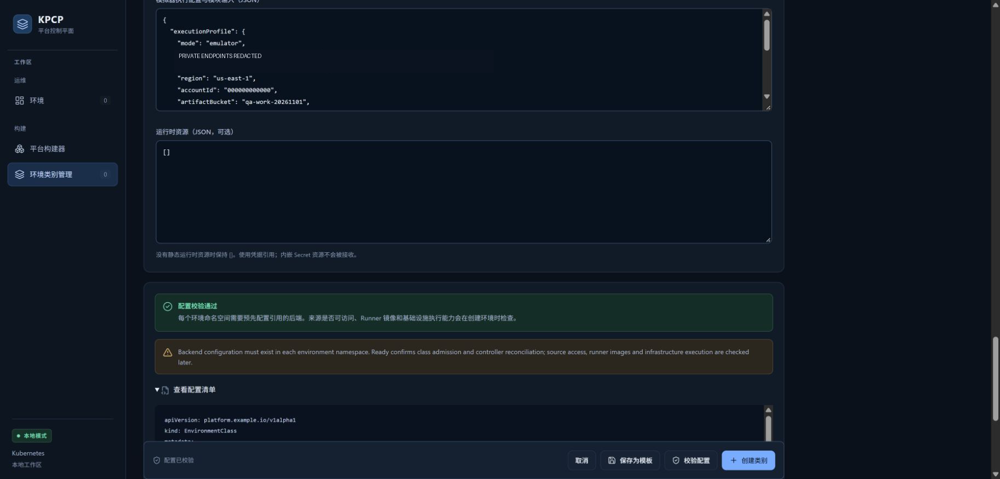

图 14（Historical Evidence）：模拟器执行配置通过 dry-run 并展开配置；既有公开副本已遮盖私有端点。

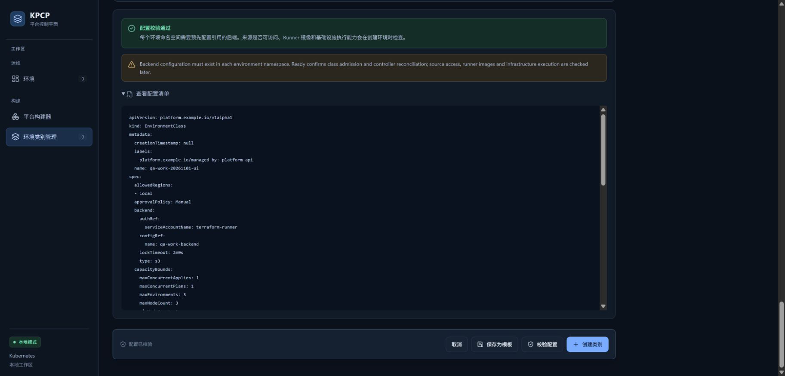

图 15（Historical Evidence）：配置 YAML 上部的名称、人工审批、Backend 与容量限制。

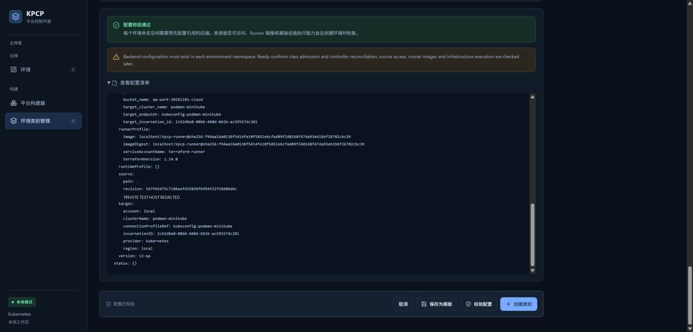

图 16（Historical Evidence）：YAML 的模块输入、Runner、固定来源及目标；既有公开副本已遮盖私网地址。

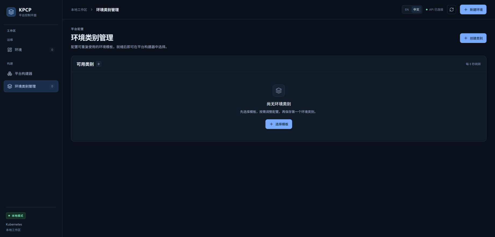

图 17（Historical Evidence）：取消未保存表单后类别列表仍为零。

**图注：** 图 14/16 使用既有公开遮盖副本；图 17 明确历史取消后的零类别，不是本轮 TC14 的删除结果。

## 4. Engineering Evidence

Current Execution：Runner 真实 Pod 对固定 Git revision 的读取、MiniStack 健康请求和 Terraform init 均成功，日志有 QA_PREREQUISITES_OK；仅做 init，未执行 Plan/Apply。专用 Controller /readyz HTTP 200。backend、Secret 和来源服务 UID 登记在本地 ledger；公开收据只保留归属/哈希与状态。Class UID 和 Ready 条件见 class-ready.json。Historical Evidence：原必填、非固定 revision、未知 execution JSON 键、错误 runtime JSON、修改后必须重校验等结果仍属于前一轮，图 03–17 保留；本轮未用历史结果替代新 Class 状态。

本轮独立前置环境、固定模块来源、Runner init 探针、二进制身份和源码差异见[前置环境审查](evidence/TC02/environment-preflight.public.json)。本轮夹具已在 TC14 清理；复测必须重新登记独占 Run ID，不能直接重用已删除引用。

构建和前置环境的范围限制见[本轮审查收据](evidence/TC02/environment-preflight.public.json)，二进制原始构建身份及哈希已保留。

- [本用例状态与截图 SHA-256](evidence/TC02/result.json)
- [Current Execution：class-ready.json](evidence/TC02/class-ready.json)（公开审查投影；原始文件保留本地并记录 SHA-256）

## 5. Actual Result

本轮 Class 从真实表单创建且 Ready，解除前一轮缺少 Ready 类别的阻塞。历史复测指导：留空目标上下文应提示必填；revision=main 应拒绝；填固定提交后通过；修改版本后应禁用创建直到重校验；执行 JSON 输入 {"unexpected":true} 应拒绝；runtime JSON 输入 {} 应拒绝，[] 才是空资源数组；配置清单应显示固定来源、Runner、Manual 策略与目标。旧图按原时间和结论保留。本轮额外声明的 ConfigMap ApplyOnly 策略是产品支持的显式测试策略，不代表 Deployment/Valkey 就绪验收。

## 6. Defects and Blockers

QA-01 本轮仍可复现，见 TC15；本轮不修改语言逻辑。Class Ready 本身只证明准入与协调，Runner 可用性另由真实探针和后续 Plan/Apply 证明。

## 7. Final Verdict

**PASS** — 配置校验历史 PASS 保留；本轮真实创建与 Class Ready 新增验证通过。

## 8. Cleanup / Handoff

Class 保留给 TC03–TC14；不得在本用例结束时删除。probe Job 成功日志已保留后按登记 UID 核对并删除，避免混入 Draft 隔离计数。Class 最终通过真实 UI 精确名称/UID 清理；无 finalizer 强制移除。

以上保留要求是本用例结束时的连续生命周期交接。整个 Run 的最终清理现已完成，见[TC14](TC14_DESTROY_CLEANUP.md)及[最终清理收据](evidence/TC14/final-cleanup.public.json)；没有待清理测试基础设施。
