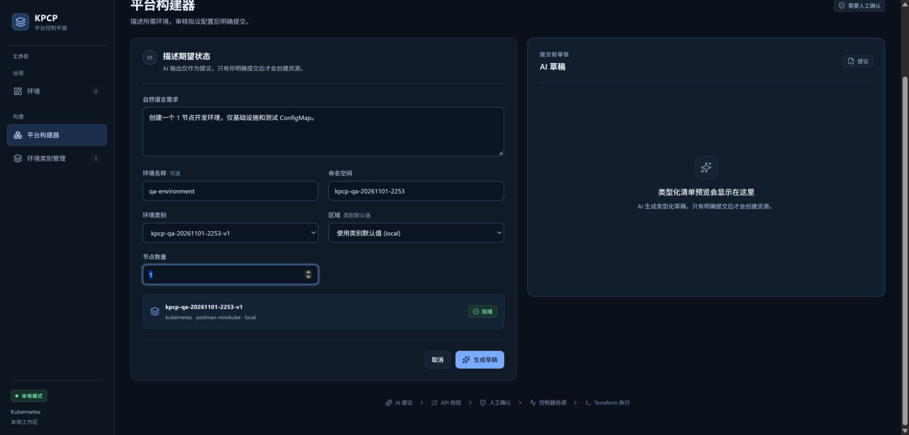
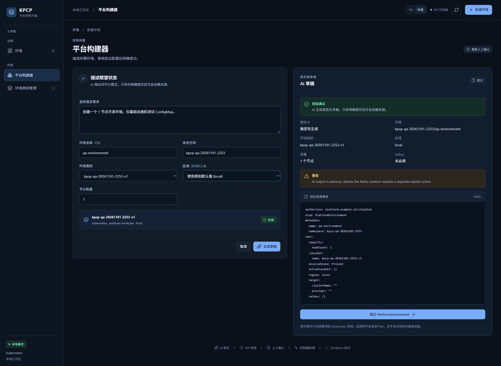
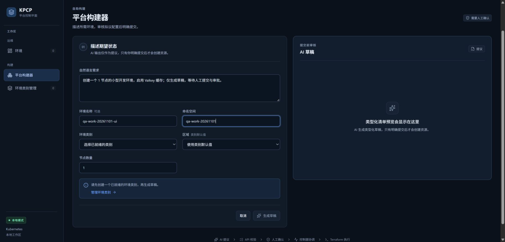
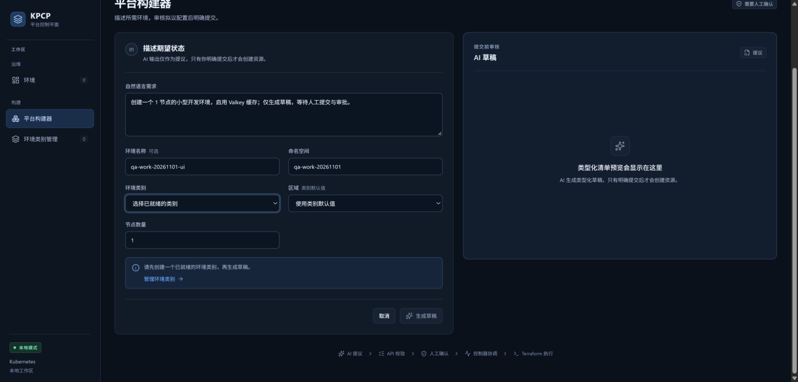
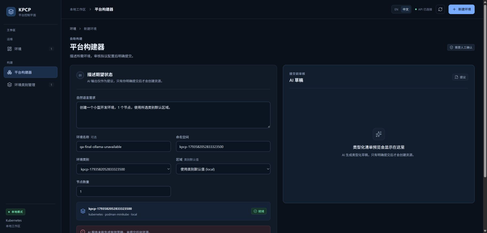
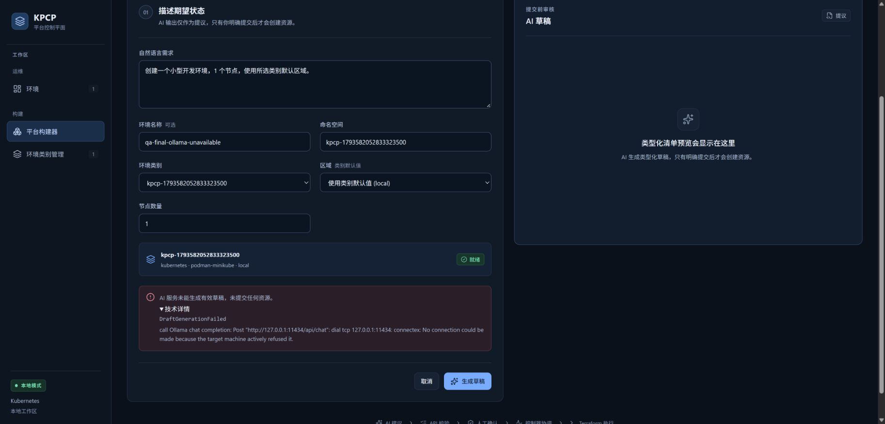
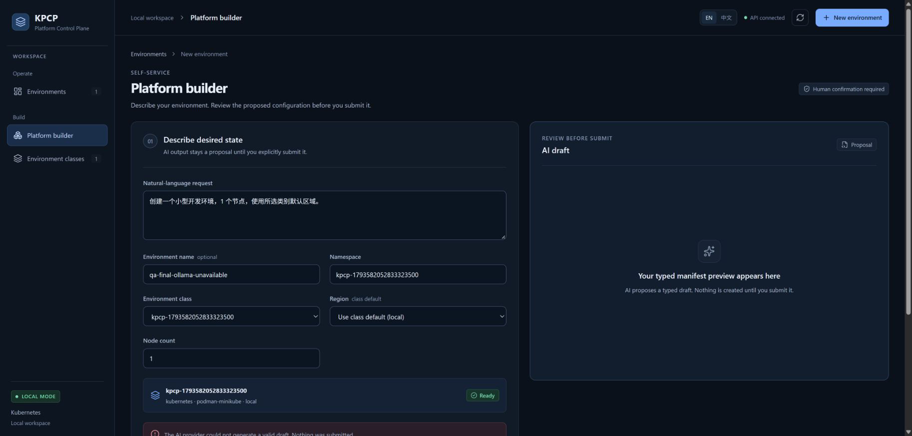

# TC03 — AI Draft

## 1. Test Case Summary

| Field | Value |
|---|---|
| Test ID | TC03 |
| Test Name | AI Draft |
| Priority | P0 |
| Test Type | Manual UI + Engineering Evidence |
| Preconditions | TC02 已通过；Class kpcp-qa-20261101-2253-v1 为 Ready；专用 Controller、固定来源和 Backend 探针成功；位于同一 Tab 3 构建器。 |
| Expected Result | 真实点击生成草稿后，原生 provider 返回通过校验的类型化预览；字段与输入一致，提交仍需独立操作。 |
| Actual Result | 生成成功，提供方显示确定性生成；名称、命名空间、Class、local 区域、1 节点、Valkey 未启用与请求一致；提交按钮独立显示。 |
| Status | PASS |
| Commit | `e40c422327aa648a89d6baabf7268cb3239310d8`（现有 5445a5f 二进制，vcs.modified=true；产品路径差异为空，非本次 clean rebuild） |
| Execution Date | 2026-11-01T23:06:48.357000+13:00 → 2026-11-01T23:06:49.178000+13:00 |
| QA Run ID | `kpcp-qa-20261101-2253` |
| Evidence Scope | Current Execution: real UI + project-native deterministic provider; live LLM quality NOT RUN |

**Historical Evidence：**原 TC03 为 BLOCKED，图 18、19 显示无 Ready 类别；本轮已真正准备 Class 与执行前置条件，新截图证明原生草稿 UI 工作流可执行。历史 BLOCKED 仍保留身份。

## 2. Test Steps

1. 从 Ready Class 点击使用此类别进入构建器。
2. 填写需求、环境名称、命名空间和节点数量。
3. 点击生成草稿。
4. 逐项审核 provider、字段、YAML 和独立提交按钮。

## 3. Detailed Manual Test Guide

### Step 1 — Enter the Draft Request

**操作：**

1. 在 Ready Class 详情点击使用此类别。
2. 自然语言需求填：创建一个 1 节点开发环境，仅基础设施和测试 ConfigMap。
3. 环境名称填 qa-environment，命名空间填 kpcp-qa-20261101-2253。
4. 核对 Class 已选 kpcp-qa-20261101-2253-v1，区域使用类别默认值 local，节点数量 1。

**预期结果：** Class 就绪、生成草稿启用，右侧尚无草稿。

**实际结果：** 字段正确，左侧 Class 卡片显示就绪；生成草稿按钮启用。

**Screenshot：**

**图注：** 完整输入和 Ready Class 卡片可见；此前没有生成结果。

### Step 2 — Generate and Review the Typed Draft

**操作：**

1. 实际点击生成草稿。
2. 检查右侧校验通过。
3. 检查提供方明确为确定性生成；不将其写成 Ollama 或真实 LLM 推理。
4. 核对环境、Class、区域、容量与 Valkey 字段。
5. 核对拟议 PlatformEnvironment YAML 的 metadata.name/namespace、spec.classRef、capacity.nodeCount 和 region。
6. 保留页面，暂不点击提交 PlatformEnvironment，交给 TC04 做隔离核对。

**预期结果：** 原生 API 结果可审核；尚未触发显式提交。

**实际结果：** 预览通过校验；qa-environment、本轮 namespace/Class、local、1 节点、Valkey 未启用；YAML 和提交按钮可见。

**Screenshot：**

**图注：** 全页保留左侧输入、右侧确定性生成身份、校验结果、YAML 和独立提交按钮；是当前产品真实页面。

### Historical Evidence — 原有截图归档引用

以下图片来自前一轮 2026-11-01 21:54–22:03、产品基线 `5445a5f`，不计入本轮截图。保留历史执行事实；含私网地址的三图引用原有遮盖副本。

图注：Historical Evidence，原报告图 18；无 Ready Class 时草稿生成被禁用。原图与公开副本对应关系沿用原有清单。

图注：Historical Evidence，原报告图 19；实际展开类别选择器后无可选项。原图与公开副本对应关系沿用原有清单。

## 4. Engineering Evidence

Current Execution：点击调用实际 QA API 的 /api/drafts，页面 provider=确定性生成，与 /api/health 的 deterministic 配置一致。未调用模型端点，没有页面数据注入。隔离边界的资源前后核对在 TC04 独立记录。Historical Evidence：既有 Go E2E PlatformAPI_DraftAndTemplate 也使用 deterministic；历史记录不替代上述新 UI 证据。

构建和前置环境的范围限制见[本轮审查收据](evidence/TC02/environment-preflight.public.json)，二进制原始构建身份及哈希已保留。

- [本用例状态与截图 SHA-256](evidence/TC03/result.json)

## 5. Actual Result

本用例 PASS 仅对应项目正式支持的原生 deterministic 草稿 UI 工作流、类型化校验和字段显示。现场 Ollama 服务/模型不可用，真实 AI 意图理解与模型质量为 NOT RUN，仍是 Phase 2.5 完整 Freeze 的缺口。默认 Valkey 需求已明确改为本轮固定模块支持的基础设施与 ConfigMap 场景，未冒充 Valkey/Deployment 验收。

## 6. Defects and Blockers

真实模型质量 NOT RUN：缺少 Ollama 服务和模型。中文 advisory warning 仍为英文，归入已打开的 QA-01，见 TC15。没有修改产品代码或禁用校验。

## 7. Final Verdict

**PASS** — 原生 deterministic 真实 UI 草稿路径 PASS；真实 LLM 推理不在此 PASS 范围。

## 8. Cleanup / Handoff

保留同一页的有效 Draft 给 TC04、TC05；不取消、刷新或删除 Class。没有通过 API/脚本代替 UI 生成。

以上保留要求是本用例结束时的连续生命周期交接。整个 Run 的最终清理现已完成，见[TC14](TC14_DESTROY_CLEANUP.md)及[最终清理收据](evidence/TC14/final-cleanup.public.json)；没有待清理测试基础设施。

## 9. 新执行批次 — 真实 Ollama 可用性与安全错误路径

Test Run ID：`kpcp-gates-20261102-0223`。上述 deterministic PASS 与历史截图保持原记录。本批次真实模型质量 **NOT RUN**；不可用错误路径 **PASS**。

前提与来源：实际 provider=`ollama`，请求模型 `phi4-mini:latest`，参数 temperature=0、num_predict=256、num_ctx=4096。最终浏览器复测 API 使用 clean `fd90a8614c6616d9d3514546aaef3840cffa0296` 二进制，`vcs.modified=false`。真实 Ollama `/api/version`、`/api/tags` 拒绝连接；没有服务版本或实际 served model 可报告。PATH/常见安装路径/卸载注册信息未发现 Ollama；`.ollama` junction 指向不存在的 `D:/Ollama/UserData/.ollama`。未下载模型、安装服务或重写配置。

| Required scenario | 本批次结果 | 证据类型 |
|---|---|---|
| 正常小型开发请求、明确容量、含糊意图 | NOT RUN | 模型服务不可用，未发生真实推理 |
| 超出 Class 容量限制 | 实际模型 NOT RUN | Class/typed validation 的 Go 回归不等于模型质量 |
| 非法格式、缺必填字段、未知字段/越权资源 | controlled regression PASS | Go HTTP response fixture，非真实模型输出 |
| 模型 timeout | controlled regression PASS | 测试 HTTP transport，非现场模型超时 |
| 模型不可用 | real unavailable path PASS | 浏览器实际调用 Ollama，连接拒绝，没有 fallback |
| Draft 后不自动 Submit、模型不能绕过审批 | real successful Draft NOT RUN | 历史 deterministic UI 边界及本轮 Go E2E 仍单独有效；不可用路径没有 Draft/Submit |

实际操作（2026-11-02T01:15Z，NZDT 14:15）：

1. 在同一个内置浏览器点击**平台构建器**；选择真实 Ready Class `kpcp-1793582052833323500`。
2. **自然语言需求**输入“创建一个小型开发环境，1 个节点，使用所选类别默认区域。”；**环境名称**填 `qa-final-ollama-unavailable`；**命名空间**填该 QA namespace，**节点数量**为 1。
3. 点击**生成草稿**，观察正在生成后出现中文错误；右侧仍为空草稿，页面没有提交资源的按钮。
4. 展开**技术详情**，检查稳定码 `DraftGenerationFailed` 和完整原始连接错误。
5. 点击 **EN**，核对英文错误且所有输入保持；再切回中文，点击**取消**。
6. 读取实际 Kubernetes 快照：该请求名称及其 `-infra` stack 均不存在。并发 Go E2E 正在创建自己的独立 environment；“无副作用”断言只对应本次 UI 请求名称，未声称全局资源不变。

缺陷及修复：本轮真实不可用路径暴露 AI 错误直接显示英文；`45a5ff5` 引入保留 stable code/original message 的 APIError，前端按码翻译。advisory warning 同样增加明确 `AdvisoryOnly` code，原文保留；正常模型 Draft 的 advisory UI 因模型缺失未复测。5 个 Node 回归、Go console 和最终前端 build PASS。

工程收据：[真实端点错误、模型与请求边界](evidence/final-gates-20261102/ollama-final.public.json)、[clean build 与回归](evidence/final-gates-20261102/clean-build.public.json)、[截图像素/哈希](evidence/final-gates-20261102/new-screenshots.public.json)。

Final Verdict：**真实模型质量 NOT RUN；真实不可用的中英文 UI / Fail-Closed 路径 PASS**。未把 deterministic 或 controlled fixture 输出写成 phi4-mini 推理。未生成/提交本次命名环境，无需清理模型基础设施。

## 10. 2026-11-02 — DeepSeek 真实推理补充

Run ID：`kpcp-deepseek-final-20261102-1644`。真实官方 DeepSeek API 串行调用 DS01–DS07 共 7 次，实际返回 `deepseek-flash`，合计 1,948 tokens，无重试；英文、中文、显式字段、Valkey、含糊意图、Class 超限和 prompt injection 均按各自判定通过。

这次是 generator API 证据，不是浏览器 UI 执行。内置 Browser 在取得当前标签页信息后，控制调用和一次受控重连均报 `browser.user is unavailable`；本轮没有打开 Builder、读取 Draft DOM、操作 Submit、切换语言或保存 PNG。共享旧 API 的 health 返回 provider `ollama`，因此不作为 DeepSeek 页面验收。

- [逐 Case 语义结果](DEEPSEEK_LIVE_VALIDATION.md)
- [安全原始日志及 SHA-256](evidence/deepseek-final-20261102/deepseek-live.public.json)
- [浏览器原始预检](evidence/deepseek-final-20261102/browser-preflight.public.json)

本节结论：**真实 DeepSeek Draft intent 子集 PASS；DeepSeek UI / Screenshot BLOCKED。** 历史 deterministic UI PASS 和 Ollama 不可用 UI PASS 均保持原来的运行身份，不扩展到本轮。

## 11. PR #3 后独立验收批次 — 2026-11-02

Run ID：`kpcp-final-20261102-1815`。当前聊天新建的 Desktop Work 内置 Browser tab 1，先实际读取 `https://example.com/` 的标题 `Example Domain` 和 AX，再访问原 `5173` 并保存真实 JPEG；没有接管旧聊天标签页。新的 QA 页面为 `http://127.0.0.1:5174/#builder`，Vite `/api` 指向独立 `8091`，health 实际返回 `aiProvider=deepseek`。旧 `5173/8090` 保留。

成功 Draft 使用 clean backend `f8c307fd6555ff118249f667dd2833d41f650e76`，`vcs.modified=false`。配置模型 `deepseek-flash`；成功产品 API 不暴露 served model/token usage，本轮不把历史 1,948 tokens 当作新 UI 用量。共两次真实收费请求，未重跑 DS01–DS07。错误本地化复测是停止本轮专属 API 后的真实连接失败，没有第三次模型调用。

| Step | 操作与预期 | 实际结果 | 状态 / 真截图 |
|---|---|---|---|
| UI01 | 打开 Builder；实际 Ready Class 可选、草稿为空 | Controller 协调后的专属 Class Ready，页面显示人工确认边界 | PASS；[初始中文](screenshots/final-acceptance-20261102/01-builder-initial-zh.jpg) |
| UI02 | 英文请求、名称、专属 namespace、2 个节点 | 实际页面输入与选择均保留；请求明确 Do not enable Valkey | PASS；[请求参数](screenshots/final-acceptance-20261102/02-request-parameters-en.jpg) |
| UI03 | 点击 Generate Draft，否定缓存请求应保持关闭 | 首次显示 DeepSeek / Validated，却错误启用 Valkey；本地 phrase matcher 把否定句中的 enable valkey 当成肯定 | **首次 FAIL 保留**；[原始错误](screenshots/final-acceptance-20261102/03-first-draft-semantic-failure.jpg) |
| UI04 | 最小修复后，第二次从真实页面生成 | DeepSeek；环境/namespace/Class/local/2 nodes 正确；Valkey Disabled；YAML 为 `valkey: {}`，容量在 Class 1–3 约束内 | PASS；[Provider / Typed Intent / YAML](screenshots/final-acceptance-20261102/04-fixed-draft-provider-yaml-en.jpg) |
| UI05 | 切换中文并检查 Warning、独立 Submit | 字段值及英文请求保持；Advisory 中文正确；提交按钮独立存在并未点击 | PASS；[中文 Warning / No Submit](screenshots/final-acceptance-20261102/05-fixed-draft-warning-submit-zh.jpg) |
| UI06 | 专属 API 停止时，错误应本地化、无模型调用 | 首次直接显示 502 Bad Gateway | **首次 FAIL 保留**；[错误原态](screenshots/final-acceptance-20261102/06-api-outage-unlocalized-before-fix.jpg) |
| UI07 | 修复 transport error 分类后复测 EN/ZH | 显示本地 API 不可用 / Nothing was submitted；技术详情保留 `APIUnavailable` 和原始 `502 Bad Gateway`；输入保持、无 Draft/Submit | PASS；[中文详情](screenshots/final-acceptance-20261102/07-api-outage-technical-zh.jpg)、[英文详情](screenshots/final-acceptance-20261102/08-api-outage-technical-en.jpg) |

每张图均为本轮实际 Browser capture，未加工或替代；Run ID、backend SHA、逐图 SHA-256 与资源快照计数见[本轮 UI 收据](evidence/final-acceptance-20261102/deepseek-ui.public.json)。错误复测前端为同批提交的可审查增量源码；最终 clean regression 另行记录。

No-Submit：两次 Draft 前后 `PlatformEnvironment=0 / InfraStack=0 / TerraformRun=0`。唯一 Job 是终端独立创建、明确归属的 `runner-preflight`，其 UID 单独记录；未将它归因于 Draft，也未把全局 Job 数写成零。没有创建 `qa-deepseek-ui` 或其 stack。首次失败、针对否定句的 red→green 单测及初始截图见[原始批次收据](evidence/final-acceptance-20261102/browser-initial.public.json)。

**本批次结论：DeepSeek Browser UI PASS（两项最小修复后）。** 原七条语义调用与旧 Browser BLOCKED 保持历史身份；本轮没有 Submit、审批或 UI 生命周期声明。专属 Class 和支撑服务的最终清理见本轮总收据。
