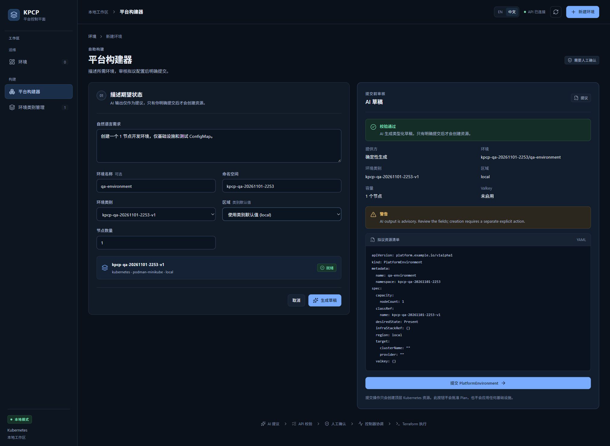

# TC04 — Draft Isolation

## 1. Test Case Summary

| Field | Value |
|---|---|
| Test ID | TC04 |
| Test Name | Draft Isolation |
| Priority | P0 |
| Test Type | Manual UI + Engineering Evidence |
| Preconditions | TC03 已生成有效 Draft，尚未点击提交；本轮专用 Controller 正常运行；生成前的 Kubernetes/S3 清单已保存。 |
| Expected Result | 生成与审核 Draft 不创建 PlatformEnvironment、InfraStack、TerraformRun、Apply Job、运行时对象或 Terraform 云资源。 |
| Actual Result | 生成前后业务资源与 Job 均为 0；本轮 artifact fixture bucket 保持一只，cloud bucket 不存在；UI 仍保留独立提交按钮和环境数 0。 |
| Status | PASS |
| Commit | `e40c422327aa648a89d6baabf7268cb3239310d8`（现有 5445a5f 二进制，vcs.modified=true；产品路径差异为空，非本次 clean rebuild） |
| Execution Date | 2026-11-01T23:06:32.132837+13:00 → 2026-11-01T23:08:33.809957+13:00 |
| QA Run ID | `kpcp-qa-20261101-2253` |
| Evidence Scope | Current Execution: generated native draft with active Controller; before/after resource comparison |

**Historical Evidence：**原 TC04 为 BLOCKED，因为没有真实 Draft；本轮已在活动 Controller 和有效 Class 前提下生成，再做前后只读比较，属于新执行。

## 2. Test Steps

1. 保存生成前清单。
2. 生成并审核 Draft，保持不提交。
3. 保存生成后清单并比较。
4. 保留有效 Draft 给 Submit。

## 3. Detailed Manual Test Guide

### Step 1 — Keep the Draft Unsubmitted

**操作：**

1. 延续 TC03 的同一 Draft，不离开页面。
2. 检查右侧校验通过、确定性生成身份及拟议 YAML。
3. 确认提交 PlatformEnvironment 按钮仍可见，整个隔离检查期间不点击它。
4. 观察左侧环境计数仍为 0。

**预期结果：** 页面是提议状态，没有顶层环境持久化。

**实际结果：** 审核后的真实 Draft 保持在页面中，环境计数 0，提交按钮独立存在。

**Screenshot：**

**图注：** 当前有效 Draft 与未点击的提交按钮、左侧环境计数同屏保留。

### Step 2 — Compare the Real Resource Inventories

**操作：**

1. 对比本轮 before-draft 与 after-draft 的只读清单。
2. 检查 PlatformEnvironment、InfraStack、TerraformRun、ChangeApproval、ResourceSet 和 Job 的数量。
3. 检查本轮 qa-runtime ConfigMap 未创建。
4. 核对 artifact fixture bucket 仍存在而 -cloud 资源桶未出现。

**预期结果：** 仅已登记的前置资源存在，生成草稿不会触发执行。

**实际结果：** 业务资源与 Job 均为 0；cloud bucket 不存在；前后数量一致，比较收据保留原始清单 SHA-256。

**Screenshot：**

本步骤没有本轮对应状态截图；按实际执行范围记录，不以历史图片替代。

**图注：** 这一断言由真实 Kubernetes/S3 收据支持，页面图只证明未提交状态，不能独立证明无副作用。

## 4. Engineering Evidence

Current Execution：[隔离比较收据](evidence/TC04/isolation-comparison.public.json) 与本用例 before/after 清单投影。底层原始清单保留受控目录，公开文件记录 SHA-256。对应 Gate E：草稿与执行边界。Historical Evidence：Go E2E PlatformAPI_DraftAndTemplate 的历史无执行断言保留原身份，本轮 PASS 基于新 UI 调用和新清单。

构建和前置环境的范围限制见[本轮审查收据](evidence/TC02/environment-preflight.public.json)，二进制原始构建身份及哈希已保留。

- [本用例状态与截图 SHA-256](evidence/TC04/result.json)
- [Current Execution：after-draft.json](evidence/TC04/after-draft.json)（公开审查投影；原始文件保留本地并记录 SHA-256）
- [Current Execution：before-draft.json](evidence/TC04/before-draft.json)（公开审查投影；原始文件保留本地并记录 SHA-256）

## 5. Actual Result

这是在真正活动 Controller、Ready Class 和可用基础设施前提下的隔离验证，已排除上一轮仅填写表单而没有 Draft 的证据缺口。探针 Job 在基线前已成功并正常删除，未把其数量混入 Terraform Job。

## 6. Defects and Blockers

本用例未发现自动创建或自动执行。真实模型质量仍未运行，但不影响草稿持久化边界的当前断言。

## 7. Final Verdict

**PASS** — 实际生成与审核 Draft 后，没有新业务资源、Job 或云资源，隔离边界 PASS。

## 8. Cleanup / Handoff

保持 Draft、Class、namespace、backend、artifact bucket、Controller 和来源服务供 TC05–TC14 使用，不清理共享生命周期状态。

以上保留要求是本用例结束时的连续生命周期交接。整个 Run 的最终清理现已完成，见[TC14](TC14_DESTROY_CLEANUP.md)及[最终清理收据](evidence/TC14/final-cleanup.public.json)；没有待清理测试基础设施。
