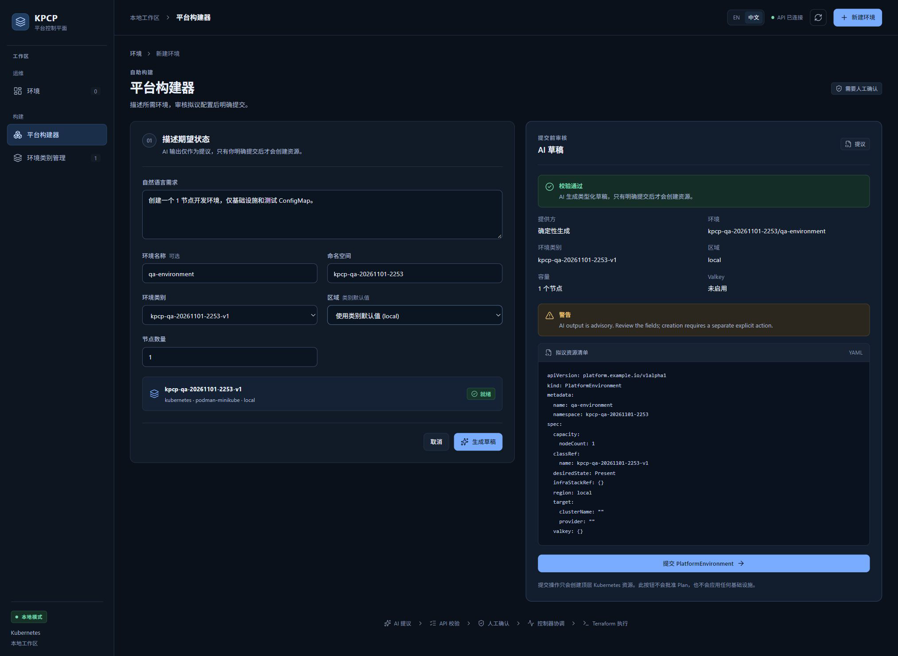
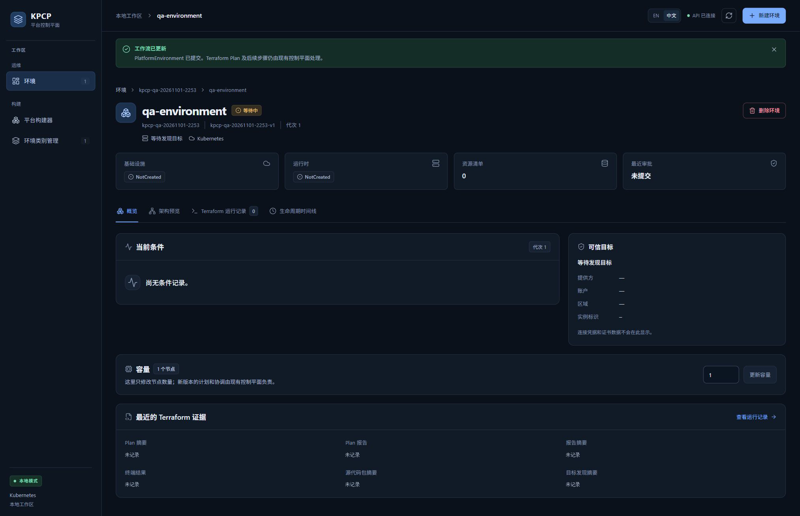

# TC05 — Environment Submit

## 1. Test Case Summary

| Field | Value |
|---|---|
| Test ID | TC05 |
| Test Name | Environment Submit |
| Priority | P0 |
| Test Type | Manual UI + Engineering Evidence |
| Preconditions | TC03 有效 Draft 与 TC04 隔离检查通过；使用同一个页面、Class、namespace 和 Controller。 |
| Expected Result | 仅在显式提交后创建唯一 PlatformEnvironment；名称、Class、region、capacity 与已审核草稿一致，不自动审批。 |
| Actual Result | 真实点击提交后进入 qa-environment 详情，左侧环境数由 0 变 1，namespace/Class 正确，generation=1，最近审批未提交。 |
| Status | PASS |
| Commit | `e40c422327aa648a89d6baabf7268cb3239310d8`（现有 5445a5f 二进制，vcs.modified=true；产品路径差异为空，非本次 clean rebuild） |
| Execution Date | 2026-11-01T23:09:03.672000+13:00 → 2026-11-01T23:09:24.204250+13:00 |
| QA Run ID | `kpcp-qa-20261101-2253` |
| Evidence Scope | Current Execution |

**Historical Evidence：**原 TC05 为 BLOCKED；本轮在已验证前置条件和有效 Draft 上实际完成提交，没有借用旧 API 对象。

## 2. Test Steps

1. 复核有效 Draft 的字段和 YAML。
2. 登记环境名称、命名空间与清理归属。
3. 点击提交 PlatformEnvironment。
4. 检查环境详情、generation 和真实 UID。

## 3. Detailed Manual Test Guide

### Step 1 — Review the Explicit Submit Action

**操作：**

1. 延续 TC04 的有效草稿。
2. 核对环境 qa-environment、本轮 namespace、Class、local、1 节点和 Valkey 未启用。
3. 检查底部说明：提交只创建顶层资源，不批准 Plan 或直接 Apply。
4. 在本地 ledger 登记本轮环境身份与 TC12–TC14 清理责任。

**预期结果：** 审核的是同一条已通过隔离检查的草稿。

**实际结果：** 提供方、字段、YAML 和独立提交按钮均存在；提交前未发现业务执行。

**Screenshot：**

**图注：** 全页保留 Draft 身份、YAML、唯一提交按钮和提交边界说明。

### Step 2 — Submit and Inspect the New Environment

**操作：**

1. 实际点击提交 PlatformEnvironment。
2. 等待跳转详情。
3. 检查 qa-environment、namespace kpcp-qa-20261101-2253、Class kpcp-qa-20261101-2253-v1 和代次 1。
4. 核对最近审批未提交、资源清单 0，以及提交成功提示。
5. 从真实 Kubernetes 只读收据记录新对象 UID，供后续更新、删除和 finalizer 追溯。

**预期结果：** 新的顶层环境对象出现，后续由 Controller 协调。

**实际结果：** 环境数 1，详情正确；初始基础设施和运行时为 NotCreated，最近审批未提交。随后 Controller 自动生成 Plan，另在 TC06 验收。

**Screenshot：**

**图注：** 提交成功横幅、唯一环境名、namespace、Class、generation、未审批状态和详情标签同屏。

## 4. Engineering Evidence

Current Execution：after-submit.json 含真实 PlatformEnvironment UID/spec、派生 InfraStack/ResourceSet 和 Controller 生成的 Plan/Job；业务操作只通过浏览器按钮完成。新的 UID 回填本轮 ledger。与 TC04 前后清单对比，顶层对象是在明确点击后才出现。

构建和前置环境的范围限制见[本轮审查收据](evidence/TC02/environment-preflight.public.json)，二进制原始构建身份及哈希已保留。

- [本用例状态与截图 SHA-256](evidence/TC05/result.json)
- [Current Execution：after-submit.json](evidence/TC05/after-submit.json)（公开审查投影；原始文件保留本地并记录 SHA-256）

## 5. Actual Result

提交本身通过。页面初始 NotCreated 是观察到的瞬时状态，后续正常协调为 Plan，不把初始截图解释为最终失败或已 Ready。没有直接调用提交 API 或手动构造环境对象。

## 6. Defects and Blockers

本用例未发现提交字段漂移或隐式审批。Controller 的短暂 optimistic-conflict 重试保留在本地原始日志；后续已正常生成 Plan，不据此伪报产品失败。

## 7. Final Verdict

**PASS** — 当前真实 UI 显式提交与顶层对象身份核对 PASS。

## 8. Cleanup / Handoff

保持本轮环境与所有前置资源，继续 TC06–TC14。不得在本用例结束后删除或重新生成环境。

以上保留要求是本用例结束时的连续生命周期交接。整个 Run 的最终清理现已完成，见[TC14](TC14_DESTROY_CLEANUP.md)及[最终清理收据](evidence/TC14/final-cleanup.public.json)；没有待清理测试基础设施。
