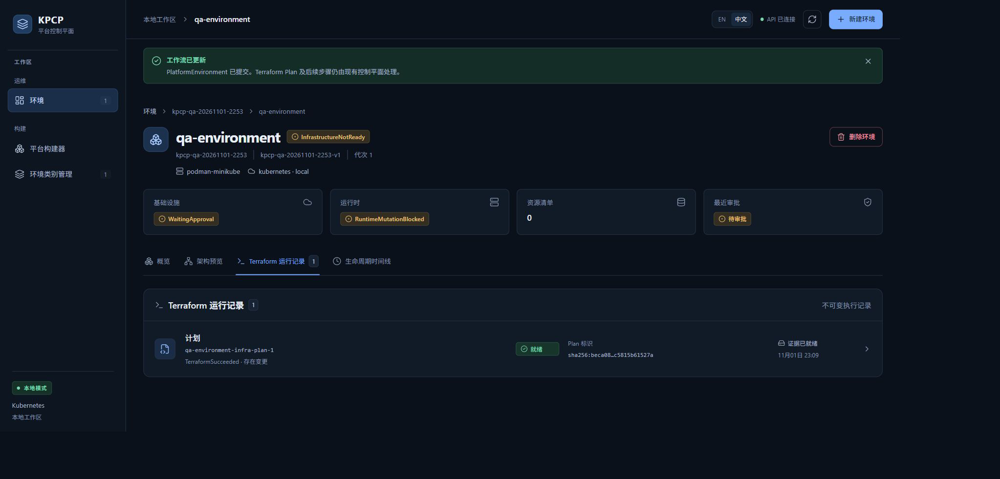
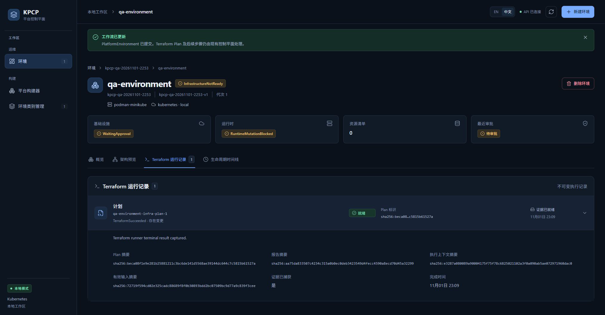
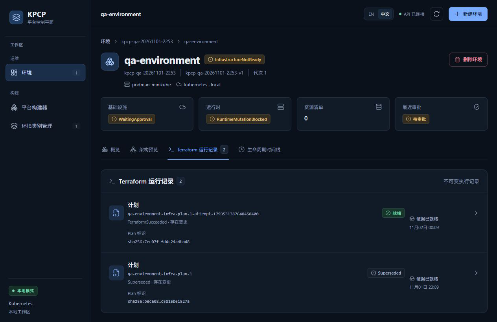

# TC06 — Terraform Plan

## 1. Test Case Summary

| Field | Value |
|---|---|
| Test ID | TC06 |
| Test Name | Terraform Plan |
| Priority | P0 |
| Test Type | Manual UI + Engineering Evidence |
| Preconditions | TC05 已明确提交本轮环境；固定 HCL、来源服务、Backend/Artifact 路由和专用 Controller 正常。 |
| Expected Result | Controller 自动生成不可变 Plan 和真实 Runner Job；Plan 有变更且证据完整；摘要、Run/Job 身份与产物一致。 |
| Actual Result | 首次 Plan 成功，5 类产物摘要相符；等待期间该 Plan 过期变为 Superseded，Controller 自动生成新 attempt，新的 ChangesPresent Plan 也有 5/5 摘要相符，尚未审批。 |
| Status | PASS |
| Commit | `e40c422327aa648a89d6baabf7268cb3239310d8`（现有 5445a5f 二进制，vcs.modified=true；产品路径差异为空，非本次 clean rebuild） |
| Execution Date | 2026-11-01T23:10:07.629000+13:00 → 2026-11-02T00:43:25.276570+13:00 |
| QA Run ID | `kpcp-qa-20261101-2253` |
| Evidence Scope | Current Execution |

**Historical Evidence：**原 TC06 为 BLOCKED。本文件所有新截图和产物摘要来自本轮共享生命周期；历史 799 秒 Go E2E 只作另外的工程追溯。

## 2. Test Steps

1. 打开本轮环境的 Terraform 运行记录。
2. 展开成功 Plan，核对上下文、输入与报告摘要。
3. 只读取回五类产物，计算 SHA-256。
4. 如过期，保留 Superseded 记录并选择 Controller 新建的有效 attempt。

## 3. Detailed Manual Test Guide

### Step 1 — Inspect the Generated Plan

**操作：**

1. 在 qa-environment 详情点击 Terraform 运行记录。
2. 查找 qa-environment-infra-plan-1。
3. 核对 TerraformSucceeded、存在变更、就绪和证据已就绪。
4. 展开该运行记录，查看 Plan、报告、执行上下文及有效输入摘要。

**预期结果：** 显示真实 Runner 终端结果与完整不可变证据。

**实际结果：** 首次 Plan 成功，Plan digest 为 sha256:beca08f1e9e281b25881211c3bc6de141d5568ae39144dc644c7c5815b61527a；四类摘要、已捕获证据和完成时间可见。

**Screenshot：**

**图注：** 运行列表与展开后的摘要来自当时真实成功 Plan，不标为仍在运行。

### Step 2 — Verify Artifacts and Runtime Identity

**操作：**

1. 在受控目录保留 Plan binary、source bundle、backend snapshot、plan report、terminal result 原字节。
2. 对照 TerraformRun status 中的五个预期摘要计算 SHA-256。
3. 核对 terminal terraformRunUID/jobUID 与 Kubernetes 真实 Run/Job；核对 Pod imageID 为固定 Runner digest。
4. 公开文档只提交经过审查的身份和摘要，原始 backend/源码包/日志不上传。

**预期结果：** 五类摘要与 Run/Job/镜像身份匹配。

**实际结果：** 两次成功 Plan 均为 5/5 摘要匹配，终端身份与 Job owner UID 一致；当前 Runner imageID 为既定 f94aa16a… digest。

**Screenshot：**

本步骤没有本轮对应状态截图；按实际执行范围记录，不以历史图片替代。

**图注：** 逐字节证明由本用例公开摘要收据支持，原始材料留本地。

### Step 3 — Handle Plan Expiration Without Reusing It

**操作：**

1. 继续任务前重新检查当前 Plan outcome 和 expiresAt。
2. 保留旧 Plan 的 UID/digest，不修改或覆盖它。
3. 检查 Controller 新建 attempt 的不同 UID、成功状态和证据就绪。
4. 将新的有效 Plan 交给 TC07–TC09。

**预期结果：** 过期 Plan 不再被批准；新 attempt 独立保存。

**实际结果：** 旧 UID ed10d459-93ee-4882-95d7-b8a049b3130c 为 Superseded；当前 UID 6dcf21e3-322d-43e0-864a-50d8dad6aa62 为 ChangesPresent，digest sha256:7ec07f2c9f1e747a07f86d089a664bc8d42fb844a27fd990ac09fddc24a4bad8，过期时间 2026-11-02 01:10:25 NZDT。

**Screenshot：**

**图注：** 新 Plan 与 Superseded 旧 Plan 同时存在，显示 Controller 新建 attempt，未覆盖原记录。

## 4. Engineering Evidence

Current Execution：plan-generated.json 与 replacement-plan-valid.json；两个 *-artifacts.public.json 记录 5 类 SHA-256、Run UID、Job UID、owner UID、真实 Pod imageID。当前有效 Plan Job UID 为 bc609e4c-45c3-4c61-8cc9-0b3cd761d2c2。对应 Gate B 和过期准入边界；本轮未注入篡改，也未重启 Controller。

构建和前置环境的范围限制见[本轮审查收据](evidence/TC02/environment-preflight.public.json)，二进制原始构建身份及哈希已保留。

- [本用例状态与截图 SHA-256](evidence/TC06/result.json)
- [Current Execution：plan-generated.json](evidence/TC06/plan-generated.json)（公开审查投影；原始文件保留本地并记录 SHA-256）
- [Current Execution：replacement-plan-valid.json](evidence/TC06/replacement-plan-valid.json)（公开审查投影；原始文件保留本地并记录 SHA-256）

## 5. Actual Result

真实固定模块 Plan 已生成且可追溯。初次 UI 截图在 2026-11-01，新 attempt 复核在 2026-11-02，同属同一 QA Run ID，时间身份分别保留。旧 Plan 因等待自然过期，Controller 自动替换；审批将使用新 attempt，而非历史或过期产物。

## 6. Defects and Blockers

未发现 Plan 产物完整性或生成缺陷。等待导致的 Superseded 是实际失效状态，已据此选择新 Plan；没有减弱有效期检查。跨集群、KMS/versioning 与全部故障矩阵仍未执行。

## 7. Final Verdict

**PASS** — 真实 Plan 生成、五类摘要和不可变 attempt 追溯 PASS。

## 8. Cleanup / Handoff

保留两份 Plan 和原始产物；当前有效 attempt 留给 TC07–TC09。最后正常 Destroy 前持续保留 source/backend/terminal closure，不手动删除运行记录或 finalizer。

以上保留要求是本用例结束时的连续生命周期交接。整个 Run 的最终清理现已完成，见[TC14](TC14_DESTROY_CLEANUP.md)及[最终清理收据](evidence/TC14/final-cleanup.public.json)；没有待清理测试基础设施。
