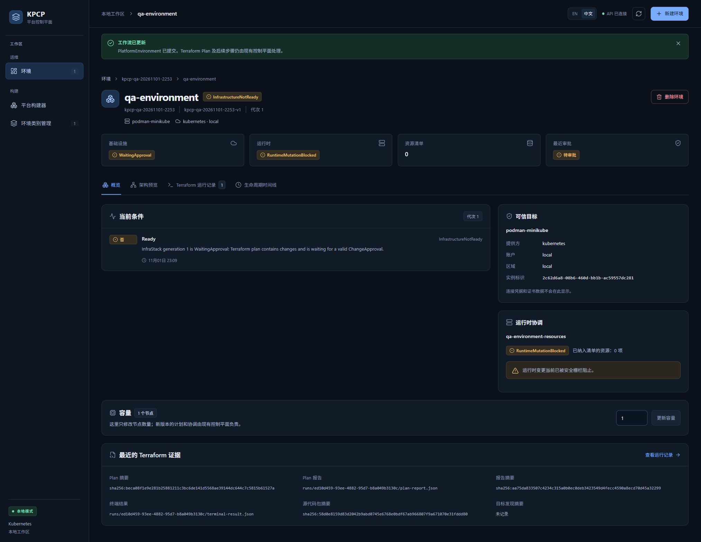
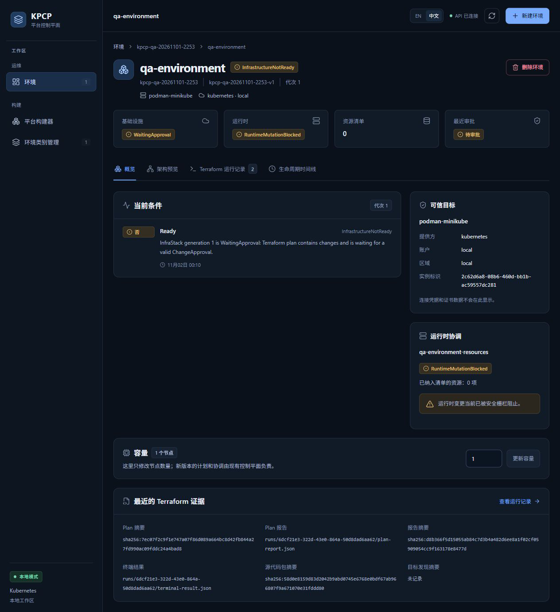

# TC07 — Approval Gate

## 1. Test Case Summary

| Field | Value |
|---|---|
| Test ID | TC07 |
| Test Name | Approval Gate |
| Priority | P0 |
| Test Type | Manual UI + Engineering Evidence |
| Preconditions | TC06 的最新 Plan 为 ChangesPresent 且证据齐全，仍在有效期内；本轮 Controller 活跃；尚无 ChangeApproval。 |
| Expected Result | 未审批时保持 WaitingApproval，不能出现 Apply Run/Job、运行时变更或实际云资源。 |
| Actual Result | 两次 UI 观察均为 WaitingApproval、RuntimeMutationBlocked、资源数 0、待审批；只读证据为 Apply Run=0、Apply Job=0、审批=0，qa-runtime 与 cloud bucket 均不存在。 |
| Status | PASS |
| Commit | `e40c422327aa648a89d6baabf7268cb3239310d8`（现有 5445a5f 二进制，vcs.modified=true；产品路径差异为空，非本次 clean rebuild） |
| Execution Date | 2026-11-01T23:12:45.300000+13:00 → 2026-11-02T00:44:56.833000+13:00 |
| QA Run ID | `kpcp-qa-20261101-2253` |
| Evidence Scope | Current Execution |

**Historical Evidence：**原 TC07 为 BLOCKED；本轮在真实有变更 Plan 上验证，旧的历史零资源状态未被当成新证据。

## 2. Test Steps

1. 打开有效 Plan 对应环境概览。
2. 保持未审批，检查运行时阻止状态。
3. 只读检查 Apply、审批与云资源不存在。
4. 将相同有效 Plan 交给 TC08、TC09。

## 3. Detailed Manual Test Guide

### Step 1 — Observe the Unapproved Environment

**操作：**

1. 进入本轮 qa-environment→概览。
2. 核对基础设施 WaitingApproval、运行时 RuntimeMutationBlocked、最近审批待审批。
3. 检查资源清单为 0，Ready 条件说明需要有效 ChangeApproval。
4. 在本步骤不点击批准此确切 Plan。

**预期结果：** 有变更的 Plan 被审批门控阻止，运行时未应用。

**实际结果：** 上述状态完整可见；第一次在 11-01 原 Plan 上观察，第二次在 11-02 新有效 attempt 上复核，均未审批。

**Screenshot：**

**图注：** 导航、环境身份、WaitingApproval、RuntimeMutationBlocked、资源 0 与待审批一并保留。

### Step 2 — Verify No Apply or Runtime Side Effects

**操作：**

1. 对同一命名空间读取 TerraformRun、Job 和 ChangeApproval。
2. 检查 operation=Apply 记录及 Apply Job 数量均为 0。
3. 检查 qa-runtime ConfigMap 不存在。
4. 读取模拟器桶清单，确认本轮 -cloud 桶不存在。
5. 记录最新 Plan UID 与 outcome，避免把 Superseded Plan 当成当前有效 Plan。

**预期结果：** 没有未批准的基础设施或运行时执行。

**实际结果：** no-apply.public.json 的三项数量均为 0；运行时与云桶均不存在，当前 Plan outcome=ChangesPresent，旧记录为 Superseded。

**Screenshot：**

本步骤没有本轮对应状态截图；按实际执行范围记录，不以历史图片替代。

**图注：** 无副作用结论依据当前只读收据；仅没有 Apply 按钮不足以证明此结论。

## 4. Engineering Evidence

Current Execution：[无 Apply 收据](evidence/TC07/no-apply.public.json) 与 unapproved-current-plan.json。对应 Gate A/E；实际 Controller 运行期间，含一次自然过期和新 attempt，仍没有审批前 Apply。Historical Evidence：错误 UID/digest/input/report/context 的五类负例在既有 Go E2E，本轮没有伪称重做。

构建和前置环境的范围限制见[本轮审查收据](evidence/TC02/environment-preflight.public.json)，二进制原始构建身份及哈希已保留。

- [本用例状态与截图 SHA-256](evidence/TC07/result.json)
- [Current Execution：unapproved-current-plan.json](evidence/TC07/unapproved-current-plan.json)（公开审查投影；原始文件保留本地并记录 SHA-256）

## 5. Actual Result

本轮真正存在可审批、有变更且证据完整的 Plan；在批准前，执行与运行时始终未发生。截图和资源清单分别支撑 UI 与控制面事实。

## 6. Defects and Blockers

本用例未发现审批前执行。完整错误身份、账户、目标与 discovery/fence 负例矩阵未全部重跑。

## 7. Final Verdict

**PASS** — 当前未审批无 Apply 的门控 PASS。

## 8. Cleanup / Handoff

不删除 Plan、环境或来源；将最新有效 Plan 留给 TC08、TC09。旧 Superseded 记录和原始证据保留，最终 TC14 正常清理。

以上保留要求是本用例结束时的连续生命周期交接。整个 Run 的最终清理现已完成，见[TC14](TC14_DESTROY_CLEANUP.md)及[最终清理收据](evidence/TC14/final-cleanup.public.json)；没有待清理测试基础设施。
