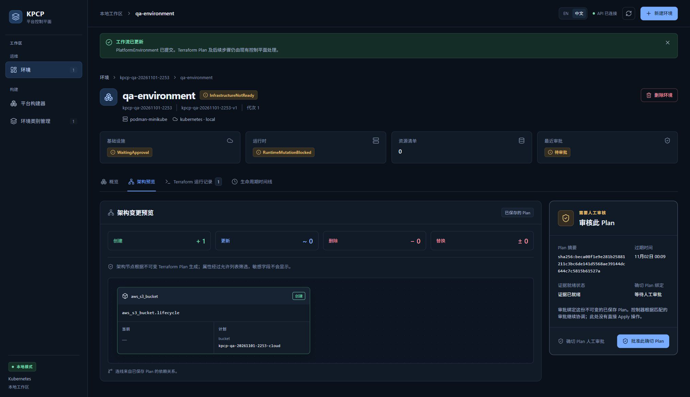
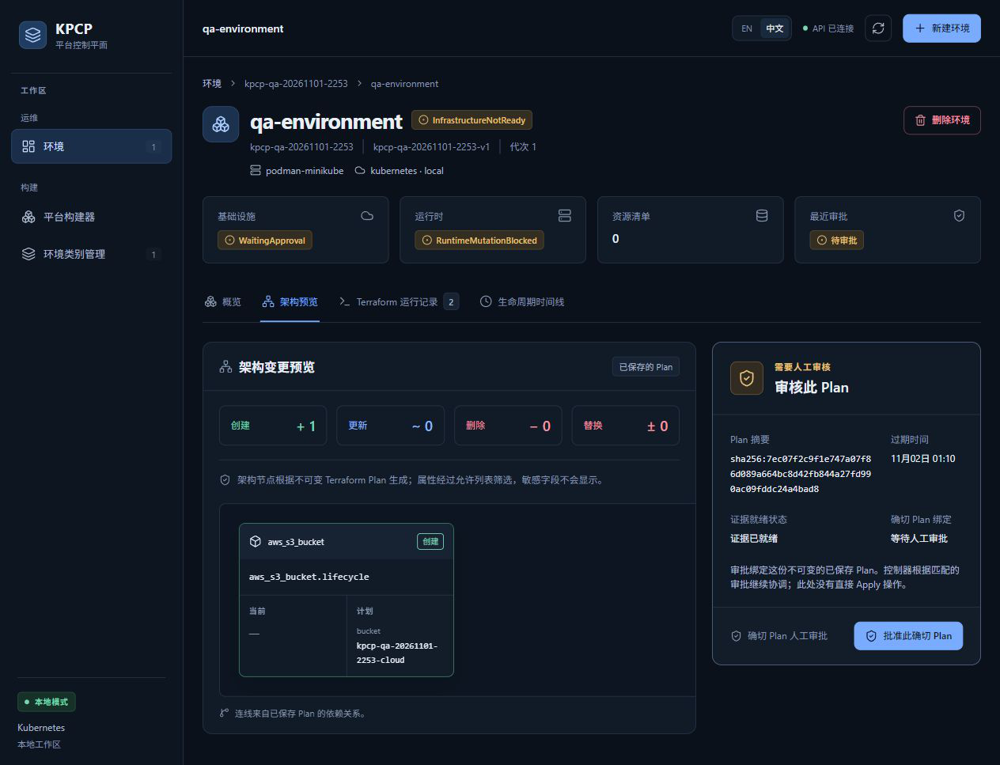

# TC08 — Plan Topology

## 1. Test Case Summary

| Field | Value |
|---|---|
| Test ID | TC08 |
| Test Name | Plan Topology |
| Priority | P0 |
| Test Type | Manual UI + Engineering Evidence |
| Preconditions | TC06 最新有效 Plan 证据完整；TC07 无未审批执行；QA API 可读取保存的 Plan。 |
| Expected Result | 真实 PlanTopology 与不可变 Plan 的 UID/digest 一致，正确显示资源动作及允许公开的 before/after 属性。 |
| Actual Result | 架构预览显示 aws_s3_bucket.lifecycle 创建 1、更新/删除/替换均 0；当前为空、计划 bucket 为本轮 -cloud 名称。当前 API graph UID/digest 与有效 Plan 一致，edges 为空符合单资源模块。 |
| Status | PASS |
| Commit | `e40c422327aa648a89d6baabf7268cb3239310d8`（现有 5445a5f 二进制，vcs.modified=true；产品路径差异为空，非本次 clean rebuild） |
| Execution Date | 2026-11-01T23:12:46.075000+13:00 → 2026-11-02T00:46:16.321604+13:00 |
| QA Run ID | `kpcp-qa-20261101-2253` |
| Evidence Scope | Current Execution |

**Historical Evidence：**原 TC08 为 BLOCKED。这里两张图片均为本轮真实 Plan 投影，分别属于首次 Plan 和过期后新 attempt；没有历史或静态拓扑替代。

## 2. Test Steps

1. 打开环境的架构预览。
2. 检查动作统计、资源地址和 before/after。
3. 核对页面摘要与只读 /plan graph 的身份。
4. 保留未审批状态交给 TC09。

## 3. Detailed Manual Test Guide

### Step 1 — Open the Saved Plan Topology

**操作：**

1. 在本轮环境详情点击架构预览。
2. 检查已保存的 Plan 标识和动作统计。
3. 在 aws_s3_bucket.lifecycle 卡片检查当前列为空，计划列为 kpcp-qa-20261101-2253-cloud。
4. 确认右侧仍是人工审批，尚未记录审批。

**预期结果：** 拓扑来自保存 Plan，动作和属性符合本轮固定模块。

**实际结果：** 创建 +1；其他动作 0；资源地址、类型和桶名正确；最初 Plan 与最新 attempt 各保留一张真实图。

**Screenshot：**

**图注：** 首次 Plan digest 为 beca08…；继续任务后的有效 Plan 为 7ec07f…，截图时间与身份不混用。

### Step 2 — Cross-check Graph Identity

**操作：**

1. 只读获取当前 run 的 /plan API 结果。
2. 核对 available=true、graph.terraformRunUID 等于当前 Run UID。
3. 核对 graph.planDigest 等于页面及保存 binary Plan 的摘要。
4. 核对 nodes 恰好一项 aws_s3_bucket.lifecycle、action=create、after.bucket 为本轮桶名。
5. 检查 edges=[]，不为单资源模块补画不存在的依赖连线。

**预期结果：** UI、API graph 与 binary Plan 身份一致，属性经过产品允许列表筛选。

**实际结果：** 当前 graph UID 6dcf21e3-322d-43e0-864a-50d8dad6aa62，digest 7ec07f2c…a4bad8；节点、summary 和空 edges 与 UI 完全一致。

**Screenshot：**

本步骤没有本轮对应状态截图；按实际执行范围记录，不以历史图片替代。

**图注：** 当前图 JSON 和原始响应 SHA-256 由审查过的公开收据保留。

## 4. Engineering Evidence

Current Execution：[Plan graph 身份收据](evidence/TC08/plan-graph.public.json)，与 TC06 保存 Plan 摘要交叉核对。对应 Gate B；只验证本固定模块真实出现的一资源拓扑，没有声称完成所有多节点布局、替换/删除动作或敏感属性全矩阵。

构建和前置环境的范围限制见[本轮审查收据](evidence/TC02/environment-preflight.public.json)，二进制原始构建身份及哈希已保留。

- [本用例状态与截图 SHA-256](evidence/TC08/result.json)

## 5. Actual Result

PlanTopology 真实展示路径通过。当前 Plan 为 Reconcile 新 attempt，右侧摘要与有效期清晰。边数 0 是当前模块事实，不是缺失依赖的伪造补全。

## 6. Defects and Blockers

本场景未发现图身份或动作统计不一致。复杂多资源依赖布局、图交互和全部敏感字段矩阵不在本轮这一单资源场景的 PASS 范围。

## 7. Final Verdict

**PASS** — 当前真实 PlanTopology 展示与不可变身份核对 PASS。

## 8. Cleanup / Handoff

保持同一架构预览和有效 Plan，供 TC09 进行明确审批；不触发基础设施执行，不修改图或保存产物。

以上保留要求是本用例结束时的连续生命周期交接。整个 Run 的最终清理现已完成，见[TC14](TC14_DESTROY_CLEANUP.md)及[最终清理收据](evidence/TC14/final-cleanup.public.json)；没有待清理测试基础设施。
