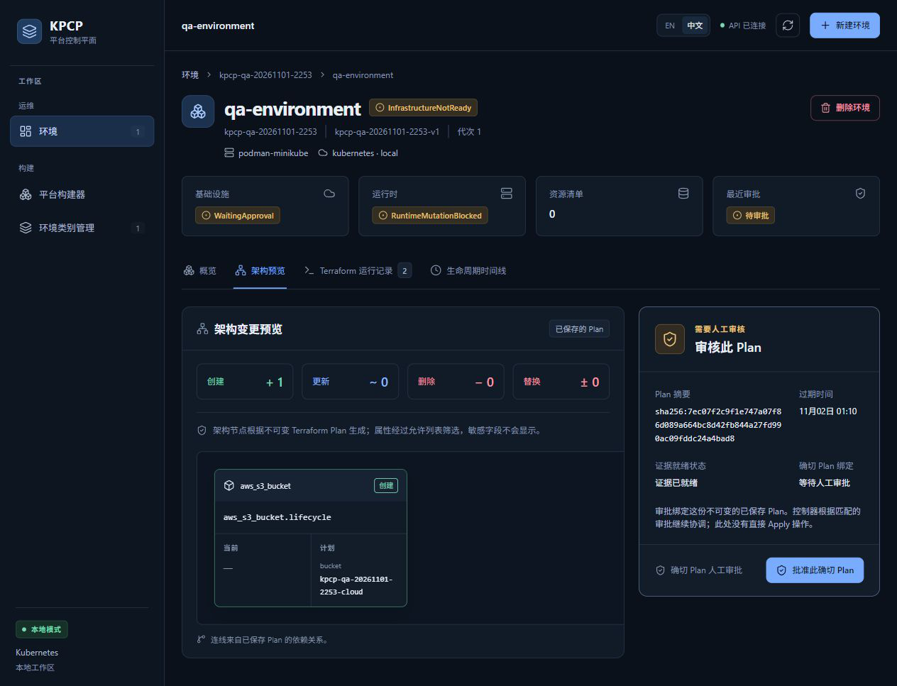
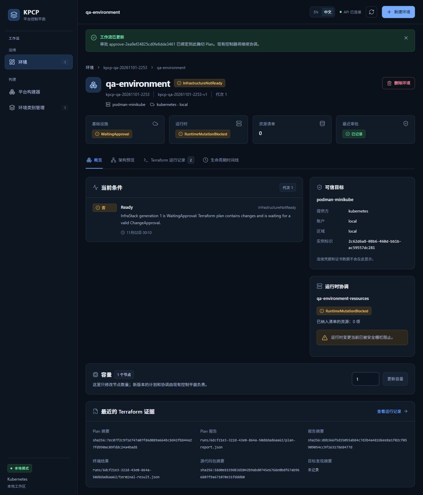

# TC09 — Exact Approval

## 1. Test Case Summary

| Field | Value |
|---|---|
| Test ID | TC09 |
| Test Name | Exact Approval |
| Priority | P0 |
| Test Type | Manual UI + Engineering Evidence |
| Preconditions | TC06–TC08 通过；当前有效 Plan UID 6dcf21e3-322d-43e0-864a-50d8dad6aa62，证据齐全，审批前复核有效期仍大于当前时间。 |
| Expected Result | 真实批准当前精确 Plan，ChangeApproval 的七项身份绑定一致；只有该审批后 Controller 才准入 Apply。 |
| Actual Result | 点击一次批准此确切 Plan；审批 approve-2ea9ef24825cd0fe6dde3461 已记录，UID 04694d1e-de82-4c31-b9a6-ba60dd8198f3；七项绑定均一致，随后只有一个 Apply Job 被准入。 |
| Status | PASS |
| Commit | `e40c422327aa648a89d6baabf7268cb3239310d8`（现有 5445a5f 二进制，vcs.modified=true；产品路径差异为空，非本次 clean rebuild） |
| Execution Date | 2026-11-02T00:46:55.065000+13:00 → 2026-11-02T00:47:19.013851+13:00 |
| QA Run ID | `kpcp-qa-20261101-2253` |
| Evidence Scope | Current Execution |

**Historical Evidence：**原 TC09 为 BLOCKED；历史错误审批 Go E2E 仅作独立追溯。本轮从当前有效 Plan 的真实 UI 按钮完成正向审批。

## 2. Test Steps

1. 核对当前 Plan 摘要、有效期和证据状态。
2. 登记将批准的 Plan UID/digest。
3. 点击批准此确切 Plan。
4. 检查已记录状态与七项不可变绑定。
5. 确认 Controller 准入唯一 Apply。

## 3. Detailed Manual Test Guide

### Step 1 — Review the Current Exact Plan

**操作：**

1. 在架构预览检查本轮桶创建动作。
2. 核对摘要 sha256:7ec07f2c9f1e747a07f86d089a664bc8d42fb844a27fd990ac09fddc24a4bad8。
3. 核对页面过期时间 2026-11-02 01:10 和证据已就绪。
4. 只读确认这是 InfraStack.latestPlanRunRef 指向的 ChangesPresent Run，旧 Superseded Run 不适用。
5. 在 ledger 保存审批意图和确切 UID，避免审批漂移。

**预期结果：** 批准目标明确、有效且与已验证产物一致。

**实际结果：** 有效期检查通过，当前 UID 与摘要和 TC08 graph 一致；未使用已过期 Plan。

**Screenshot：**

**图注：** 本轮当前拓扑、完整 Plan 摘要、过期时间、证据就绪状态和批准按钮。

### Step 2 — Approve Through the Real UI

**操作：**

1. 实际点击批准此确切 Plan 一次。
2. 检查工作流已更新横幅中的审批名称。
3. 检查最近审批变为已记录。
4. 保留等待 Controller 协调的初始状态，不把已记录等同于 Apply 已成功。

**预期结果：** 只创建精确 ChangeApproval；Controller 决定后续执行。

**实际结果：** 审批名称 approve-2ea9ef24825cd0fe6dde3461；页面显示已绑定此确切 Plan，最近审批已记录。

**Screenshot：**

**图注：** 审批成功横幅和已记录徽标同屏；此时初始基础设施状态仍可处于 WaitingApproval。

### Step 3 — Verify the Immutable Binding and Admission

**操作：**

1. 只读获取该 ChangeApproval、当前 Plan 以及后续 Apply Run/Job。
2. 逐项核对 Plan name、Plan UID、planDigest、executionContextDigest、effectivePlanInputDigest、planReportRef 和 planReportDigest。
3. 记录审批 UID 与后续唯一 Apply Job UID。
4. 实际 Apply 成功和 Ready 继续在 TC10 验收。

**预期结果：** 七项完全匹配，产生一次对应准入。

**实际结果：** exact-binding.public.json 七项均为 true；审批 UID 04694d1e-de82-4c31-b9a6-ba60dd8198f3；对应 Apply Job UID cba2db62-f123-4454-a8af-8a3b7f7a374d。

**Screenshot：**

本步骤没有本轮对应状态截图；按实际执行范围记录，不以历史图片替代。

**图注：** 绑定和准入由真实 Kubernetes 记录证明；单次 UI 点击没有脚本替代。

## 4. Engineering Evidence

Current Execution：[七项 exact binding](evidence/TC09/exact-binding.public.json) 与 after-exact-approval.json。对应 Gate A/B；审批前零 Apply 的证据在 TC07，唯一 Apply 与 saved-plan 身份在 TC10。历史五类错误审批、重复审批去重、过期/变更快照负例不冒充本轮已重跑。

构建和前置环境的范围限制见[本轮审查收据](evidence/TC02/environment-preflight.public.json)，二进制原始构建身份及哈希已保留。

- [本用例状态与截图 SHA-256](evidence/TC09/result.json)
- [Current Execution：after-exact-approval.json](evidence/TC09/after-exact-approval.json)（公开审查投影；原始文件保留本地并记录 SHA-256）

## 5. Actual Result

正向精确审批与身份绑定通过。整个业务动作来自 Desktop Work 真实点击；命令只读核对对象，不提交或修补审批。审批中断前的旧 Plan 没有被复用。

## 6. Defects and Blockers

本轮正向路径无新缺陷。没有通过可编辑 HTML、改 DOM、改审批摘要或放宽验证来制造成功。完整 live 错误绑定负例矩阵仍沿用历史覆盖范围限制。

## 7. Final Verdict

**PASS** — 当前有效 Plan 的真实精确审批和单次准入 PASS。

## 8. Cleanup / Handoff

保留 ChangeApproval、Plan 和所有产物给 TC10–TC14；不撤销或重新批准旧 Plan。后续 Destroy 必须生成独立 Plan 与审批。

以上保留要求是本用例结束时的连续生命周期交接。整个 Run 的最终清理现已完成，见[TC14](TC14_DESTROY_CLEANUP.md)及[最终清理收据](evidence/TC14/final-cleanup.public.json)；没有待清理测试基础设施。
