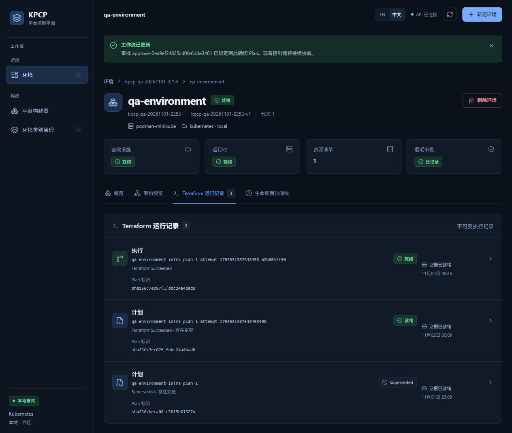
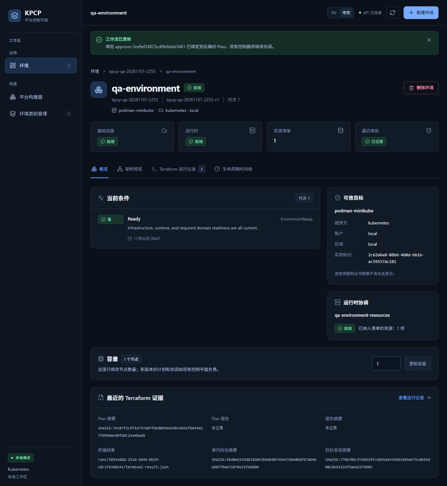
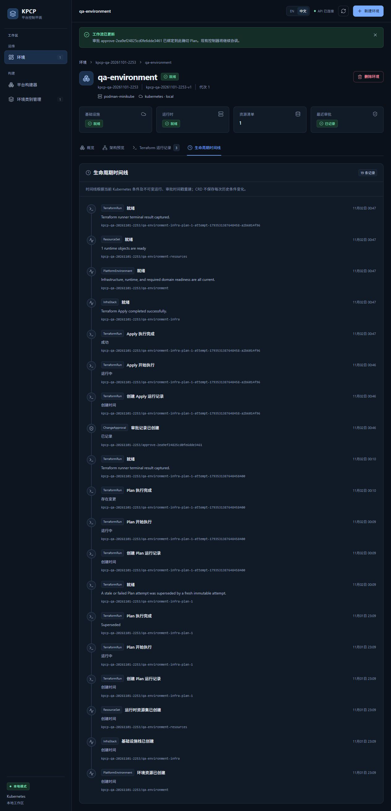

# TC10 — Apply / Ready

## 1. Test Case Summary

| Field | Value |
|---|---|
| Test ID | TC10 |
| Test Name | Apply / Ready |
| Priority | P0 |
| Test Type | Manual UI + Engineering Evidence |
| Preconditions | TC09 已通过真实 UI 批准当前 Reconcile Plan；Controller、Runner 和本轮专用 MiniStack/Backend 可用。Environment UID 443a7caa-25aa-48f2-9bbd-095e76210ab7。 |
| Expected Result | Controller 仅执行一个绑定已审批 saved plan 的 Apply；成功后基础设施和运行时达到当前代次 Ready。 |
| Actual Result | 唯一 Apply Run/Job 成功，Environment generation/observedGeneration 均为 1；MiniStack 测试桶存在，唯一受管 ConfigMap UID 与 ResourceSet inventory 一致。 |
| Status | PASS |
| Commit | `e40c422327aa648a89d6baabf7268cb3239310d8`（现有 5445a5f 二进制，vcs.modified=true；产品路径差异为空，非本次 clean rebuild） |
| Execution Date | 2026-11-02T00:47:39.906000+13:00 → 2026-11-02T00:54:57.679517+13:00 |
| QA Run ID | `kpcp-qa-20261101-2253` |
| Evidence Scope | Current Execution；单集群、MiniStack S3 和项目支持的 ApplyOnly ConfigMap 运行时；不包含 EKS、Valkey 或工作负载健康探针验收。 |

**Historical Evidence：**原 TC10 为 BLOCKED。本轮实际完成真实 UI 审批后的 Apply 和 Ready；没有把历史 Go E2E 成功作为本轮结果。

## 2. Test Steps

1. 打开 Terraform 运行记录，确认 Apply 及执行结果。
2. 打开概览，检查基础设施、运行时和环境就绪。
3. 检查生命周期时间线的审批、Apply 开始、完成和 Ready 顺序。
4. 只读核对 saved plan、审批、Job、终态产物和实际资源。

## 3. Detailed Manual Test Guide

### Step 1 — Observe the Apply Result

**操作：**

1. 保持 TC09 的 qa-environment 详情页。
2. 点击 Terraform 运行记录。
3. 找到操作为 Apply 的唯一记录，检查运行结果和产物就绪状态。
4. 核对名称 qa-environment-infra-plan-1-attempt-1793531387648458-a2b6014f96。

**预期结果：** Apply 由 Controller 在审批后准入并最终成功，不能把审批已记录等同于成功。

**实际结果：** 实际首张 Apply 观察截图时已完成；没有声称截到短暂 Running 状态。Apply outcome=Succeeded，28 秒完成，证据已捕获。

**Screenshot：**

**图注：** 运行记录中的唯一 Apply 与成功状态；另外两条是原 Plan 及其过期后的新 Plan。

### Step 2 — Verify Environment Ready

**操作：**

1. 点击概览标签。
2. 核对环境名称、命名空间、类别及代次 1。
3. 检查环境就绪、基础设施就绪、运行时就绪与资源清单 1。
4. 核对节点数量仍为 1，保留给 TC11 更新。

**预期结果：** Ready 对应当前代次；实际基础设施及运行时对象已经创建。

**实际结果：** Environment、InfraStack、ResourceSet 的 Ready 条件均为 True 且 observedGeneration 当前；桶 HEAD 200，qa-runtime UID=16924f81-c3dd-49a1-83d4-4223c4810b7a。

**Screenshot：**

**图注：** 概览同屏显示三层 Ready 和资源清单；本运行时按显式 ApplyOnly 策略验证 ConfigMap。

### Step 3 — Review Timeline and Immutable Execution Evidence

**操作：**

1. 点击生命周期时间线。
2. 定位审批创建、Apply 创建、开始、执行完成以及各层 Ready 事件。
3. 只读比较 Apply 的 planRunUID、planDigest、planRef、approvalUID 和 RetainedBundle。
4. 下载本轮终态产物到受控目录并验证摘要、terraformRunUID、jobUID。

**预期结果：** 执行身份与 TC09 精确审批一致，终态证据可信，未发生重复 Apply。

**实际结果：** Apply UID=58914d88-251d-4d44-bb29-c0c378388541，Job UID=cba2db62-f123-4454-a8af-8a3b7f7a374d；12 项 Ready/身份检查均通过，终态摘要和两个 UID 一致。

**Screenshot：**

**图注：** 时间线保留审批后执行顺序；它依据现存 CR 条件及不可变记录重建，不声称保存所有历史条件转换。

## 4. Engineering Evidence

Current Execution：[Ready 与执行身份检查](evidence/TC10/ready-proof.public.json)，以及 apply-ready.json 公开投影。Plan UID=6dcf21e3-322d-43e0-864a-50d8dad6aa62；Plan digest=sha256:7ec07f2c9f1e747a07f86d089a664bc8d42fb844a27fd990ac09fddc24a4bad8；ChangeApproval UID=04694d1e-de82-4c31-b9a6-ba60dd8198f3。终态 SHA-256=276b89500ec9659f617b4af610f4831e01f8f45bff98cf091456dd4c43efe5fb。适用 Gate A/B；Gate C 本轮未执行重启，Gate D 双集群 NOT RUN。

构建和前置环境的范围限制见[本轮审查收据](evidence/TC02/environment-preflight.public.json)，二进制原始构建身份及哈希已保留。

- [本用例状态与截图 SHA-256](evidence/TC10/result.json)
- [Current Execution：apply-ready.json](evidence/TC10/apply-ready.json)（公开审查投影；原始文件保留本地并记录 SHA-256）

## 5. Actual Result

真实 Terraform 创建本轮 MiniStack 桶，Controller 发现目标身份后创建受管 ConfigMap。ResourceSet inventory UID、ownership-id、运行 ID、三个当前代次 Ready 条件均独立核对通过。Apply 只有一次。没有改产品代码、替换 HCL 或跳过审批/产物检查。

## 6. Defects and Blockers

本用例限定范围内无新缺陷。实际集群只有一个；本用例不证明双集群隔离、多副本接管、真实 AWS 或 Valkey 就绪。短暂 Running 未被截图捕获，开始和完成时间由实际 CR/时间线提供。

观察项 OBS-01（展示约定待确认）：图 02 的最近 Terraform 证据中 Plan 报告/报告摘要显示未记录，但原 Plan 的报告确实存在并已在 TC06 校验；Apply 终态状态未带这两个字段。该显示不影响本用例 saved-plan Apply 和 Ready 的实际成功，不能据此宣称原报告产物缺失。

## 7. Final Verdict

**PASS** — 本轮单集群真实 Apply、saved plan 绑定及当前代次 Ready PASS。

## 8. Cleanup / Handoff

保留 Environment、InfraStack、ResourceSet、桶、qa-runtime、Run/Approval 及产物给 TC11–TC14。业务资源须通过 UI Delete、独立 Destroy Plan 审批和 Controller finalizer 正常清理。

以上保留要求是本用例结束时的连续生命周期交接。整个 Run 的最终清理现已完成，见[TC14](TC14_DESTROY_CLEANUP.md)及[最终清理收据](evidence/TC14/final-cleanup.public.json)；没有待清理测试基础设施。
