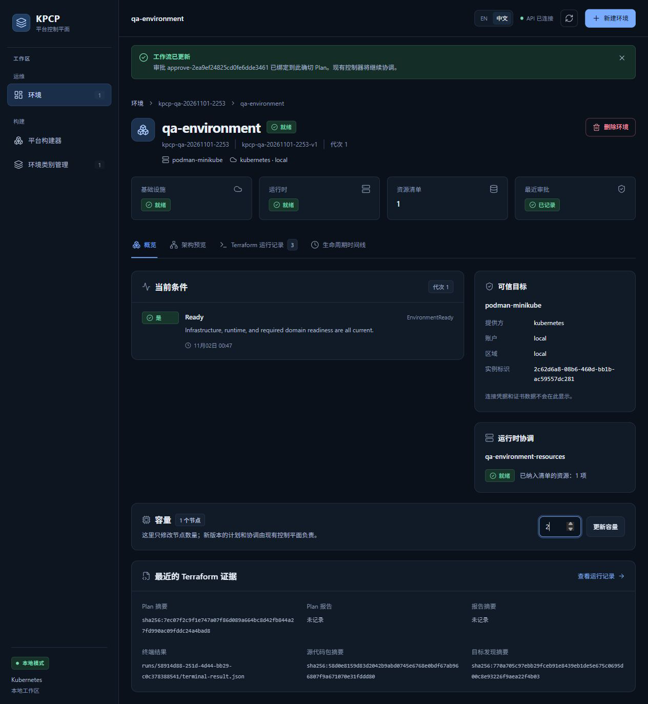
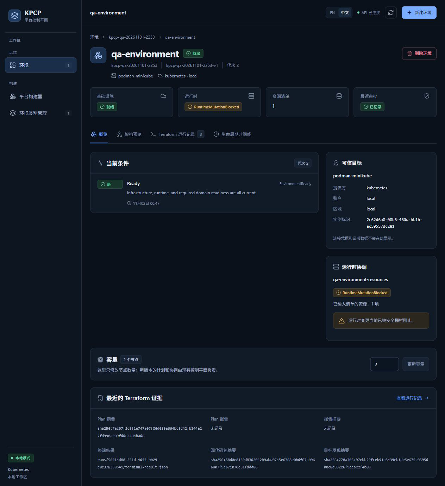
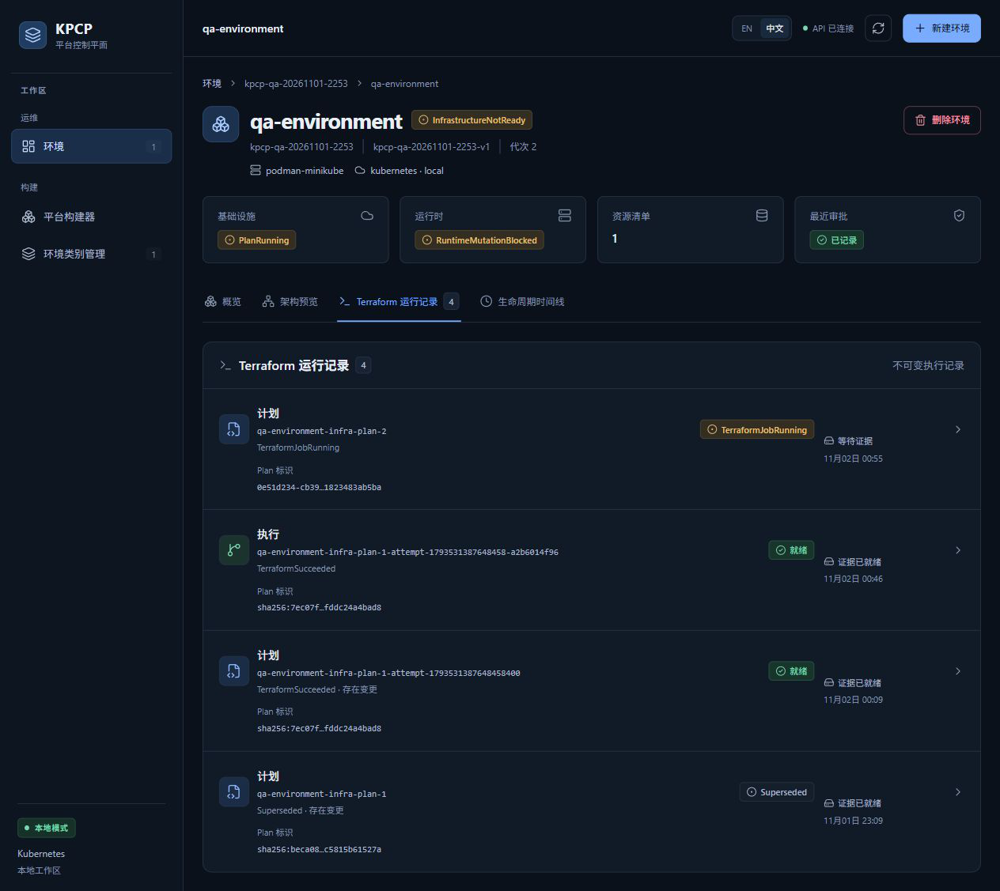
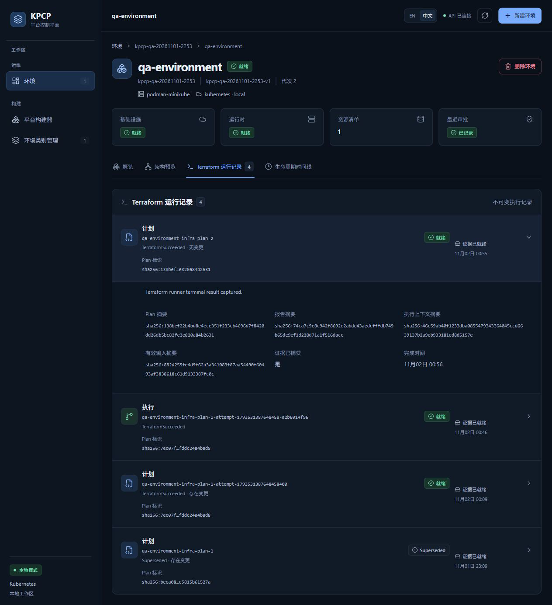
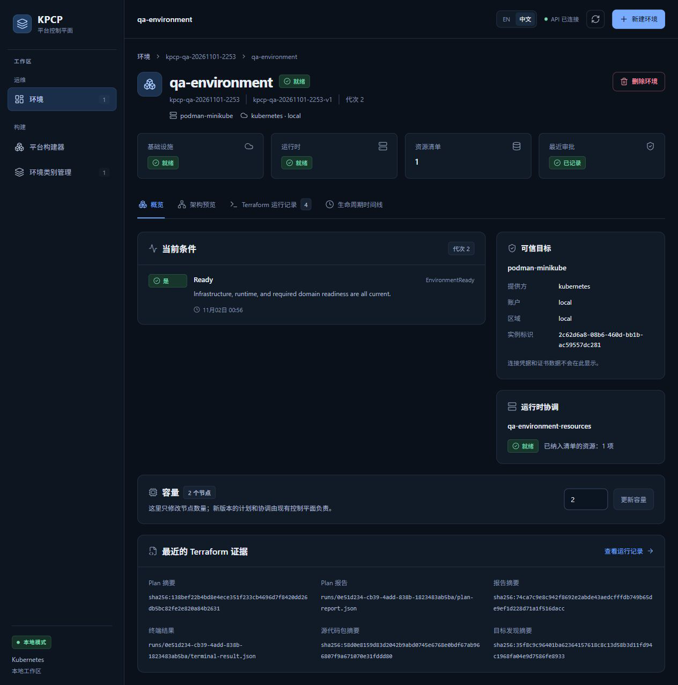
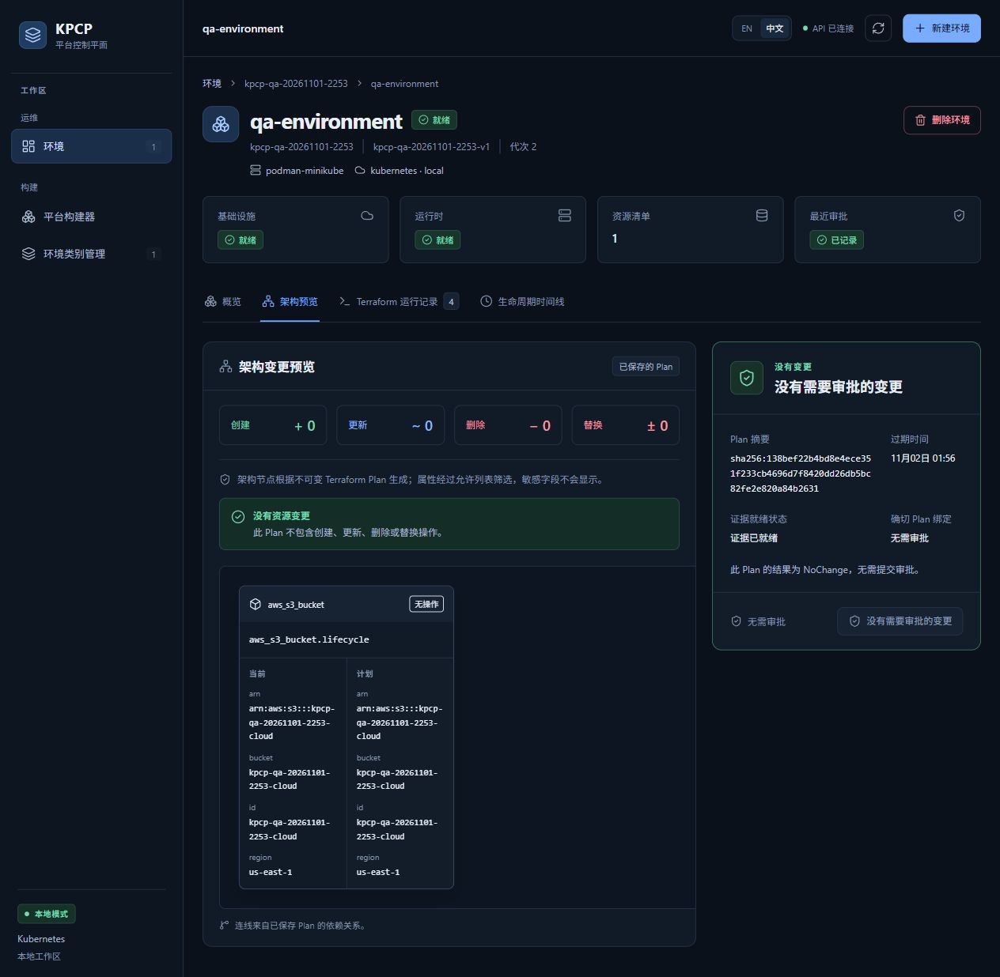

# TC11 — Update / NoChange

## 1. Test Case Summary

| Field | Value |
|---|---|
| Test ID | TC11 |
| Test Name | Update / NoChange |
| Priority | P0 |
| Test Type | Manual UI + Engineering Evidence |
| Preconditions | TC10 的 qa-environment generation 1 Ready，节点输入为 1；固定模块只管理本轮 S3 桶，类别允许 1–3 节点。 |
| Expected Result | 真实更新容量输入后新代次重新 Plan；固定模块无资源差异时 NoChange，不新增 Apply 或审批，最终当前代次 Ready。 |
| Actual Result | 页面把节点输入从 1 更新为 2；新 Plan UID 0e51d234-cb39-4add-838b-1823483ab5ba 返回 NoChange；代次及 observedGeneration=2，Apply 仍为 1，审批仍为 1，运行时 UID 不变。 |
| Status | PASS |
| Commit | `e40c422327aa648a89d6baabf7268cb3239310d8`（现有 5445a5f 二进制，vcs.modified=true；产品路径差异为空，非本次 clean rebuild） |
| Execution Date | 2026-11-02T00:55:53.629000+13:00 → 2026-11-02T00:57:27.988000+13:00 |
| QA Run ID | `kpcp-qa-20261101-2253` |
| Evidence Scope | Current Execution；容量字段更新与 S3 固定模块 NoChange，不声称真实工作节点扩容。 |

**Historical Evidence：**原 TC11 为 BLOCKED；历史 Go TestLifecycle/NoChange 单独保留。本轮实际点击更新并核对真实 Runner、CR 和产物。

## 2. Test Steps

1. 在概览把节点数量改为 2。
2. 点击更新容量并观察代次及安全栅栏。
3. 打开新 Plan 运行详情并检查无变更。
4. 核对代次 2 Ready、零差异拓扑和无需审批。
5. 只读确认没有新增 Apply，运行时 UID 与桶保持。

## 3. Detailed Manual Test Guide

### Step 1 — Enter the New Capacity

**操作：**

1. 进入命名空间 kpcp-qa-20261101-2253 的 qa-environment。
2. 点击概览，在容量区域找到节点数量。
3. 将 1 改为 2，检查更新容量按钮可用。

**预期结果：** 合法范围内的修改可提交；尚未点击时显示的持久化容量仍为 1。

**实际结果：** 输入框为 2，原容量徽标为 1；更新按钮已启用。

**Screenshot：**

**图注：** 输入与已保存容量并列，可区分编辑值和持久化值。

### Step 2 — Submit and Observe Reconciliation

**操作：**

1. 实际点击更新容量一次。
2. 检查环境代次变为 2、容量徽标变为 2。
3. 进入 Terraform 运行记录，观察新 Plan 和等待证据。
4. 保留更新过程的 RuntimeMutationBlocked 状态，等待正常协调完成。

**预期结果：** Controller 对新代次重新 Plan，收敛前阻止运行时变更。

**实际结果：** 出现新 Run qa-environment-infra-plan-2，PlanRunning 和 RuntimeMutationBlocked；提交瞬间旧 Ready 文本短暂保留，随后转为 InfrastructureNotReady 并最终恢复。

**Screenshot：**

**图注：** 截图按时间排列，不能把瞬时旧条件视为新代次已完成；终态由 observedGeneration 核对。

### Step 3 — Inspect the NoChange Run

**操作：**

1. 在 Terraform 运行记录点击 qa-environment-infra-plan-2。
2. 检查 TerraformSucceeded · 无变更、证据已就绪、证据已捕获是和完成时间。
3. 记录 Plan 摘要、报告摘要、上下文和有效输入摘要。

**预期结果：** 新 Plan 确实执行，结果为 NoChange，证据完整。

**实际结果：** Plan UID 0e51d234-cb39-4add-838b-1823483ab5ba，Job UID feb18598-fd2d-4271-8669-03f2d17a4196，五类产物摘要全部一致。

**Screenshot：**

**图注：** 展开的是代次 2 新 Plan；下面唯一执行行仍属于代次 1。

### Step 4 — Verify Current Readiness and No Approval

**操作：**

1. 点击概览，核对代次 2、节点 2 和三层就绪。
2. 点击架构预览，检查创建/更新/删除/替换均为 0。
3. 检查没有需要审批的变更按钮禁用，明确显示 NoChange、无需审批。
4. 只读核对 Run/Approval 数量及 qa-runtime 原 UID、桶存在。

**预期结果：** NoChange 自动收敛，没有第二次 Apply 或无意义审批。

**实际结果：** Environment observedGeneration=2；三层 Ready 当前；Apply UID 和审批 UID 与 TC10 完全相同；ConfigMap UID 保持，桶仍存在。

**Screenshot：**

**图注：** Ready 是最终代次 2 状态；拓扑保留同一个桶的当前/计划属性并显示无操作。

## 4. Engineering Evidence

Current Execution：[NoChange/无重复执行证明](evidence/TC11/nochange-proof.public.json)；[五类产物校验](evidence/TC11/qa-environment-infra-plan-2-artifacts.public.json)。Plan digest=sha256:138bef22b4bd8e4ece351f233cb4696d7f8420dd26db5bc82fe2e820a84b2631。after-update.json 与 nochange-ready.json 分别保存过程及终态投影；适用 Gate B/E。历史 TestLifecycle/NoChange 只是独立追溯。

构建和前置环境的范围限制见[本轮审查收据](evidence/TC02/environment-preflight.public.json)，二进制原始构建身份及哈希已保留。

- [本用例状态与截图 SHA-256](evidence/TC11/result.json)
- [Current Execution：after-update.json](evidence/TC11/after-update.json)（公开审查投影；原始文件保留本地并记录 SHA-256）
- [Current Execution：nochange-ready.json](evidence/TC11/nochange-ready.json)（公开审查投影；原始文件保留本地并记录 SHA-256）

## 5. Actual Result

修改容量字段会生成新 Plan，但该固定 HCL 不创建工作节点，因此没有基础设施差异。Runner terraformExitCode=0、mutationClassification=NoMutation。未点击新审批、未提交新 Apply；原 qa-runtime UID 16924f81-c3dd-49a1-83d4-4223c4810b7a 保留。

## 6. Defects and Blockers

本用例收敛及 NoChange 范围通过。记录了提交瞬间旧 Ready 文本与 RuntimeMutationBlocked 并存的短暂显示；后续页面和当前 observedGeneration 已一致，不将瞬态截图作为最终 Ready 证据。真实节点扩容不属于本固定模块。

## 7. Final Verdict

**PASS** — 新代次真实 NoChange、无重复 Apply、当前代次 Ready PASS。

## 8. Cleanup / Handoff

保留同一 Environment 及已收敛 source/backend/执行身份给 TC12；不回滚容量、不直接删除 CR。TC12 通过正常 UI 请求删除，TC13 独立批准 Destroy。

以上保留要求是本用例结束时的连续生命周期交接。整个 Run 的最终清理现已完成，见[TC14](TC14_DESTROY_CLEANUP.md)及[最终清理收据](evidence/TC14/final-cleanup.public.json)；没有待清理测试基础设施。
