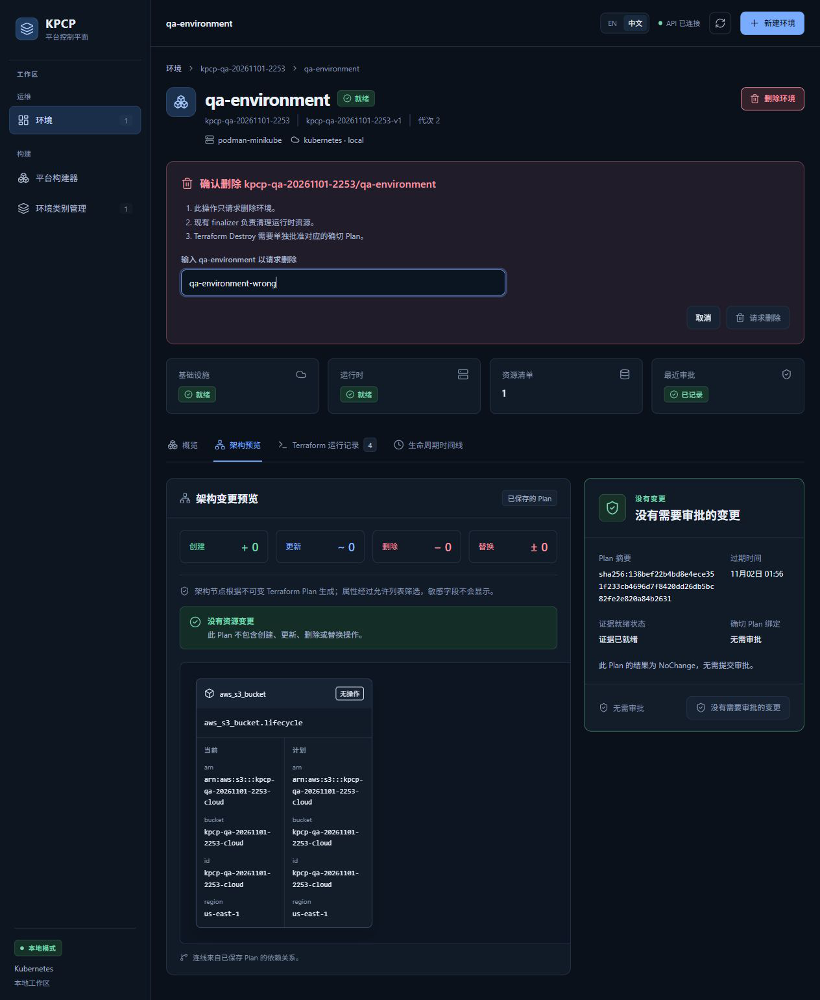
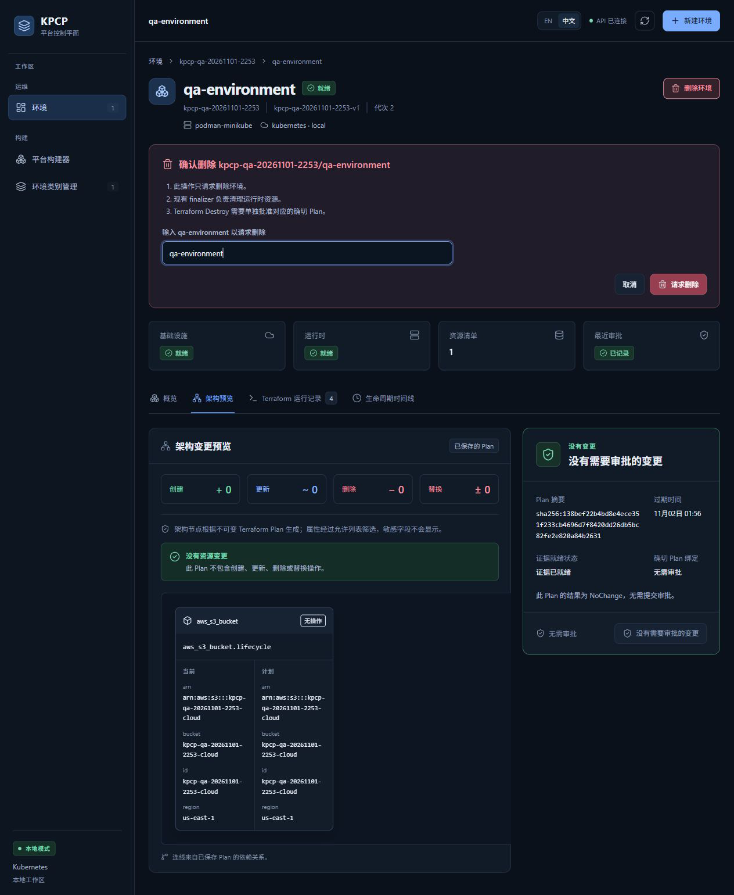
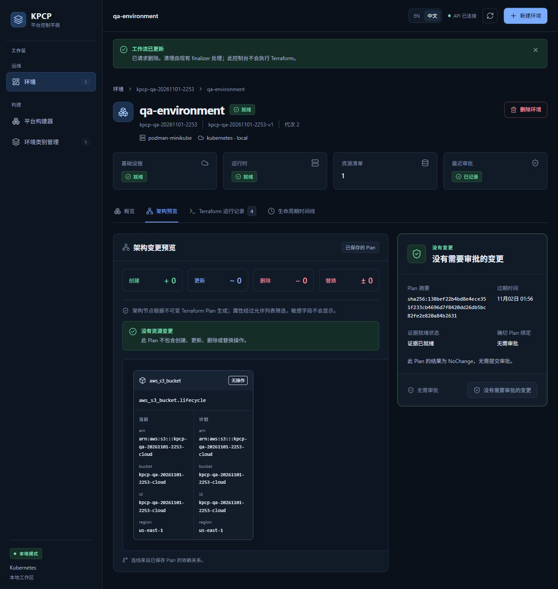
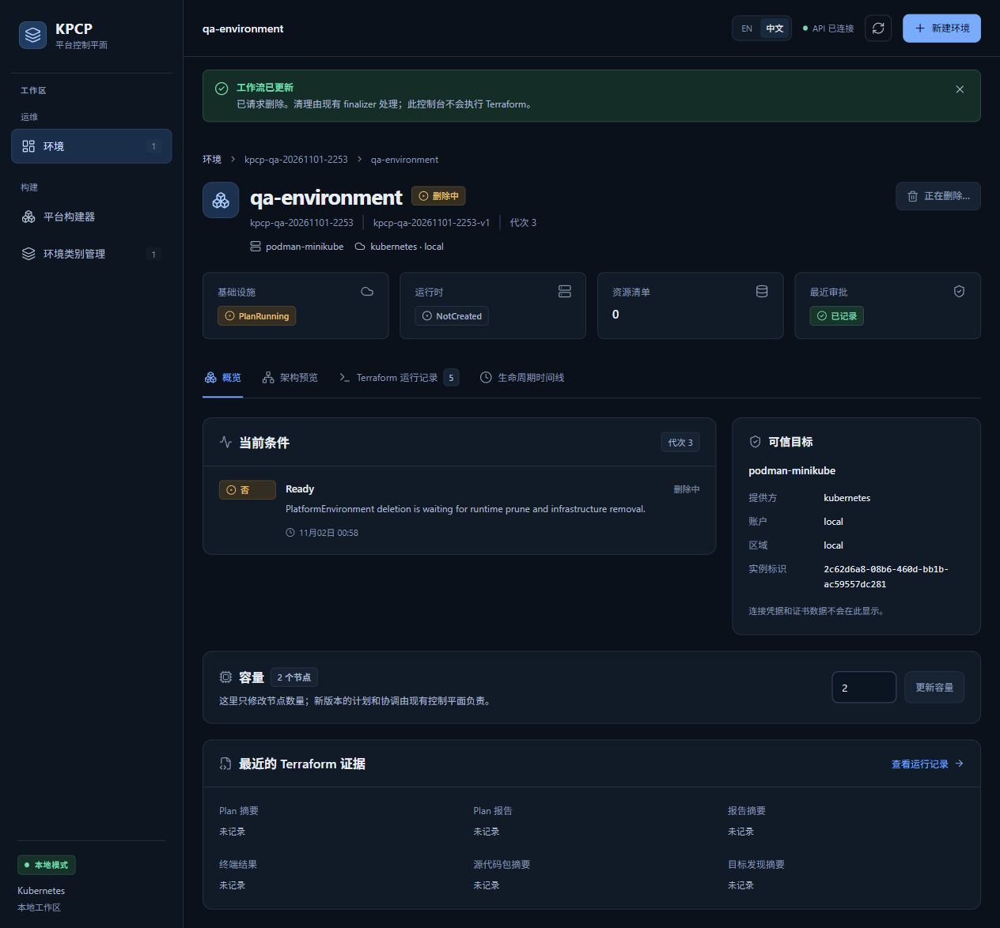

# TC12 — Delete Request

## 1. Test Case Summary

| Field | Value |
|---|---|
| Test ID | TC12 |
| Test Name | Delete Request |
| Priority | P0 |
| Test Type | Manual UI + Engineering Evidence |
| Preconditions | TC11 generation 2 Ready；本轮独占 Environment UID 443a7caa-25aa-48f2-9bbd-095e76210ab7；云桶与 qa-runtime 存在，最终清理已登记。 |
| Expected Result | 必须输入确切环境名才能请求删除；请求只进入 finalizer 流程，先清理运行时，在独立 Destroy 审批前保留云资源及环境 finalizer。 |
| Actual Result | 错误名称时请求删除禁用，正确名称启用；真实点击后 deletionTimestamp=2026-11-01T11:58:25Z；运行时已 prune，Environment/InfraStack finalizer 保留，云桶仍在，未产生 Destroy Run/Job。 |
| Status | PASS |
| Commit | `e40c422327aa648a89d6baabf7268cb3239310d8`（现有 5445a5f 二进制，vcs.modified=true；产品路径差异为空，非本次 clean rebuild） |
| Execution Date | 2026-11-02T00:58:15.111000+13:00 → 2026-11-02T00:59:08.308000+13:00 |
| QA Run ID | `kpcp-qa-20261101-2253` |
| Evidence Scope | Current Execution |

**Historical Evidence：**原 TC12 为 BLOCKED；本轮首次实际从该连续 UI 生命周期请求删除。历史 Go E2E 删除路径不替代本轮操作。

## 2. Test Steps

1. 点击删除环境并阅读 finalizer 与独立审批说明。
2. 输入错误名称，确认请求删除不可用。
3. 改为 qa-environment，点击请求删除。
4. 观察删除中、资源清单归零和正常 finalizer 保留。
5. 只读确认云桶未被提前销毁。

## 3. Detailed Manual Test Guide

### Step 1 — Verify Wrong-name Protection

**操作：**

1. 打开 qa-environment 详情页，核对命名空间和类别均属于本轮。
2. 点击右上角删除环境。
3. 阅读只请求删除、finalizer 清理运行时、Destroy 需单独审批三条说明。
4. 在确认环境名称输入 qa-environment-wrong。
5. 检查请求删除按钮禁用，不尝试绕过禁用。

**预期结果：** 误输入不能发出删除请求。

**实际结果：** 工具读取请求删除 isEnabled=false；环境仍 Ready，未请求删除。

**Screenshot：**

**图注：** 错误名称、禁用按钮及删除语义说明同屏。

### Step 2 — Request Exact Environment Deletion

**操作：**

1. 将确认环境名称改为 qa-environment。
2. 核对按钮已启用及对象所属本轮命名空间。
3. 登记 UID 绑定删除意图。
4. 实际点击请求删除一次。
5. 检查工作流已更新横幅。

**预期结果：** 接受删除请求，由现有 Controller/finalizer 执行后续流程。

**实际结果：** 正确名称 isEnabled=true；点击后横幅明确已请求删除，UI 没有直接执行 Terraform。

**Screenshot：**

**图注：** 先保存启用按钮，再保存请求成功横幅；请求成功瞬间旧 Ready 尚未刷新，不代表删除已完成。

### Step 3 — Observe Runtime-first Finalization

**操作：**

1. 点击概览，等待删除中状态。
2. 检查按钮变为正在删除且禁用、当前条件 Ready=False。
3. 检查运行时 NotCreated 和资源清单 0。
4. 只读检查 PlatformEnvironment 和 InfraStack finalizer、qa-runtime 缺失、无关 sentinel 保持原 UID。
5. 确认云桶仍 HEAD 200，只有原 Reconcile 审批，没有 Destroy Run/Job。

**预期结果：** 删除不会绕过独立审批，先清理受管运行时并保留云资源。

**实际结果：** Environment 代次 3 删除中；两个业务 finalizer 保留；独立 Destroy Plan UID=55ac0497-1f85-453d-8321-ad8a4c82ef1d 开始运行，Destroy 准入仍为 0。

**Screenshot：**

**图注：** 概览证明删除中与运行时归零；finalizer、云桶和 sentinel 身份以公开只读证据交叉核对。

## 4. Engineering Evidence

Current Execution：[删除前置与独立审批栅栏](evidence/TC12/pre-destroy-approval.public.json)，after-delete-request.json。Environment UID=443a7caa-25aa-48f2-9bbd-095e76210ab7，InfraStack UID=a7322cd8-7fcc-49e4-9dd6-5886d8b5ab9d；sentinel UID=3501db4b-a21c-4a3e-a435-bb30d5566714。10 项检查通过，适用 Gate E/F。Destroy Plan 完成与审批在 TC13 验收。

构建和前置环境的范围限制见[本轮审查收据](evidence/TC02/environment-preflight.public.json)，二进制原始构建身份及哈希已保留。

- [本用例状态与截图 SHA-256](evidence/TC12/result.json)
- [Current Execution：after-delete-request.json](evidence/TC12/after-delete-request.json)（公开审查投影；原始文件保留本地并记录 SHA-256）

## 5. Actual Result

真实 UI 错误/正确名称检查通过，删除请求已进入 Controller finalizer 流程。运行时先被 Controller 删除，而 MiniStack 云桶仍存在。原 Reconcile ChangeApproval 未自动授权 Destroy。没有直接删除 InfraStack、云桶或 patch finalizer。

## 6. Defects and Blockers

本用例无新阻塞或功能缺陷；删除中是预期等待状态，不能当作已完成 Cleanup。TC13 还需审核独立 Destroy Plan。

## 7. Final Verdict

**PASS** — 正常 UI 删除请求、名称保护、runtime-first 和审批前 finalizer 保留 PASS。

## 8. Cleanup / Handoff

保持正在删除的 Environment、InfraStack、Destroy Plan、原产物及 Backend；必须继续 TC13/TC14。不得移除 finalizer 或直接删除云桶来结束测试。

以上保留要求是本用例结束时的连续生命周期交接。整个 Run 的最终清理现已完成，见[TC14](TC14_DESTROY_CLEANUP.md)及[最终清理收据](evidence/TC14/final-cleanup.public.json)；没有待清理测试基础设施。
