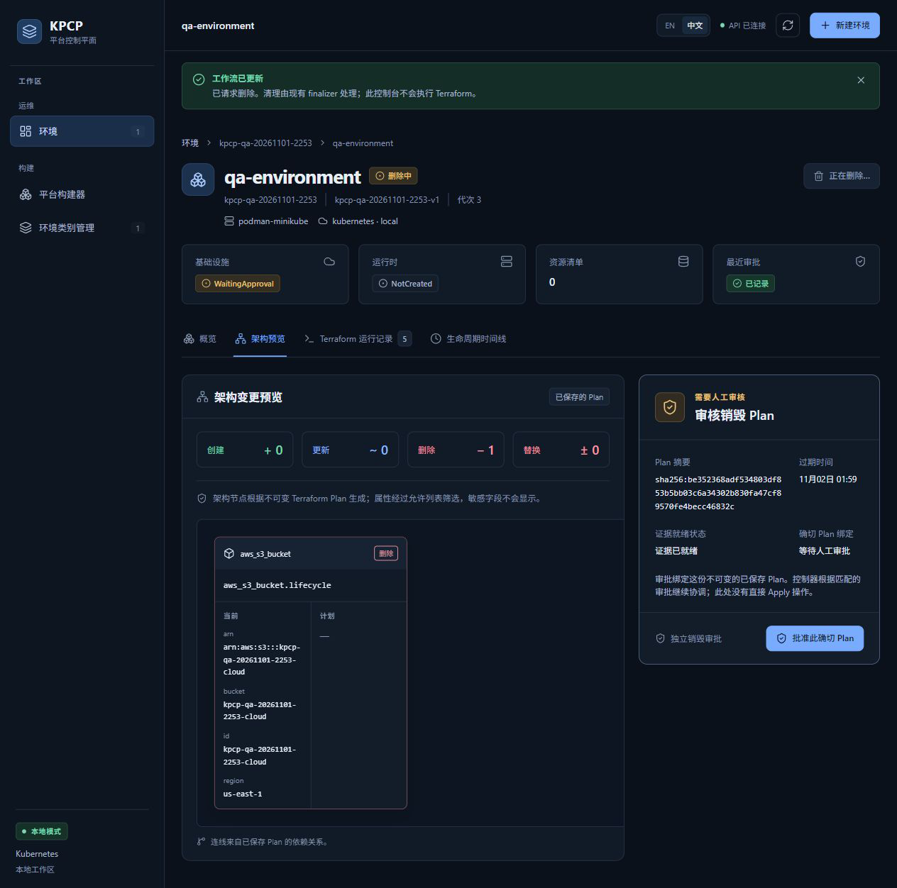
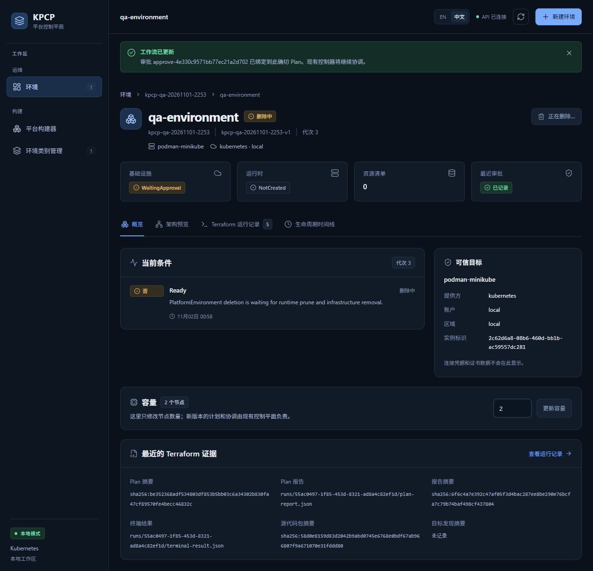

# TC13 — Destroy Approval

## 1. Test Case Summary

| Field | Value |
|---|---|
| Test ID | TC13 |
| Test Name | Destroy Approval |
| Priority | P0 |
| Test Type | Manual UI + Engineering Evidence |
| Preconditions | TC12 已正常请求删除，运行时已 prune、云桶和 finalizer 保留；新的 Destroy Plan 已完成且证据可校验，原 Reconcile 审批未授权 Destroy。 |
| Expected Result | Destroy 使用独立 Plan 和新 ChangeApproval；七项 exact binding 一致，审批前零 Destroy 执行，审批后仅准入一个 saved-destroy-plan Apply。 |
| Actual Result | 真实点击批准此确切 Plan；独立审批 UID 3e145dd5-ab21-4caf-baa4-eb5c83e5aeed 绑定 Destroy Plan UID 55ac0497-1f85-453d-8321-ad8a4c82ef1d；七项匹配，仅一个 Destroy 执行 Run/Job 准入。 |
| Status | PASS |
| Commit | `e40c422327aa648a89d6baabf7268cb3239310d8`（现有 5445a5f 二进制，vcs.modified=true；产品路径差异为空，非本次 clean rebuild） |
| Execution Date | 2026-11-02T00:59:48.098000+13:00 → 2026-11-02T01:00:49.203329+13:00 |
| QA Run ID | `kpcp-qa-20261101-2253` |
| Evidence Scope | Current Execution |

**Historical Evidence：**原 TC13 为 BLOCKED；历史 TestLifecycle/F_DestroyFinalizer 独立审批仅作工程追溯。本轮通过实际页面完成新的 Destroy 审批。

## 2. Test Steps

1. 在架构预览审核删除 1 个本轮测试桶的 Destroy Plan。
2. 校验产物、有效期和审批前零 Destroy 执行。
3. 点击独立销毁审批区域的批准此确切 Plan。
4. 核对新审批 UID、七项绑定和唯一执行准入。

## 3. Detailed Manual Test Guide

### Step 1 — Review the Independent Destroy Plan

**操作：**

1. 保持正在删除的 qa-environment 详情页，点击架构预览。
2. 检查基础设施 WaitingApproval、运行时 NotCreated、资源清单 0。
3. 检查摘要创建 0、更新 0、删除 1、替换 0；节点仅 aws_s3_bucket.lifecycle。
4. 核对当前桶名 kpcp-qa-20261101-2253-cloud，计划属性为空。
5. 在右侧审核销毁 Plan 区域检查独立销毁审批、证据已就绪、等待人工审批以及过期时间 11月02日 01:59。

**预期结果：** 显示独立销毁计划，原审批不能继续执行销毁。

**实际结果：** 新 Plan UID 55ac0497-1f85-453d-8321-ad8a4c82ef1d；Plan digest=sha256:be352368adf534803df853b5bb03c6a34302b830fa47cf89570fe4becc46832c；审批前零 Destroy Run/Job。

**Screenshot：**

**图注：** 本轮桶删除拓扑、完整摘要、有效期和独立审批入口同屏。

### Step 2 — Approve the Exact Destroy Plan

**操作：**

1. 只读核对五类产物 SHA-256 与 Plan/Job UID，确认有效期仍大于当前时间。
2. 在资源台账记录此次 Destroy Plan UID 和摘要。
3. 实际点击批准此确切 Plan 一次。
4. 检查工作流已更新横幅中的新审批名称 approve-4e330c9571bb77ec21a2d702。
5. 保留 Controller 自行协调，不从命令行提交任何审批或 Terraform 操作。

**预期结果：** 新建独立 ChangeApproval，绑定本次 Destroy Plan。

**实际结果：** 新审批 UID=3e145dd5-ab21-4caf-baa4-eb5c83e5aeed，明显区别于初始 Reconcile 审批 04694d1e-de82-4c31-b9a6-ba60dd8198f3。

**Screenshot：**

**图注：** 横幅证明新审批已绑定确切 Plan；此时仍显示删除中，不将审批记录等同于最终销毁完成。

### Step 3 — Verify Independent Admission

**操作：**

1. 只读核对 planName、planUID、planDigest、executionContextDigest、effectivePlanInputDigest、planReportRef、planReportDigest 七项。
2. 核对 Controller 新执行记录的 planRunUID、approvalUID、planRef、RetainedBundle 和 Job owner UID。
3. 确认只有一个 planMode=Destroy 且 operation=Apply 的执行记录。
4. 实际执行截图和最终清理在 TC14 查看。

**预期结果：** 使用已审批的 saved destroy plan，仅准入一次。

**实际结果：** 七项审批绑定和八项独立准入身份检查全部为 true；执行 Run UID=068b0320-3e23-445c-b4e4-0528fcbc3bd2，Job UID=fd1e2cb6-1826-4524-bdb2-4678f7c54b00。

**Screenshot：**

本步骤没有本轮对应状态截图；按实际执行范围记录，不以历史图片替代。

**图注：** 准入身份由实际 CR 快照证明；产品将 Terraform Destroy 表示为 operation=Apply、planMode=Destroy，不能按字符串 operation=Destroy 计数。

## 4. Engineering Evidence

Current Execution：[审批前 finalizer/零执行](evidence/TC13/pre-destroy-approval.public.json)、[五类产物校验](evidence/TC13/qa-environment-infra-destroy-plan-4-artifacts.public.json)、[七项 exact binding](evidence/TC13/exact-binding.public.json)、[独立执行准入](evidence/TC13/independent-destroy-admission.public.json)。Destroy Plan Job UID=502fabbf-da5a-4344-845e-68f2bad986fd。适用 Gate A/B/E/F；before/after-destroy-approval.json 保留真实阶段投影。

构建和前置环境的范围限制见[本轮审查收据](evidence/TC02/environment-preflight.public.json)，二进制原始构建身份及哈希已保留。

- [本用例状态与截图 SHA-256](evidence/TC13/result.json)
- [Current Execution：after-destroy-approval.json](evidence/TC13/after-destroy-approval.json)（公开审查投影；原始文件保留本地并记录 SHA-256）
- [Current Execution：before-destroy-approval.json](evidence/TC13/before-destroy-approval.json)（公开审查投影；原始文件保留本地并记录 SHA-256）

## 5. Actual Result

独立 Destroy 审批没有复用初始 Reconcile 审批。审批前仍有云桶和两个业务 finalizer；审批后 Controller 创建唯一 saved-plan Apply，mode=Destroy，沿用已保留 source bundle 和 backend snapshot。没有直接调用 terraform destroy 或修改 finalizer。

## 6. Defects and Blockers

本用例限定范围内无新缺陷。所有计数依据 operation=Apply 且 planMode=Destroy，并用 Run owner UID 关联 Job；完整错误 Destroy 审批负例未在本轮新增注入。

## 7. Final Verdict

**PASS** — 真实独立 Destroy 精确审批、身份绑定与单次准入 PASS。

## 8. Cleanup / Handoff

审批证据和产物保存后继续 TC14；允许 Controller 正常执行并释放 finalizer。审批 CR 没有 ownerReference，正常业务清理后留作审计，最终随本轮专用命名空间清理。

以上保留要求是本用例结束时的连续生命周期交接。整个 Run 的最终清理现已完成，见[TC14](TC14_DESTROY_CLEANUP.md)及[最终清理收据](evidence/TC14/final-cleanup.public.json)；没有待清理测试基础设施。
