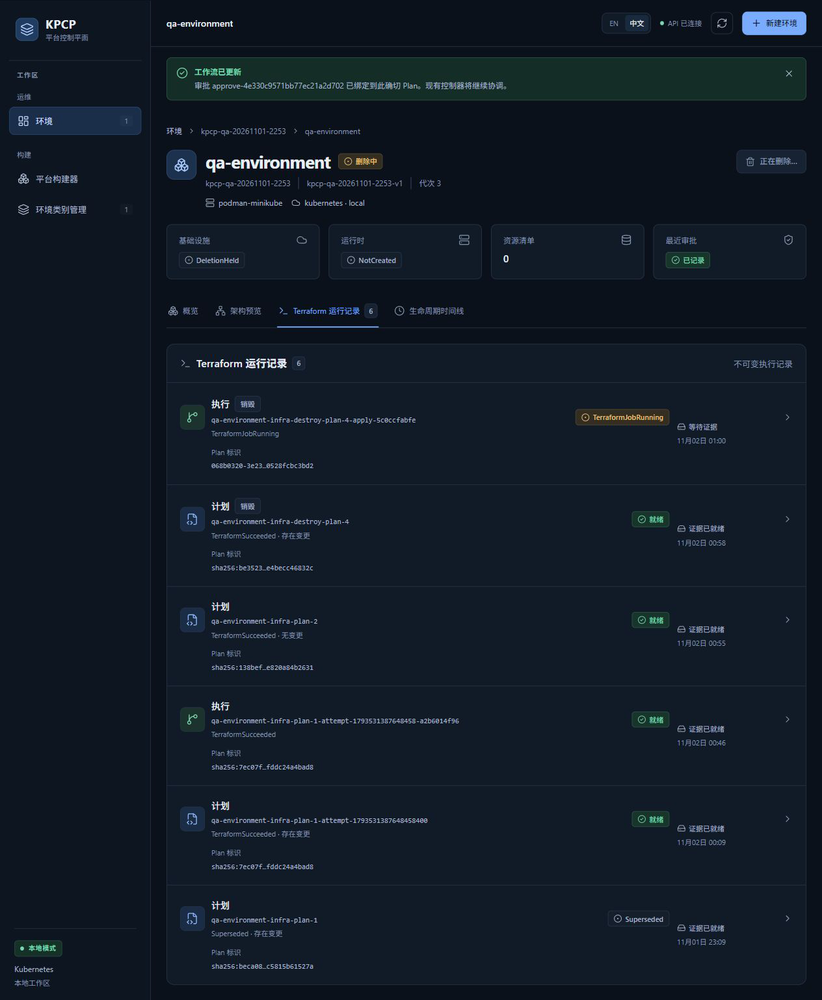
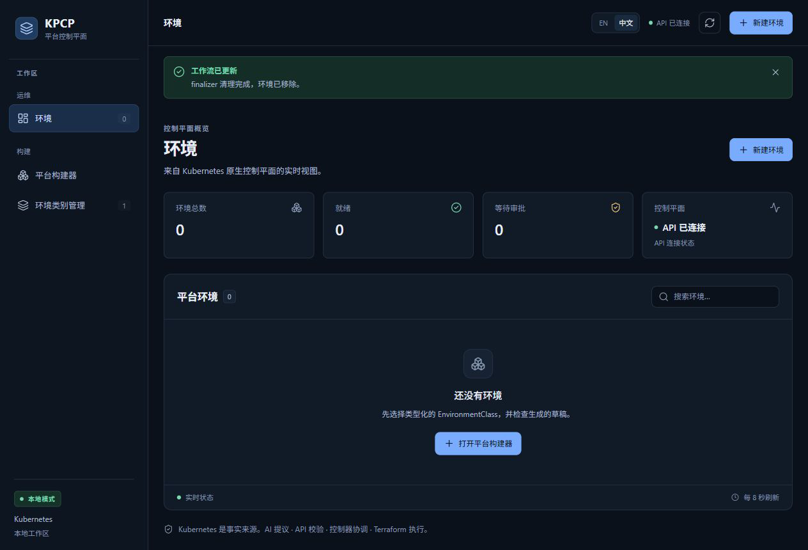
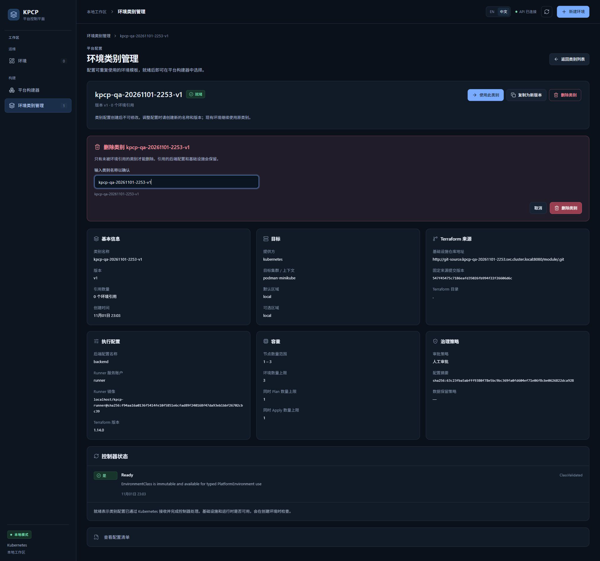
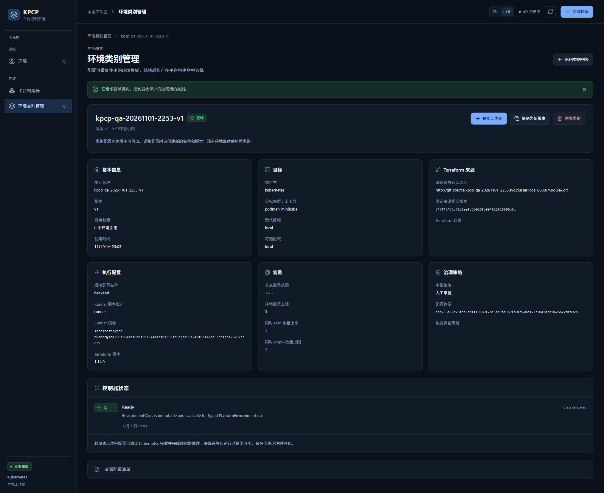
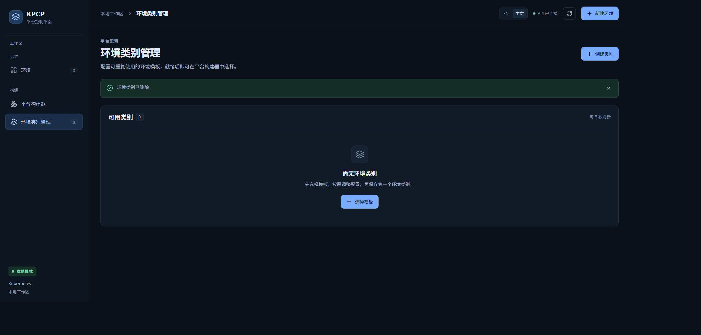
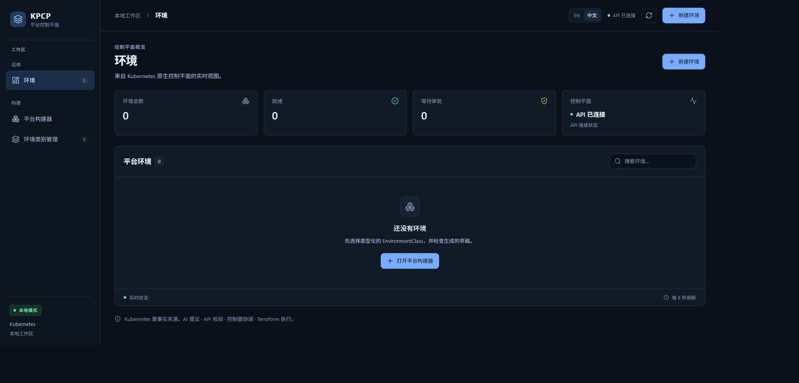

# TC14 — Destroy / Cleanup

## 1. Test Case Summary

| Field | Value |
|---|---|
| Test ID | TC14 |
| Test Name | Destroy / Cleanup |
| Priority | P0 |
| Test Type | Manual UI + Engineering Evidence |
| Preconditions | TC13 通过真实 UI 创建独立 Destroy 审批，saved destroy plan digest 和七项绑定已验证；原始产物保留在本轮专用桶。 |
| Expected Result | Controller 应用已审批的 Destroy Plan；成功后云桶消失、finalizer 正常释放、业务 CR/Jobs 清理；仅清理本轮独占夹具，保存原始证据并保留共享服务。 |
| Actual Result | Destroy Run/Job 成功，Terraform exit 0；页面显示 finalizer 清理完成、环境移除。云桶 HEAD 404，业务 CR/Jobs 消失；测试类别、命名空间、35 个已归档产物及夹具桶、专用进程全部清理，原始 5173 API 仍连接。 |
| Status | PASS |
| Commit | `e40c422327aa648a89d6baabf7268cb3239310d8`（现有 5445a5f 二进制，vcs.modified=true；产品路径差异为空，非本次 clean rebuild） |
| Execution Date | 2026-11-02T01:01:00.594000+13:00 → 2026-11-02T01:10:24.002585+13:00 |
| QA Run ID | `kpcp-qa-20261101-2253` |
| Evidence Scope | Current Execution；单集群、MiniStack 本轮桶、ApplyOnly ConfigMap、普通 finalizer 清理；不包含故障恢复或跨集群清理。 |

**Historical Evidence：**原 TC14 为 BLOCKED。本轮实际执行 normal finalizer 生命周期。历史 scoped 503 故障恢复为另一次独立 Go E2E 证据，本轮没有重新故障注入。

## 2. Test Steps

1. 打开 Terraform 运行记录，记录真实 Destroy 执行。
2. 等待页面返回环境列表并显示 finalizer 清理完成。
3. 读取保留终态产物并核对退出码、Plan/Run/Job UID 和桶缺失。
4. 通过 UI 删除无引用的本轮类别。
5. 归档全部原始产物，按 UID 清理专用命名空间、桶和进程。
6. 确认原始服务、共享 MiniStack 和原集群仍可用。

## 3. Detailed Manual Test Guide

### Step 1 — Observe the Destroy Execution

**操作：**

1. 在 TC13 审批后的详情页点击 Terraform 运行记录。
2. 找到带销毁标记的执行行 qa-environment-infra-destroy-plan-4-apply-5c0ccfabfe。
3. 检查 TerraformJobRunning、等待证据及基础设施 DeletionHeld。
4. 让 Controller/Runner 完成，不从命令行直接执行 Terraform。

**预期结果：** 真实 Runner 在独立审批后执行 saved destroy plan，完成前保留 finalizer。

**实际结果：** 本轮截图捕获运行中；Run UID 068b0320-3e23-445c-b4e4-0528fcbc3bd2、Job UID fd1e2cb6-1826-4524-bdb2-4678f7c54b00。终态于 01:01:07 NZDT 成功。

**Screenshot：**

**图注：** 销毁执行与独立 Destroy Plan 并列，下面仍保留原 NoChange/Reconcile 历史记录。

### Step 2 — Verify Normal Finalization

**操作：**

1. 等待下一次页面刷新。
2. 确认自动回到环境列表，横幅显示 finalizer 清理完成，环境已移除。
3. 检查环境总数、就绪、等待审批均为 0。
4. 读取本轮保留 terminal-result.json，核对 S3 摘要元数据与本地计算值、Run UID、Job UID、saved Plan ref/digest。
5. 只读检查云桶 404、qa-runtime 消失、Env/InfraStack/ResourceSet/Run/Job 归零，sentinel 原 UID 保留。

**预期结果：** Destroy 成功后通过正常 finalizer 完成删除，不能只凭列表为空判断云资源已清理。

**实际结果：** 终态 exitCode=0、Succeeded、artifactsReady=true；SHA-256 与元数据一致。业务对象和桶消失；两条无 ownerReference 的审计审批暂留至专用命名空间清理。

**Screenshot：**

**图注：** 此截图证明 UI 最终清理通知；CR 终态短暂存在后被正常 GC，未捕获成功执行行截图，终态由保留产物证明。

### Step 3 — Delete the Unused QA Class Through UI

**操作：**

1. 点击环境类别管理并打开 kpcp-qa-20261101-2253-v1。
2. 确认引用数量为 0，并只读核对类别 UID 4878d691-c702-4214-bf20-e00b354e5fc4。
3. 点击删除类别，输入完整类别名确认。
4. 实际点击确认区的删除类别。
5. 等待自动返回类别列表，核对环境类别已删除和可用类别 0。

**预期结果：** 删除本轮无引用类别，不直接影响 Backend 或共享基础设施。

**实际结果：** 页面先接受请求，随后类别列表归零；没有绕过类别 finalizer。

**Screenshot：**

**图注：** 04 为删除请求刚被接受时的过渡详情；05 才是类别已删除的最终列表。

### Step 4 — Retain Evidence and Clean Only Owned Fixtures

**操作：**

1. 将专用产物桶的全部 35 个对象归档到受控目录，保存 key/长度/SHA-256，并验证产物摘要元数据。
2. 检查 ledger、命名空间 UID、夹具对象 UID/ownerReference 和仅含 dummy 值的 Secret 元数据；不导出 Secret 值。
3. 停止已核对命令及创建时间的本轮 Controller、API、Vite 与 scoped proxy。
4. 使用 UID precondition 请求删除专用命名空间，等待普通 Kubernetes 终止完成。
5. 复核桶 qa-run 标签及归档 key 集合后，仅清空并删除本轮夹具产物桶；云桶此前已由 Terraform 删除。
6. 在同一浏览器标签页打开原始 http://127.0.0.1:5173/，核对 API 已连接和零环境。

**预期结果：** 所有本轮资源清理可追溯，共享引擎/集群/模拟器与原始服务保留，原始证据留在本地。

**实际结果：** 11 项最终检查通过：专用 namespace/class/两个桶/进程/proxy 均消失；原 cluster UID 与 Node Ready 保持、MiniStack 健康 HTTP 200、原始 API health HTTP 200，S3 恢复空桶基线。

**Screenshot：**

**图注：** 最后一张位于原始 5173，前五张位于隔离 QA 5174；切回真实原始服务以验证收尾，没有替换产品页面。

## 4. Engineering Evidence

Current Execution：[Destroy 终态和业务清理](evidence/TC14/destroy-cleanup-proof.public.json)、[35 个对象留存清单](evidence/TC14/artifact-retention.public.json)、[UID 绑定 namespace 清理意图](evidence/TC14/namespace-cleanup-intent.public.json)、[专用进程身份与停止](evidence/TC14/owned-process-cleanup.public.json)、[产物夹具桶清理](evidence/TC14/artifact-fixture-cleanup.public.json)、[最终 11 项清理检查](evidence/TC14/final-cleanup.public.json)。Destroy terminal SHA-256=8163d78533d4a4c29d92d780eda0c40a00257143eb4fafb81bd01120d48ed866；与审批前 finalizer/cloud 保留的 TC12/13 证据共同追溯 Gate F，并覆盖本轮 Gate A/B 的正常正向路径。

构建和前置环境的范围限制见[本轮审查收据](evidence/TC02/environment-preflight.public.json)，二进制原始构建身份及哈希已保留。

- [本用例状态与截图 SHA-256](evidence/TC14/result.json)
- [Current Execution：after-business-cleanup.json](evidence/TC14/after-business-cleanup.json)（公开审查投影；原始文件保留本地并记录 SHA-256）
- [Current Execution：destroy-executing.json](evidence/TC14/destroy-executing.json)（公开审查投影；原始文件保留本地并记录 SHA-256）

## 5. Actual Result

Destroy 实际持续约 28 秒，operation=Apply、planMode=Destroy，应用已审批 Plan 55ac0497-1f85-453d-8321-ad8a4c82ef1d。成功终态 CR 被正常 GC 前未取得终态状态截图，保留了运行中截图、最终列表截图、准入时 Run/Job 身份和 S3 不可变终态摘要。两个审批 CR 没有 ownerReference，先作为审计证据保留，后随仅属于本轮的 namespace 一起清理。namespace 正常终止曾短暂显示 Terminating，未强制移除任何 finalizer。

## 6. Defects and Blockers

本用例正常销毁与清理通过。没有新增故障注入，不能声称本轮验证了 503 恢复、多副本 failover 或跨集群清理。成功终态行没有截图，已明确使用真实保留产物补充，未伪造完成截图。

## 7. Final Verdict

**PASS** — 独立审批后的真实 Terraform Destroy、正常 finalizer、runtime-first、仅本轮资源清理及共享服务保留 PASS。

## 8. Cleanup / Handoff

本轮清理已完成，无待删除测试基础设施。Namespace UID 99cd7893-6a37-4eed-8312-6caaa33d823b 及类别均已消失；云桶由 Terraform 删除，夹具桶仅在 35 个对象归档验证后删除。专用 Controller/API/Vite/proxy 已退出；原始服务仍运行。原始 JPEG、DOM、私有配置、日志和产物字节保留在受控工作目录，不推送公开仓库；公开交付仅含审查后的 PNG、摘要和身份记录。
