# TC15 — Language & Errors

## 1. Test Case Summary

| Field | Value |
|---|---|
| Test ID | TC15 |
| Test Name | Language & Errors |
| Priority | P1 |
| Test Type | Manual UI + Engineering Evidence |
| Preconditions | TC02 的未保存类别表单；中文模式；固定来源版本可编辑；真实 QA API 可用。 |
| Expected Result | EN/中文切换改变标题和标签并保留输入值；中文面向用户错误与警告也为中文。 |
| Actual Result | 语言切换与输入保留通过；中文模式下 source.revision 错误句及 Backend 警告仍为英文，QA-01 未关闭。 |
| Status | FAIL |
| Commit | `e40c422327aa648a89d6baabf7268cb3239310d8`（现有 5445a5f 二进制，vcs.modified=true；产品路径差异为空，非本次 clean rebuild） |
| Execution Date | 2026-11-01T23:02:57.847000+13:00 → 2026-11-01T23:03:20.947000+13:00 |
| QA Run ID | `kpcp-qa-20261101-2253` |
| Evidence Scope | Current Execution; historical language PASS / localization PARTIAL preserved separately |

**Historical Evidence：**前一轮 TC15 为 PARTIAL：语言切换通过，QA-01 本地化缺陷未关闭；原图 20–22 保留。本轮重新复现，按当前完整预期判定 FAIL，未改写历史 PARTIAL。

## 2. Test Steps

1. 中文模式输入 main 并校验。
2. 保存错误与警告全文。
3. 切换 EN，再切回中文并检查输入保留。

## 3. Detailed Manual Test Guide

### Step 1 — Reproduce QA-01 in Chinese

**操作：**

1. 在环境类别配置中填满其他必填值。
2. 固定来源提交版本填 main，点击校验配置。
3. 定位错误提示全文，核对红色标题、英文错误句和黄色后端警告。

**预期结果：** 校验阻止移动版本；错误正文和警告与中文界面一致。

**实际结果：** 移动版本被正确拒绝，但完整错误句与警告为英文。

**Screenshot：**

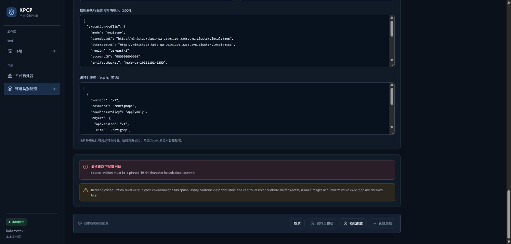

**图注：** 中文导航和红色中文标题，与英文错误正文、黄色英文警告同时可见；创建按钮仍禁用。

### Step 2 — Switch to English

**操作：**

1. 点击右上角 EN。
2. 检查文档标题、导航、表单标签和创建前校验按钮。
3. 确认类别名与已填写目标、来源、JSON 值保持。

**预期结果：** 切换为英文；用户输入不丢失。

**实际结果：** 标题为 Platform Control Plane；标签为英文，Class name 仍为本轮唯一名称。

**Screenshot：**

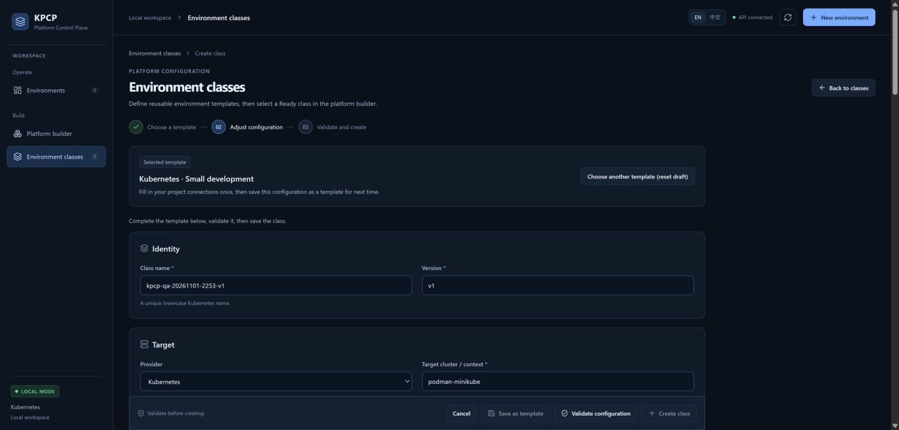

**图注：** 本轮真实表单顶部与英文导航、输入字段和禁用创建按钮。

### Step 3 — Restore Chinese

**操作：**

1. 点击右上角 中文。
2. 检查标题恢复平台控制平面。
3. 读取固定来源提交版本，确认仍为 main。
4. 将表单交还 TC02，把 revision 改为固定提交后继续，不创建失败对象。

**预期结果：** 中文恢复，输入保持。

**实际结果：** 标题恢复中文；revision 的真实字段 value 仍为 main。

**Screenshot：**

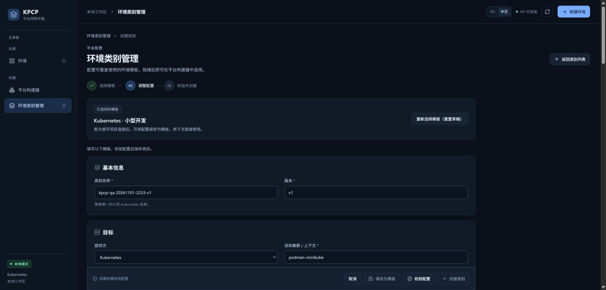

**图注：** 同一表单恢复中文，类别名和其他输入保持；错误校验状态没有触发资源创建。

### Historical Evidence — 原有截图归档引用

以下图片来自前一轮 2026-11-01 21:54–22:03、产品基线 `5445a5f`，不计入本轮截图。保留历史执行事实；含私网地址的三图引用原有遮盖副本。

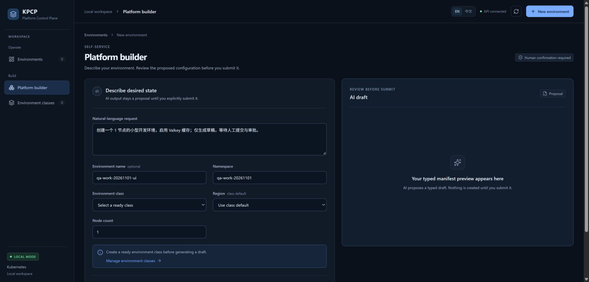

图注：Historical Evidence，原报告图 20；英文构建器的标题、导航和字段。原图与公开副本对应关系沿用原有清单。

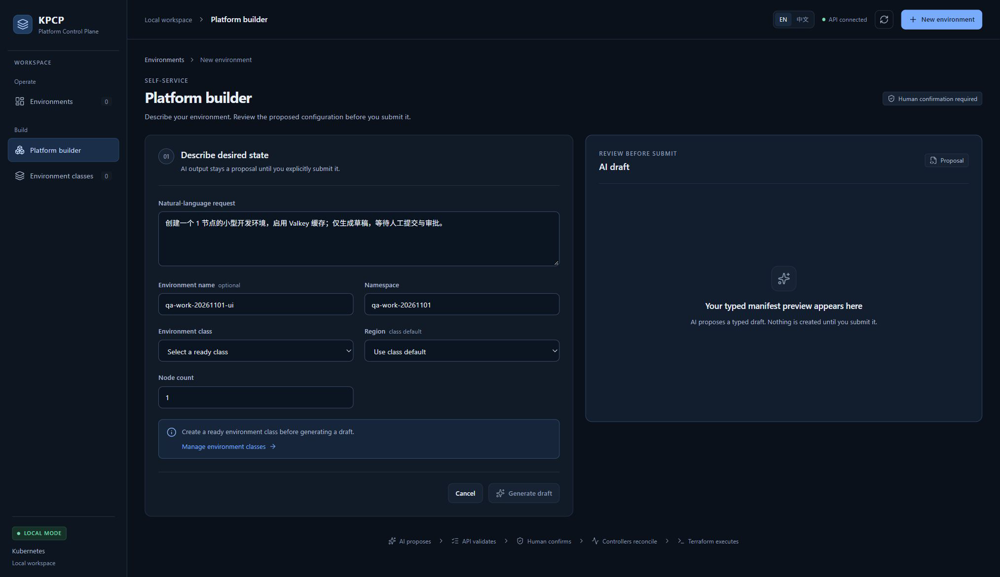

图注：Historical Evidence，原报告图 21；同一英文构建器全页图，Generate draft 禁用。原图与公开副本对应关系沿用原有清单。

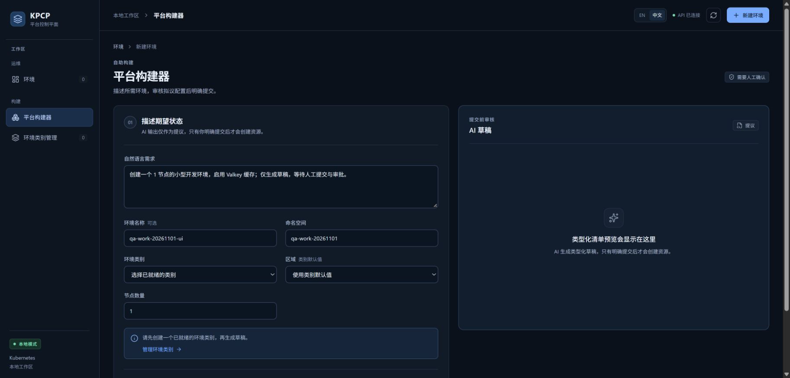

图注：Historical Evidence，原报告图 22；切回中文后原输入保留。原图与公开副本对应关系沿用原有清单。

## 4. Engineering Evidence

Current Execution：三张真实浏览器截图和对应受控 DOM 快照。源代码定位 internal/console/classes.go 的服务端英文错误/警告，以及 web/src/ClassManager.tsx 的校验结果展示；本轮不修改这些文件。语言切换后 document.title 与字段值均从真实页面读取。Historical Evidence：原图 20–22 只用于归档。

构建和前置环境的范围限制见[本轮审查收据](evidence/TC02/environment-preflight.public.json)，二进制原始构建身份及哈希已保留。

- [本用例状态与截图 SHA-256](evidence/TC15/result.json)

## 5. Actual Result

界面语言切换功能 PASS；完整本地化预期 FAIL。高级 JSON 的既有中文提示记录保持历史身份，本轮没有把它提升为新测试。QA-01 可从独立类别表单以 main 版本直接复现。

## 6. Defects and Blockers

QA-01 / P2：中文模式的 source.revision 错误及后端警告仍为英文。影响中文手工指导与异常可读性。复现条件、操作与截图见 Step 1。未修复，留给后续产品任务。

## 7. Final Verdict

**FAIL** — 完整语言与错误提示预期未满足，当前 FAIL；不掩盖其中语言切换已通过的事实。

## 8. Cleanup / Handoff

本 TC 仅修改未保存表单与语言状态，未创建平台资源。已恢复中文，将同一表单交回 TC02 完成固定版本校验与创建。

以上保留要求是本用例结束时的连续生命周期交接。整个 Run 的最终清理现已完成，见[TC14](TC14_DESTROY_CLEANUP.md)及[最终清理收据](evidence/TC14/final-cleanup.public.json)；没有待清理测试基础设施。

## 9. 新执行批次 — QA-01 修复与回归

- Test Run ID：`kpcp-gates-20261102-0223`；执行：2026-11-02 02:25–02:34 NZDT。
- Root Cause：Class API 返回英文字符串，ClassManager 直接显示；后端校验正文没有稳定的 i18n 标识。
- Fix Commit：`92d009a`。新增结构化 `code/field/message`，前端按明确诊断码翻译；保留原 `errors/warnings` API 字段及完整原文，技术详情可展开。未知码和旧 API 原文仍可见。
- Preconditions：同一内置浏览器；原服务保存 Before；修复内容在独占 5175/8092 服务验证。此初步二进制不是最终 Clean Build 证明，干净构建另见工程 Gate 索引。
- Regression Tests：Go console 全包、3 个 Node 回归、TypeScript/Vite build 均 exit 0；[执行与截图收据](evidence/final-gates-20261102/qa01-regression.public.json)。

操作与实际结果：

1. 填写同一未保存类别，`source.revision=main`，点击**校验配置**。中文错误和 Backend warning 已翻译；**创建类别**禁用。
2. 展开两个**技术详情**，完整英文原文、诊断码与字段保留。
3. 点击 **EN** 再点击**中文**，逐一对比所有 textbox 值；完全一致。英文提示正确。
4. 固定 revision 后把最少节点改为 9、最多 3；中文容量错误，创建禁用。
5. 清空版本并校验；浏览器 `required/valueMissing=true`，实际提示“请填写此字段”。
6. 恢复有效字段并校验；绿色通过、中文 Backend warning、创建可用。再修改版本，创建与保存模板重新禁用。
7. 点击**取消**；实际 Kubernetes 平台资源与 Job 均为 0，无持久化类别或环境。

Before / After：

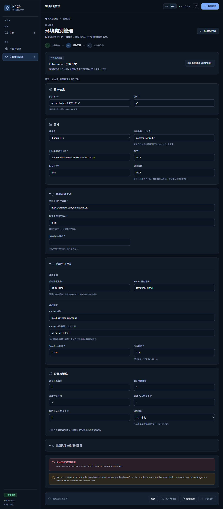

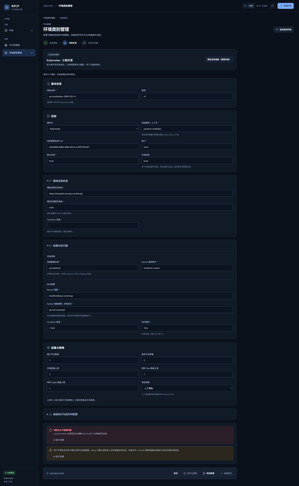

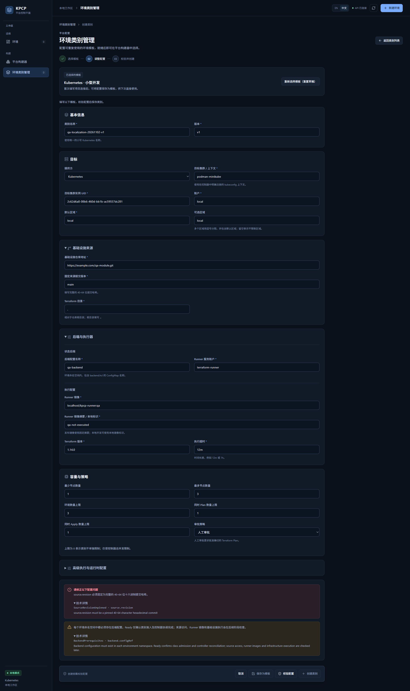

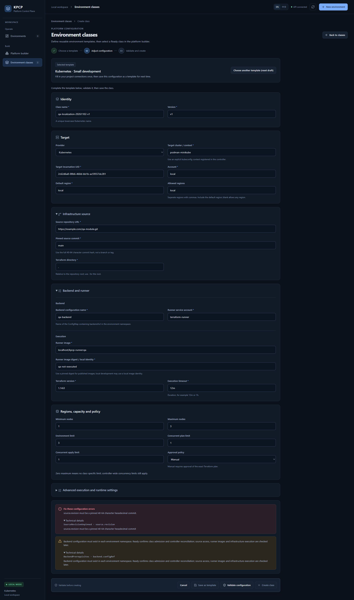

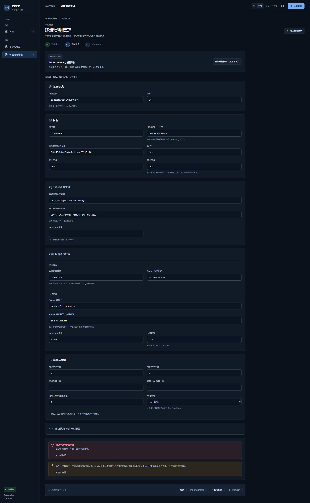

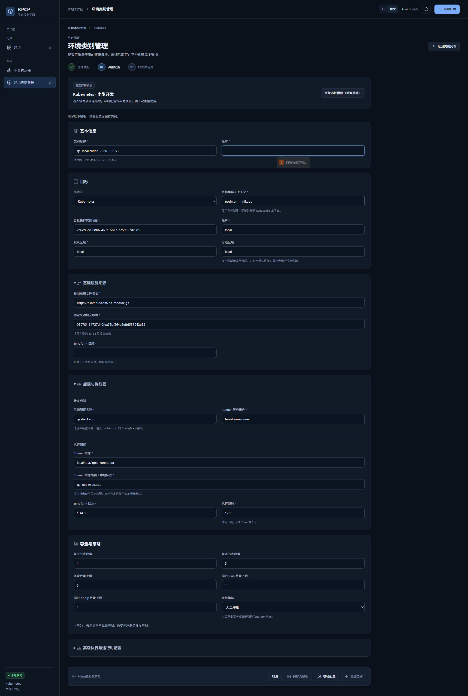

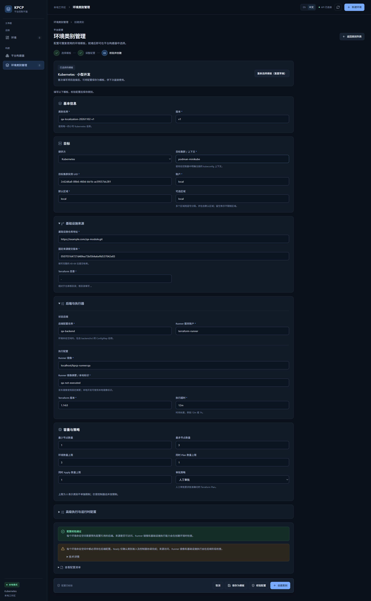

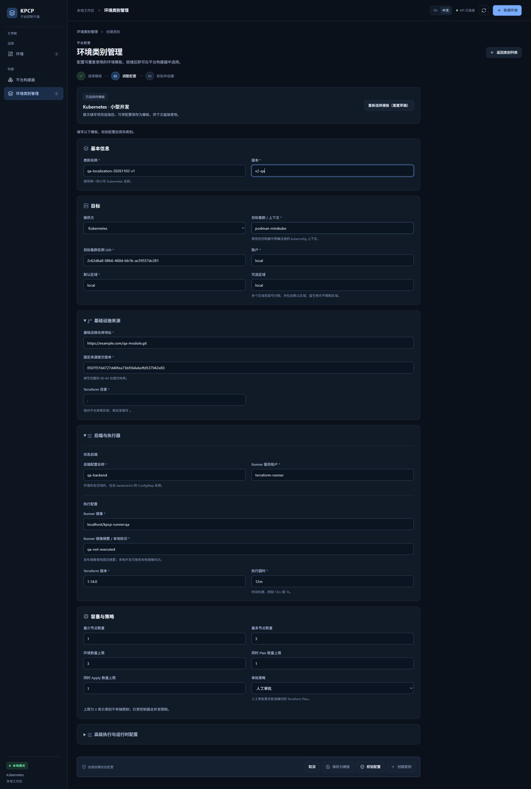

Actual Result / Final Verdict：**PASS（本批次 QA-01 的 Class 校验路径）**。历史 FAIL 与截图保留。该结果不覆盖任意 Kubernetes 错误的全面本地化，也不等同最终 Clean Build 或全部产品 Freeze。

截图来自真实浏览器 JPEG；PNG 是解码像素无损转存，逐张像素比较通过，原始 JPEG 本地保留。

## 10. 最终 clean API 回归 — AI 错误提示

同一 Run，2026-11-02T01:15Z。API binary 来源 `fd90a8614c6616d9d3514546aaef3840cffa0296`，`vcs.modified=false`；最小 AI 本地化修复为 `45a5ff5`。浏览器实际调用真实配置的 Ollama，收到连接拒绝。

操作：**平台构建器 → 填写需求/名称/命名空间 → 生成草稿 → 展开技术详情 → EN → 中文 → 取消**。中文摘要、英文摘要、完整服务端诊断及稳定码同时保留，输入没有丢失；右侧没有草稿、没有创建请求。步骤和本批次三张真实 PNG 见 [TC03 新批次](TC03_AI_DRAFT.md#9-新执行批次--真实-ollama-可用性与安全错误路径)。

回归：5 个 Node tests、完整 Go tests/race/vet、frontend build 均 exit 0，见[clean 证据](evidence/final-gates-20261102/clean-build.public.json)。Class 本地化路径的产品源码自第 9 节验证后未改变。

本批次结果：**Class 校验和真实 AI 不可用提示的已执行路径 PASS**。正常 AI Draft 的 advisory warning 已按结构化码修复、单测 PASS，但由于模型服务缺失，其正常 UI 路径 **NOT RUN**；不宣称全部服务端错误全面本地化。历史第 7 节 FAIL 保持不变。
