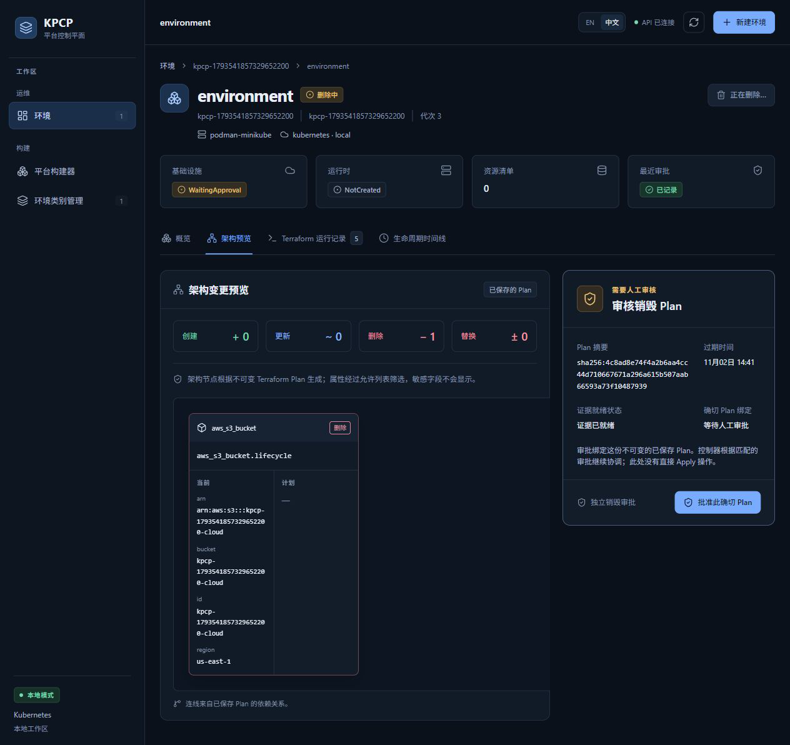
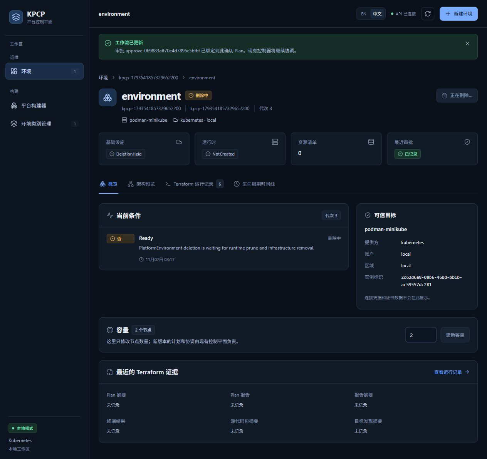
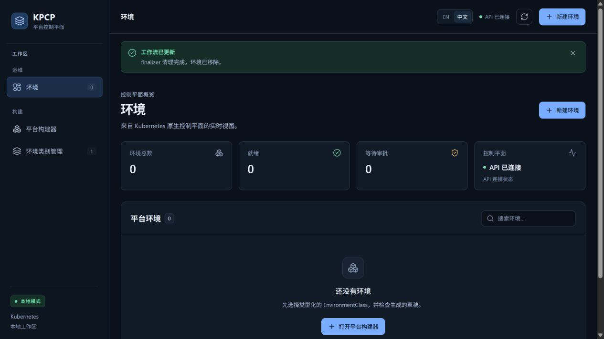

# Gate F — Terraform Destroy / Finalizer

## 1. Test Objective

删除必须使用 retained convergence/source、独立 exact Destroy approval 和 saved binary Destroy Plan；失败时持有 finalizer，成功后只清理本轮资源。

## 2. Preconditions

真实 MiniStack S3、固定 Runner、明确归属 namespace/bucket/sentinel。Destroy 故障通过本轮专属 artifact transport 开关注入。未调用真实 AWS，没有手工移除任何业务 finalizer。

## 3. Test Matrix

| 场景 | 本轮结果 | 范围 |
|---|---|---|
| 独立 Destroy approval | PASS | Reconcile 审批和错误 Destroy digest 均不能准入 |
| 临时 artifact 503 | PASS | Controller 正常读取证据；Pod 所访问的精确 QA bucket 返回 503 |
| Destroy Job failure | PASS，限定 Destroy **Plan** Job | Job UID `c36cb291-3969-403d-b72a-150382e44c6a`；finalizer/原 cloud 仍保留 |
| 恢复、新 immutable Plan、重新审批 | PASS | 故障开关撤销；审核新 Plan，而非复用失效审批 |
| Pending / Active Destroy 进程重启 | PASS | 原 Run/Job/Plan terminal identity 一致 |
| Pending / Active Destroy 两副本 failover | PASS | 独立 Gate C lane，真实 Leader Pod 退出 |
| unrelated sentinel / 正常 cleanup | PASS | sentinel 不变，cloud 404，业务对象消失，正常删除 namespace/桶 |
| 部分执行后的 Destroy Apply 失败/不确定终态 | 单测 PASS；live NOT RUN | Plan Job 失败不能替代该场景 |

## 4. Execution Steps

1. 删除 UID 匹配的环境；先清理所拥有的 runtime，保留与 Terraform 相关的 finalizer。
2. 本轮代理对精确 artifact bucket 返回 503，等待实际 Destroy Plan Job failed；核对 cloud 仍在、零额外 Apply。
3. 撤销故障，等待新的有效 Destroy Plan；核对错误审批不能授权。
4. 重启专属 Controller/退出本轮 Leader，确认仍 Pending Approval。
5. 对新 saved Plan 明确审批；在 active Destroy 时再次重启/接管。
6. 核对 terminal Run UID/Job UID、Plan ref/digest、exit 0、artifactsReady；读取 cloud 404 和 sentinel。
7. 归档测试产物后正常删除 Class/namespace/桶，不 patch finalizer。

## 5. Expected Results

缺少审批、存储不可用和不确定 mutation 时不得释放 finalizer；恢复只执行被审批的 saved Plan；非归属资源不变。

## 6. Actual Results

首轮全套 F 因 host/Pod 故障范围不当 FAIL，未把它改成 PASS。正确传输 lane **PASS（总计 255.98 秒，F 146.03 秒）**。Destroy Apply Run UID `5daadbb1-3b67-4641-938c-5f4fe4149811`，Job UID `624f2050-a06a-44a0-babe-fc5523d2b939`，终态 Succeeded/exit 0。

配额中断后，首轮旧 Destroy Plan 已真实过期。Controller 自然 Supersede 并生成新 Plan；在内置浏览器查看 delete 拓扑并点击独立 exact approval 后正常删除。该人工恢复 **PASS**，原失败执行仍是 FAIL。152 个对象归档后才删除专属证据桶。

## 7. Evidence

- [失败 Job / 恢复 / 命令结果](../evidence/final-gates-20261102/e2e-fault-corrected.selected.log)
- [独立审批、active Run/Job 和 terminal 收据](../evidence/final-gates-20261102/e2e-fault-corrected.receipts.public.json)
- [中断后真实恢复](../evidence/final-gates-20261102/interrupted-recovery-result.public.json)、[正常夹具清理](../evidence/final-gates-20261102/interrupted-fixture-cleanup.public.json)
- [多副本 Destroy failover](GATE_C_CONTROLLER_RECOVERY.md)

操作：检查 Plan UID、digest、有效期与 delete 1；点击独立审批按钮。截图保留审核上下文，确切审批及执行身份以收据为准。

## 8. Failure / Recovery Behavior

首轮 Controller pre-Job 503 保持 finalizer。临时故障恢复后新 Plan 需要新审批；过期恢复同样没有绕过人工门禁。两次 D 前置测试时序失败也按“从未准入 Apply”的正常业务路径清理，未强制 finalizer。

## 9. Remaining Coverage

没有真实注入 Terraform Destroy Apply 已部分执行后失败、terminal evidence 丢失后恢复的完整矩阵。不能将成功 Destroy 或 Destroy Plan failure 宣称为这些负例 PASS。

## 10. Final Verdict

**PARTIAL**。独立审批、503/Plan failure、进程与 Leader 恢复、普通 finalizer 清理 PASS；不确定/部分 Destroy Apply 的 live 负例未关闭。

## 11. 2026-11-02 Final Closure Attempt

| 本轮要求场景 | 本轮结果 | 证据 / 原因 |
|---|---|---|
| Destroy Apply 部分执行后失败 | BLOCKED | 本轮没有独立 QA environment、Runner/backend transport 或可注入的专属 cloud resource |
| Destroy 已执行但缺 terminal evidence | BLOCKED | 不在共享对象上移除/伪造终态；没有 QA-owned Run/Job |
| Ambiguous Destroy 时重启 dedicated Controller | BLOCKED | 当前没有 dedicated Controller；不能用共享服务重启代替隔离恢复测试 |
| Cleanup | PASS（只读核对） | 当前 KPCP business objects/Jobs 均为零；MiniStack bucket list 为空；没有本轮 QA mutation 要清理 |

本轮未创建/删除任何 Kubernetes 或云模拟资源，也未 patch finalizer。共享 Podman、Minikube、MiniStack 未重启。详见[只读预检收据](../evidence/deepseek-final-20261102/infrastructure-preflight.public.json)。

**本轮 Destroy 故障场景 BLOCKED；Gate F 仍 PARTIAL。** Cleanup 的 PASS 仅表示复核时无需回收本轮未创建的业务资源，不代表重新运行了完整 Destroy 生命周期。
