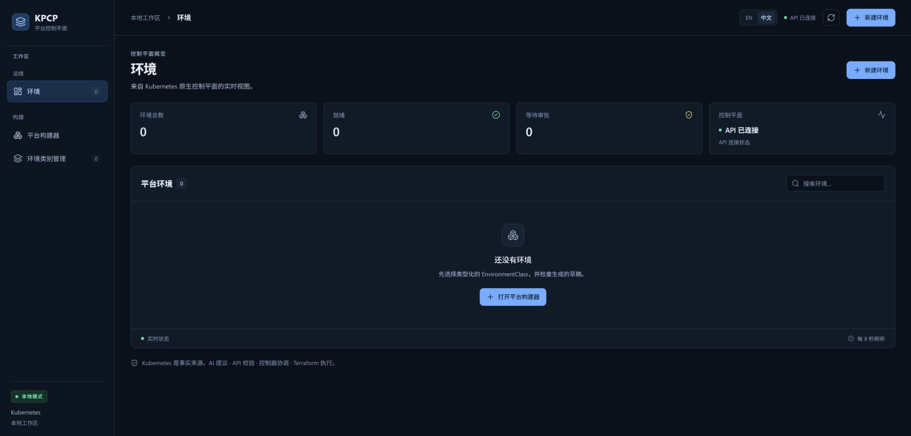

# Phase 2.5 最终 Engineering Gate 验证

本轮结论：**完整 Phase 2.5 Freeze = NO-GO**。已修复 Class/AI 提示本地化和 Standby readiness；真实双副本 failover、独立双集群、核心 saved Plan/审批/Destroy 路径通过。真实 Ollama 质量未运行，A/B/E/F 的完整 live 故障矩阵仍有缺口，没有获批的例外。

## 本轮边界与来源

Run ID：`kpcp-gates-20261102-0223`。2026-11-02 NZDT，UTC 原始时间逐项保留；中间因配额停止约 10 小时，恢复后先正常回收旧测试环境。开始与交付前读取的 remote main 均为 `0507f3164727d40fea73bf364a6effd537042e83`。所有工作在 `qa/phase25-final-gate-closure`，不合并 main。

| 层次 | 本轮实际来源 / 范围 |
|---|---|
| 产品修复 | `92d009a` Class diagnostics；`45a5ff5` AI APIError/AdvisoryOnly；`580aef4` Standby readiness |
| 最终干净构建 | clean-source `5deadde`；Windows Controller/API `vcs.modified=false`，Go 1.27.2；binary hash 和完整 SHA 见收据 |
| 真实双集群 E2E | Go E2E `5deadde`，实际 host Controller binary `fd90a86`；产品路径 diff 为空，非用 `vcs.modified=true` 冒充 |
| 双副本 Controller OCI | clean `580aef4`，manifest `sha256:89ad57997f97fba75c0401824998e3d34016f363a7ea59ad76d5b4fbee339fc7`；构建上下文排除 `.git`，来源以命令、clean checkout、OCI revision label 绑定 |
| Runner OCI | clean `d9f0386`，manifest `sha256:7e57a7a3d8b6ffafb8061ed9bb768037c26c3e1287b8d3546ccfc0b31a1c4f60`；实际 Pod imageID 一致，相关生产包至最终代码无差异 |
| Terraform source | 固定模块 Git commit `98da3fb6cad0b60c60a58169aeb282aa555dbeb8`，版本化四文件与 lockfile；没有任意 HCL 生成 |
| 基础设施 | 主集群 v1.37.0、独立 QA 第二集群 v1.37.0、Podman WSL remote、MiniStack 1.5.35/dummy account；没有真实 AWS |
| 浏览器 | 同一 Desktop Work Browser 2；真实本地服务与 PNG。最终 clean API UI 使用 `fd90a86`；5173 收尾图只证明原服务存活 |

## Gate 最终矩阵

| Gate | 新执行 | Final Status | 主要剩余范围 |
|---|---|---|---|
| [A Exact Approval](GATE_A_EXACT_APPROVAL.md) | 7 绑定错误、无审批、过期/替代、幂等、独立 Destroy | PARTIAL | live source/target/backend/runner 变更矩阵；单测不能替代 |
| [B Immutable Evidence](GATE_B_IMMUTABLE_EVIDENCE.md) | Plan/source/backend/report/terminal 损坏/缺失、credential drift；真实 immutable conflict | PARTIAL | 有效内容摘要下伪造 terminal 身份的 live 攻击、部分上传失败 |
| [C Controller Recovery](GATE_C_CONTROLLER_RECOVERY.md) | 两副本、同 Lease UID、六次真实 Leader 接管、唯一 Apply、Destroy 恢复 | PASS（限定范围） | API outage、网络分区、节点掉电不在范围 |
| [D Multi Cluster](GATE_D_MULTI_CLUSTER.md) | 不同 kube-system UID/CA/凭据；并发/重启/真实 runtime/state/逐目标 Destroy | PASS（限定范围） | 多主机故障域、运行中 cluster replacement、生产 IAM 不在范围 |
| [E Fail-Closed](GATE_E_FAIL_CLOSED.md) | source/endpoint Job failure、4 项真实启动拒绝、scoped 503、A/B 负例 | PARTIAL | live wrong-account、Git outage、foreign/ambiguous/partial mutation |
| [F Destroy / Finalizer](GATE_F_DESTROY_FINALIZER.md) | 独立审批、Destroy Plan failure/503、进程/Leader 恢复、普通清理 | PARTIAL | 部分执行后 Destroy Apply 失败及证据丢失的 live 矩阵 |

## 实际执行与失败记录

| 命令 lane | 结果 | 限定与恢复 |
|---|---|---|
| 首个 `TestLifecycle` 全套 | **FAIL / exit 1** | A、B、进程恢复、NoChange、单集群并发、E PASS；F 夹具同时 fault host/Pod，等待 Job 超时。D 因单集群 SKIP |
| `PlatformAPI + F_DestroyFinalizer`，修正传输 | **PASS / 255.98 秒** | F 146.03 秒；真实失败的是 Destroy Plan Job；host direct/Pod proxy |
| 双副本基线 | **FAIL / 91.02 秒** | 两 Running / 一 Ready，发现 QA-02 |
| 双副本修复后 `PlatformAPI + C + F` | **PASS / 261.85 秒** | 六阶段真实 Lease failover、无重复 Apply、正常 Destroy |
| Target startup rejection | **PASS / 1.31 秒** | 真实 binary，incarnation/context/endpoint/未知字段，未启动 manager |
| 双集群前置尝试一 | **FAIL / 手工终止等待** | 测试误将 Job intent 当 active；零 Apply、正常清理 |
| 双集群前置尝试二 | **FAIL / 54.34 秒** | 重启后尚未 WaitingApproval，API 正确 409；零 Apply、正常清理 |
| 最终 `PlatformAPI + D + F` | **PASS / 512.02 秒，exit 0** | D 283.80 秒、F 117.30 秒；两目标及主环境正常清理 |

失败批次均保持原 exit code。修复的是专属测试同步/传输夹具或已确认的产品缺陷，没有减少 assertion、绕过审批或更改共享环境来获取 PASS。

## Clean Build / Regression

| 检查 | 本轮结果 |
|---|---|
| `go test ./... -v -count=1` | PASS；opt-in E2E/Ollama/MiniStack 默认 SKIP，明确不当 live PASS |
| `go test -race ./... -count=1` | PASS |
| `go vet ./...` | PASS |
| 前端 `npm ci` / 5 个 Node tests / `npm run build` | PASS |
| Terraform fmt / init / validate | 真实 Runner Pod exit 0；`-backend=false -lockfile=readonly` |
| `TestMiniStackIntegration` | 真实 S3/STS、immutable retry/conflict/corrupt bytes、lock contention PASS |
| 实际 Runner imageID | 与本轮导入的 manifest digest 相符 |
| 重现性限定 | 受控 clean source/command/binary/image identity；未声明重复构建逐字节一致 |

参见 [clean build 收据](../evidence/final-gates-20261102/clean-build.public.json)、[真实前置 Pod 验证](../evidence/final-gates-20261102/prerequisite-probe.public.json)、[Runner 实际身份](../evidence/final-gates-20261102/actual-runner-images.public.json)和[证据索引](../evidence/final-gates-20261102/receipt-index.public.json)。完整原日志、kubeconfig、Secret 和产物字节仅在本地受控 work 目录，不提交 GitHub。

## UI / AI / 基础设施验收分界

UI 历史 15 TC 保留；只追加实际受影响的 [TC03](../TC03_AI_DRAFT.md) 和 [TC15](../TC15_LANGUAGE_ERRORS.md)。本轮 Class 错误/Backend warning 的中英文、输入保留、字段校验，以及真实 AI unavailable 错误路径 PASS。正常 AI Draft 的 advisory UI 未真实复测；模型质量 NOT RUN。Controlled HTTP fixtures 与 deterministic 结果始终单独标识。

基础设施验证证明本地主机的 WSL Podman、Minikube、MiniStack 能执行本轮固定模块，不证明 Windows 原生 Podman CLI、真实 AWS 或生产 portability。没有恢复旧 PowerShell Session Harness，没有全局 reset/restart。

## 最终清理与 Freeze 建议

所有本轮业务环境、Class、Run、Job、namespace、cloud/artifact bucket 已正常清理；本轮第二集群节点/卷/网络和 QA API/Vite/transport 停止/删除。主集群/Node UID、共享容器 ID 不变，Node Ready、MiniStack 健康，原 5173/8090 服务保留。本轮镜像、构建缓存和私有产物归档作为本地验证材料保留。

`minikube delete` 曾 exit 0 却留下节点；独立检查拦住该误报，按已记录的容器 ID 普通 stop/rm 后重新确认清理。没有 force container removal 或人工业务 finalizer patch。[最终清理收据](../evidence/final-gates-20261102/final-cleanup.public.json)。

**Freeze = NO-GO**。解除条件是补齐真实 Ollama 规定场景，以及 A/B/E/F 列出的必要 live 安全矩阵，或取得对明确范围的正式例外。已执行的本地正向生命周期、双副本和双集群结果可以独立采用，不能替代完整 Freeze。没有用户获批例外，不自行降为 CONDITIONAL GO。
